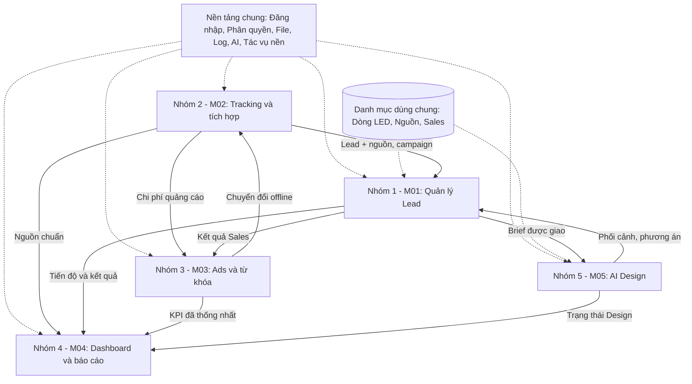
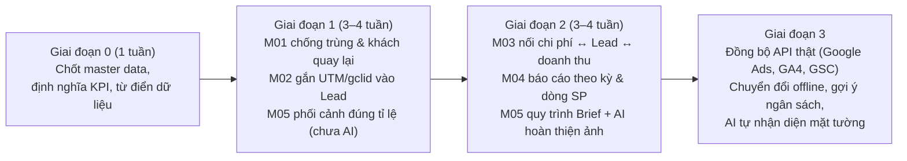
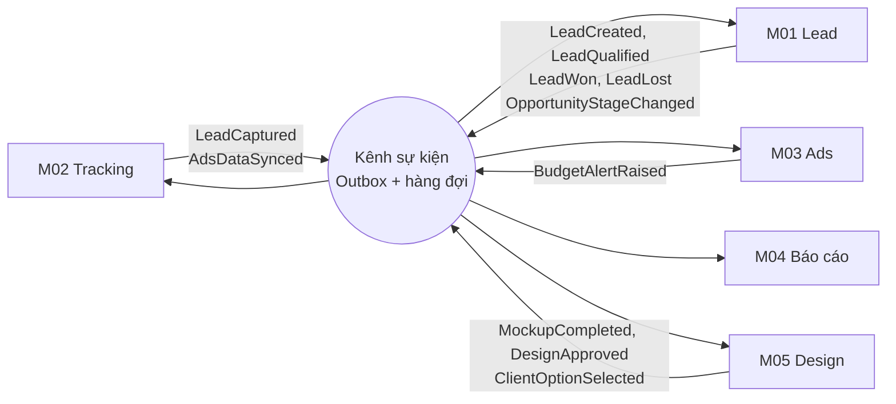

# 00 – Tổng quan & mối liên kết giữa 5 Module

## 1. Bức tranh chung

Toàn Trung kinh doanh **màn hình LED & bảng điện tử B2B**: giá trị đơn hàng lớn, chu kỳ bán dài (vài tuần đến vài tháng), khách thường hỏi nhiều lần trước khi mua. Vì vậy hệ thống cần trả lời được 4 câu hỏi kinh doanh:

| Câu hỏi | Module trả lời chính |
| :--- | :--- |
| Khách này là ai, đã từng hỏi chưa, ai đang phụ trách? | **M01 – Quản lý Lead** |
| Khách đến từ đâu (kênh, chiến dịch, từ khóa, trang nào)? | **M02 – Tracking & đồng bộ** |
| Tiền quảng cáo bỏ ra mang về bao nhiêu Lead và doanh thu thật? | **M03 – Ads & từ khóa** |
| Kết quả kinh doanh/marketing theo ngày, tuần, tháng, năm ra sao? | **M04 – Dashboard & báo cáo** |
| Làm sao thuyết phục khách nhanh hơn bằng hình ảnh trực quan? | **M05 – AI hỗ trợ Design** |

## 2. Đối chiếu yêu cầu của Marketing với từng module

| Yêu cầu từ team BA – Marketing | Module | Tài liệu |
| :--- | :--- | :--- |
| Tìm ra sự trùng lặp (SĐT, dự án, sản phẩm…) | M01 | Mục 4.1 – Chống trùng nhiều tầng |
| Sau khi Sales nhận thông tin thì lưu trực tiếp vào hệ thống (khách hỏi lại sau 1–3–6–12 tháng mà chưa mua) | M01 | Mục 4.2 – Hồ sơ khách hàng & chăm sóc lại |
| Cảnh báo trùng để tránh nhiều Sales cùng gọi 1 khách + biết Sales nào đang phụ trách | M01 | Mục 4.3 – Quyền sở hữu khách & cảnh báo |
| Phân loại đánh giá dữ liệu tiềm năng khách hàng | M01 | Mục 4.4 – Chấm điểm & phân loại tiềm năng |
| Báo cáo số liệu theo ngày/tuần/tháng/năm, chính xác, phân rõ từng mặt hàng/dòng sản phẩm, xuất + nhập Excel | M04 | Mục 4 |
| Dùng AI tạo ảnh sản phẩm sau lắp đặt: khách gửi ảnh không gian, dùng sản phẩm của công ty phối vào, ra ảnh xem trước đúng tỉ lệ thật | M05 | Mục 4.2 – Phối cảnh đúng tỉ lệ thật |

## 3. Sơ đồ liên kết giữa 5 module

### Các điểm nối quan trọng (phải thống nhất trước khi các nhóm code)

| # | Điểm nối | Từ → Đến | Dữ liệu trao đổi | Rủi ro nếu không thống nhất |
| :---: | :--- | :--- | :--- | :--- |
| 1 | **Gắn nguồn cho Lead** | M02 → M01 | `source`, `utm_source/medium/campaign/term/content`, `gclid`, trang đích, thiết bị | M03 không thể biết từ khóa nào ra Lead |
| 2 | **Kết quả bán hàng về Ads** | M01 → M03 | Trạng thái Lead, Lead đạt chuẩn, doanh thu chốt, ngày chốt | Chỉ đo được click, không đo được tiền thật |
| 3 | **Chuyển đổi offline** | M03 → M02 → Google Ads | Danh sách `gclid` đã thành Lead chất lượng/đơn chốt | Google tối ưu sai mục tiêu (ra nhiều Lead rác) |
| 4 | **Yêu cầu thiết kế** | M01 ↔ M05 | `leadId`, dòng LED, kích thước, ảnh khảo sát; trả về ảnh phối cảnh, trạng thái | Ảnh phối cảnh và báo giá lệch thông số |
| 5 | **Số liệu báo cáo** | M01/M02/M03/M05 → M04 | Dữ liệu đọc qua giao diện công khai (`public.ts`) | Mỗi phòng một con số, lãnh đạo không tin báo cáo |
| 6 | **Danh mục dòng LED** | Dùng chung | Mã dòng, pitch, kích thước cabinet, đơn giá, nhóm sản phẩm | Báo cáo không phân được theo dòng sản phẩm, phối cảnh sai kích thước |

## 4. Dữ liệu dùng chung (Master Data) – cần chốt đầu tiên

Đây là **phần quan trọng nhất** để 5 nhóm làm song song mà không vỡ số liệu:

| Danh mục | Chủ sở hữu | Dùng bởi | Ghi chú |
| :--- | :--- | :--- | :--- |
| **Dòng sản phẩm LED** (mã, tên, nhóm, pitch, cabinet, đơn giá) | Core | M01, M03, M04, M05 | Thay thế danh sách giá đang để cứng trong giao diện |
| **Khách hàng / Công ty** (MST, tên chuẩn hóa, địa chỉ) | M01 | M03, M04, M05 | Mới – để giải quyết khách quay lại và trùng công ty |
| **Nguồn Lead** (Hotline, Website, Google Ads, Facebook, Zalo, Giới thiệu, Triển lãm…) | M02 | M01, M03, M04 | Một bộ mã nguồn duy nhất cho toàn hệ thống |
| **Chiến dịch & từ khóa** | M03 | M01, M04 | Liên kết với UTM/gclid của Lead |
| **Nhân sự, phòng ban, vai trò** | Core | Tất cả | Đã có (`User`, `Department`) |
| **Từ điển trạng thái & lý do thất bại** | M01 | M03, M04 | Chuẩn hóa để báo cáo chính xác |

## 5. Lộ trình chung đề xuất

**Lý do thứ tự này:** M03 và M04 chỉ chính xác khi M01 có dữ liệu sạch (không trùng) và M02 đã gắn được nguồn cho từng Lead. Làm M03/M04 trước sẽ ra báo cáo đẹp nhưng sai.

## 6. Nguyên tắc chung cho cả 5 nhóm

1. **Một nguồn sự thật:** mỗi loại dữ liệu chỉ có một module được ghi (xem `docs/modules/DATABASE_OWNERSHIP.md`).
2. **Giao tiếp qua cổng công khai:** module khác chỉ gọi qua `public.ts` (backend) / `index.ts` (frontend).
3. **Không làm giả kết quả:** tính năng chưa kết nối thật phải hiển thị "Chưa cấu hình", không hiển thị số liệu mẫu như số thật.
4. **Đo được hiệu quả:** mỗi module phải có 3–5 KPI đo được sau khi triển khai (đã liệt kê trong từng file).
5. **Bảo vệ dữ liệu cá nhân:** SĐT, email, địa chỉ khách là dữ liệu cá nhân (Nghị định 13/2023/NĐ-CP) → phân quyền xem, ghi log truy cập, không xuất Excel tự do.

## 7. Liên kết 5 module khi hệ thống lớn: sự kiện nghiệp vụ

Khi quy mô lớn, ngoài việc gọi nhau qua `public.ts`, các module **phát và nhận sự kiện** để làm việc độc lập – thêm tính năng mới không phải sửa module của nhóm khác.

| Sự kiện | Phát từ | Module nhận | Kết quả |
| :--- | :--- | :--- | :--- |
| `LeadCaptured` | M02 | M01 | Tạo/gộp Lead kèm nguồn, gclid |
| `AdsDataSynced` | M02 | M03, M04 | Tính lại chỉ số Ads, cập nhật báo cáo |
| `LeadQualified`, `LeadWon`, `LeadLost` | M01 | M03, M04 | CPQL, ROAS, chuyển đổi offline, lý do thất bại |
| `OpportunityStageChanged` | M01 | M04, M05 | Dự báo doanh thu; giai đoạn "Thiết kế" tự tạo Brief |
| `BudgetAlertRaised` | M03 | M04 | Cảnh báo cho lãnh đạo/MKT |
| `MockupCompleted`, `ClientOptionSelected` | M05 | M01, M04 | Gắn phối cảnh vào hồ sơ, cập nhật phương án báo giá, cộng điểm tiềm năng |

> Chi tiết nâng cấp từng module cho dự án lớn nằm ở mục **"NÂNG CẤP CHO DỰ ÁN LỚN"** cuối mỗi file M01–M05; bảng tổng hợp ở `07_HUONG_PHAT_TRIEN_DU_AN_LON.md`.
