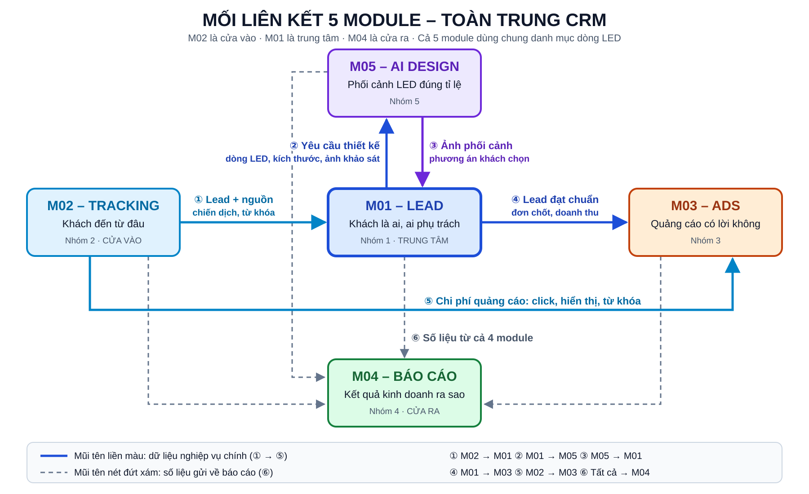
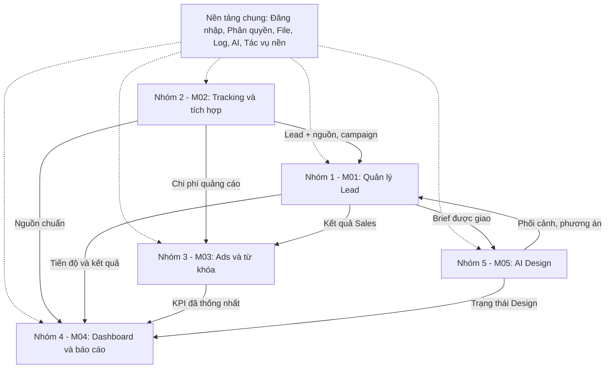

# 01 – Mối liên kết 5 Module (bản tóm tắt dễ xem)

> Bản ngắn gọn nhất để nắm 5 module nối với nhau thế nào. Bản đầy đủ 7 sơ đồ: [08_SO_DO_LIEN_KET_HE_THONG.md](./08_SO_DO_LIEN_KET_HE_THONG.md).

## 1. Mỗi module trả lời một câu hỏi

| Module | Câu hỏi trả lời | Nhóm |
| :--- | :--- | :---: |
| **M02 – Tracking** | Khách đến từ đâu? | Nhóm 2 |
| **M01 – Lead** | Khách là ai, ai phụ trách, chốt được không? | Nhóm 1 |
| **M05 – AI Design** | Khách thấy trước màn LED trong không gian thật ra sao? | Nhóm 5 |
| **M03 – Ads** | Mỗi đồng quảng cáo mang về bao nhiêu? | Nhóm 3 |
| **M04 – Báo cáo** | Kết quả kinh doanh ra sao? | Nhóm 4 |

## 2. Sơ đồ liên kết

**Sơ đồ hình ảnh (chữ to, rõ – mở file `so-do-lien-ket-5-module.svg` bằng trình duyệt để phóng to):**



**Sơ đồ Mermaid (ranh giới 5 module):**



- **Nét đứt:** Nền tảng chung cung cấp cho cả 5 module (đăng nhập, phân quyền, lưu file, ghi log, kết nối AI, tác vụ chạy nền).
- **Nét liền:** dữ liệu nghiệp vụ đi giữa các module.

**Bản vẽ chữ (xem được ở mọi nơi):**

```text
                    ┌──────────────────────┐
                    │  M05 – AI DESIGN     │
                    │  Phối cảnh đúng tỉ lệ│
                    └──────────────────────┘
                         ▲ (2)      │ (3)
               Yêu cầu   │          ▼  Ảnh, phương án
┌──────────────┐ (1) ┌──────────────────────┐ (4) ┌──────────────────┐
│ M02 TRACKING │────▶│  M01 – LEAD          │────▶│ M03 – ADS        │
│ Khách đến    │     │  Khách là ai,        │     │ Quảng cáo có     │
│ từ đâu       │     │  ai phụ trách        │     │ lời không        │
└──────────────┘     └──────────────────────┘     └──────────────────┘
       │  └──────────────── (5) Chi phí quảng cáo ───────▶│
       │                         │                         │
       └─────────────────────────┼─────────────────────────┘
                                 ▼ (6) Số liệu của cả 4 module
                    ┌──────────────────────┐
                    │  M04 – BÁO CÁO       │
                    │  Kết quả ra sao      │
                    └──────────────────────┘
```

## 3. Giải thích từng mũi tên

| # | Từ → Đến | Dữ liệu chuyển | Nếu thiếu thì sao |
| :---: | :--- | :--- | :--- |
| 1 | **M02 → M01** | Lead kèm nguồn, chiến dịch, từ khóa, gclid | Không biết khách đến từ đâu |
| 2 | **M01 → M05** | Thông tin khách, dòng LED, kích thước, ảnh khảo sát | Designer phải hỏi lại Sales, dễ sai số liệu |
| 3 | **M05 → M01** | Ảnh phối cảnh, phương án khách chọn | Phối cảnh và báo giá không khớp |
| 4 | **M01 → M03** | Lead đạt chuẩn, đơn chốt, doanh thu | Chỉ đo được click, không đo được tiền thật |
| 5 | **M02 → M03** | Chi phí, click, hiển thị theo từ khóa | Không tính được chi phí cho mỗi Lead |
| 6 | **Tất cả → M04** | Số liệu từng module | Phải làm báo cáo thủ công |

## 4. Bảng: module nào cần gì từ module nào

Đọc theo hàng: module ở cột đầu **lấy gì** từ module ở các cột còn lại.

| Lấy từ → | M01 | M02 | M03 | M04 | M05 |
| :--- | :---: | :---: | :---: | :---: | :---: |
| **M01 Lead** | – | Nguồn khách | – | – | Phối cảnh |
| **M02 Tracking** | – | – | Danh sách đơn chốt để gửi Google Ads | – | – |
| **M03 Ads** | Lead đạt chuẩn, doanh thu | Chi phí quảng cáo | – | – | – |
| **M04 Báo cáo** | Lead, doanh thu | Lượt truy cập | ROAS, chi phí | – | Số lượng, thời gian thiết kế |
| **M05 Design** | Thông tin khách, dòng LED | – | – | – | – |

## 5. Ghi nhớ

- **M01 là trung tâm** – mọi dữ liệu khách hàng đều đi qua M01.
- **M02 là cửa vào** – mọi dữ liệu từ bên ngoài (website, quảng cáo, Zalo) vào qua M02.
- **M04 là cửa ra** – chỉ đọc số liệu để báo cáo, không sửa dữ liệu của module khác.
- **Cả 5 module dùng chung danh mục dòng LED** → báo giá, phối cảnh, quảng cáo, báo cáo khớp nhau.

## 6. Các nhóm cần phối hợp với ai

| Nhóm | Phải thống nhất với | Nội dung cần thống nhất |
| :--- | :--- | :--- |
| Nhóm 1 (M01) | Nhóm 2, 3, 4, 5 | Cấu trúc Lead, trạng thái, định nghĩa "Lead đạt chuẩn", dòng LED |
| Nhóm 2 (M02) | Nhóm 1, 3 | Quy ước UTM, danh sách nguồn, cách gắn gclid vào Lead |
| Nhóm 3 (M03) | Nhóm 1, 2 | Công thức CPL/CPQL/ROAS, cách tính doanh thu |
| Nhóm 4 (M04) | Cả 4 nhóm | Từ điển KPI, kỳ báo cáo, phân quyền xem |
| Nhóm 5 (M05) | Nhóm 1 | Thông số dòng LED, liên kết phương án phối cảnh ↔ báo giá |
