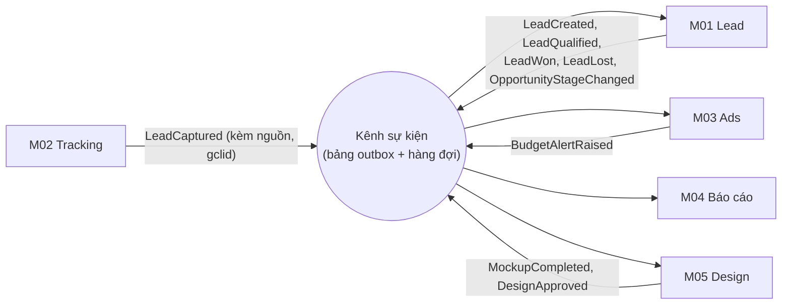
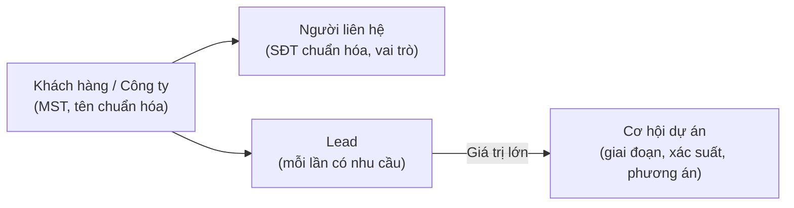

# 07 – Hướng phát triển 5 Module cho dự án lớn

> Mục tiêu: mỗi module phải **chịu được quy mô lớn** (nhiều Sales, nhiều phòng ban, hàng chục nghìn khách, dự án LED giá trị lớn, nhiều kênh quảng cáo) mà **vẫn chính xác, nhanh và dễ mở rộng**.
>
> Nguyên tắc chung cho cả 5 module:
> 1. **Mỗi module tự chủ** dữ liệu của mình, giao tiếp với module khác qua `public.ts` và **sự kiện nghiệp vụ**.
> 2. **Việc nặng chạy nền** (đồng bộ, AI, nhập Excel, nhắc việc), người dùng không phải chờ.
> 3. **Mọi con số truy được nguồn gốc** đến từng bản ghi.
> 4. **Quy tắc nghiệp vụ cấu hình được** (ngưỡng, thời hạn, điểm số) – không sửa code mỗi lần thay đổi.

---

## 0. Cách 5 module liên kết khi hệ thống lớn: dùng "sự kiện nghiệp vụ"

Hiện tại module gọi trực tiếp nhau qua `public.ts`. Khi lớn, nên bổ sung **sự kiện**: module phát sinh việc gì thì "thông báo", module khác tự lắng nghe và xử lý → các nhóm làm độc lập, thêm tính năng không phải sửa module khác.

| Sự kiện | Phát từ | Ai nghe | Để làm gì |
| :--- | :--- | :--- | :--- |
| `LeadCaptured` | M02 | M01 | Tạo/gộp Lead kèm nguồn |
| `LeadQualified`, `LeadWon` | M01 | M03, M04 | Tính CPQL, ROAS; đẩy chuyển đổi offline; cập nhật báo cáo |
| `OpportunityStageChanged` | M01 | M04, M05 | Cập nhật dự báo doanh thu; giai đoạn "Thiết kế" tự tạo Brief |
| `MockupCompleted` | M05 | M01, M04 | Gắn phối cảnh vào hồ sơ, cộng điểm tiềm năng, đếm báo cáo |
| `BudgetAlertRaised` | M03 | M04 | Hiển thị cảnh báo cho lãnh đạo/MKT |

---

## M01 – Quản lý Lead (cho dự án lớn)

### Mô hình dữ liệu 4 tầng

### Hướng phát triển
| # | Hạng mục | Khi dự án lớn cần gì | Mức |
| :---: | :--- | :--- | :---: |
| 1 | **Chống trùng quy mô lớn** | Cột chuẩn hóa (SĐT, email, MST, tên công ty, địa chỉ) có chỉ mục; tìm gần đúng bằng `pg_trgm`; kiểm tra < 200 ms trên hàng trăm nghìn bản ghi; **bỏ giới hạn quét 100 bản ghi hiện tại** | Must |
| 2 | **Khách hàng – Lead** | Một khách nhiều lần hỏi (1–3–6–12 tháng) vẫn chung hồ sơ; một công ty nhiều người liên hệ | Must |
| 3 | **Cơ hội dự án lớn** | Lead ≥ 500 triệu hoặc ≥ 30 m² → Cơ hội: Khảo sát → Thiết kế → Báo giá → Thầu/Đàm phán → Hợp đồng → Thi công → Nghiệm thu; xác suất thắng theo giai đoạn | Must |
| 4 | **Nhiều bên liên quan** | Chủ đầu tư, người quyết định, tư vấn, nhà thầu chính, kế toán; mức ảnh hưởng, thái độ | Must |
| 5 | **Báo giá nhiều phương án & phiên bản** | Phương án P2.5 / P3 / P4, mỗi phương án v1, v2…, khóa bản đã gửi khách | Must |
| 6 | **Duyệt giá nhiều cấp** | ≤ 5% Sales; 5–10% Trưởng phòng; > 10% Giám đốc – ngưỡng cấu hình được | Must |
| 7 | **Quyền sở hữu & chia khách theo luật** | Thời hạn giữ khách, kho chung, chia theo dòng SP/khu vực/tải; quy tắc cấu hình trong trang quản trị | Must |
| 8 | **Phân quyền theo nhóm/khu vực/chi nhánh** | Sales chỉ thấy khách của mình/nhóm; quản lý thấy theo khu vực; ẩn một phần SĐT | Should |
| 9 | **Nhập Excel lớn chạy nền** | Hàng nghìn dòng, báo cáo dòng lỗi/trùng, không treo giao diện | Should |
| 10 | **Đối thủ & lý do thua** | Lưu đối thủ, giá đối thủ, lý do thắng/thua cho từng Cơ hội | Should |
| 11 | **Sau hợp đồng** | Bảo hành, bảo trì định kỳ → cơ hội bán thêm và giới thiệu | Could |

**KPI quy mô lớn:** Lead trùng < 2% · Kiểm tra trùng < 200 ms · Lead HOT liên hệ < 15 phút · Tỉ lệ thắng Cơ hội lớn · Doanh thu từ khách quay lại.

---

## M02 – Tracking & đồng bộ đa kênh (cho dự án lớn)

| # | Hạng mục | Khi dự án lớn cần gì | Mức |
| :---: | :--- | :--- | :---: |
| 1 | **Hộp nhận dữ liệu (inbox)** | Mọi webhook (website, Facebook, Zalo) ghi vào bảng nhận trước, có **khóa chống trùng** → không mất, không nhân đôi Lead khi nền tảng gửi lại | Must |
| 2 | **Bộ kết nối dạng "cắm thêm"** | Mỗi nền tảng (Google Ads, GA4, GSC, Facebook, TikTok, Zalo) là một adapter cùng chuẩn → thêm kênh mới không sửa lõi | Must |
| 3 | **Đồng bộ chạy nền theo lịch** | Worker chạy hằng ngày/hằng giờ, tự chạy lại khi lỗi, ghi đè an toàn theo ngày × chiến dịch × từ khóa | Must |
| 4 | **Ghi nhận nguồn chạm đầu & chạm cuối** | Cookie 90 ngày; lưu cả first-touch và last-touch trên Lead | Must |
| 5 | **Từ điển nguồn thống nhất** | Một bộ mã nguồn duy nhất cho toàn hệ thống, tự quy đổi tên nguồn lạ | Must |
| 6 | **Nhiều tài khoản quảng cáo** | Hỗ trợ tài khoản quản lý MCC, nhiều website/landing page, nhiều thương hiệu | Should |
| 7 | **Giám sát chất lượng dữ liệu** | Cảnh báo khi % Lead "không rõ nguồn" tăng, khi đồng bộ trễ, khi token hết hạn | Should |
| 8 | **Đồng ý thu thập dữ liệu** | Thông báo cookie/đồng ý trên website theo Nghị định 13/2023 | Should |

**KPI:** ≥ 90% Lead website có nguồn · ≥ 95% Lead Google Ads có gclid · Lead vào hệ thống < 1 phút · Đồng bộ thành công ≥ 99%.

---

## M03 – Ads & phân tích từ khóa (cho dự án lớn)

| # | Hạng mục | Khi dự án lớn cần gì | Mức |
| :---: | :--- | :--- | :---: |
| 1 | **Bảng dữ liệu theo ngày cấp từ khóa** | Ngày × chiến dịch × nhóm quảng cáo × từ khóa × cụm từ tìm kiếm; xử lý hàng triệu dòng | Must |
| 2 | **Nối chi phí ↔ Lead ↔ Cơ hội ↔ doanh thu** | Qua gclid/UTM; cửa sổ ghi nhận **90–180 ngày** cho dự án lớn | Must |
| 3 | **Đo theo giá trị pipeline** | Với dự án lớn, đo **giá trị Cơ hội tạo ra / chi phí**, không chỉ số Lead (vì 1 dự án lớn = hàng trăm Lead nhỏ) | Must |
| 4 | **Bộ quy tắc cảnh báo cấu hình được** | Đốt tiền, Lead rác, cụm từ không liên quan, đáng tăng ngân sách – MKT tự chỉnh ngưỡng | Must |
| 5 | **Chuyển đổi offline tự động** | Đẩy Lead đạt chuẩn, Cơ hội lớn, đơn chốt (kèm giá trị) lên Google Ads → Google tối ưu theo khách giá trị cao | Should |
| 6 | **Đa nền tảng** | Google, Facebook, TikTok, Zalo dùng chung bộ chỉ số qua adapter của M02 | Should |
| 7 | **Kế hoạch ngân sách theo dòng sản phẩm & mùa vụ** | Phân bổ ngân sách theo ROAS từng dòng LED + xu hướng Google Trends | Should |
| 8 | **Thử nghiệm A/B** | So sánh mẫu quảng cáo, trang đích (dùng ảnh phối cảnh từ M05) | Could |

**KPI:** ≥ 90% chi phí nối được với Lead · CPQL giảm 20% sau 3 tháng · Chi phí từ khóa "đốt tiền" giảm 50% · ROAS theo dòng SP hằng tháng · Giá trị pipeline / chi phí.

---

## M04 – Dashboard & báo cáo (cho dự án lớn)

| # | Hạng mục | Khi dự án lớn cần gì | Mức |
| :---: | :--- | :--- | :---: |
| 1 | **Từ điển KPI** | Mỗi KPI một định nghĩa, một công thức, ghi rõ tính theo ngày tạo/ngày chốt/ngày chi | Must |
| 2 | **Bảng tổng hợp tính sẵn** | Ngày × dòng SP × nguồn × Sales × chi nhánh, cập nhật theo sự kiện + chạy lại hằng đêm → dashboard mở < 2 giây | Must |
| 3 | **Xem chi tiết đến từng bản ghi** | Bấm vào con số ra danh sách Lead/đơn tạo nên con số → lãnh đạo tin số liệu | Must |
| 4 | **Dự báo doanh thu** | Từ Cơ hội dự án lớn: giá trị × xác suất theo giai đoạn, theo tháng/quý | Must |
| 5 | **Phân quyền nhiều cấp** | Giám đốc / chi nhánh / phòng / cá nhân | Must |
| 6 | **Xuất & nhập Excel theo mẫu, chạy nền** | Xuất file lớn không treo; nhập chỉ tiêu, dữ liệu lịch sử, chi phí ngoài có kiểm tra lỗi; ghi log | Must |
| 7 | **Đối soát tự động** | Hằng đêm so tổng báo cáo với dữ liệu gốc, báo lệch | Should |
| 8 | **Báo cáo tự gửi định kỳ** | Email/Zalo sáng thứ Hai và ngày 1 hằng tháng | Should |
| 9 | **So sánh kỳ & chỉ tiêu** | So với kỳ trước, cùng kỳ năm trước, so với chỉ tiêu nhập từ Excel | Should |

**KPI:** Báo cáo tháng < 5 phút · Dashboard < 2 giây · Lệch số liệu = 0 · ≥ 80% quản lý dùng hằng tuần.

---

## M05 – AI hỗ trợ Design (cho dự án lớn)

| # | Hạng mục | Khi dự án lớn cần gì | Mức |
| :---: | :--- | :--- | :---: |
| 1 | **Phối cảnh đúng tỉ lệ thật** | Hiệu chuẩn 4 góc + số đo thật, ghép theo cabinet, AI chỉ hoàn thiện ánh sáng, dán lại lớp màn gốc | Must |
| 2 | **Nhiều phương án cho một không gian** | Cùng một ảnh, so sánh P2.5 / P3 / P4, nhiều kích thước, nhiều vị trí – khớp với phương án báo giá M01 | Must |
| 3 | **Quy trình Brief – phân công – duyệt** | Kanban, SLA, phân công theo tải Designer, phiên bản v1/v2, bình luận | Must |
| 4 | **Tác vụ AI chạy nền** | Gửi yêu cầu → nhận trạng thái "đang xử lý" → thông báo khi xong; không timeout khi nhiều người dùng cùng lúc | Must |
| 5 | **Kho tài sản thiết kế** | Lưu ảnh, file PSD/AI/MP4 trên object storage, có phiên bản, phân quyền, tìm kiếm theo dòng SP/loại công trình | Must |
| 6 | **Danh mục dòng LED đầy đủ** | Pitch, cabinet, viền, độ dày, độ sáng, ảnh cabinet thật – dùng chung với báo giá | Must |
| 7 | **Bộ hồ sơ thiết kế gửi thầu** | Đóng gói phối cảnh + bản vẽ bố trí cabinet + bảng thông số kỹ thuật thành PDF | Should |
| 8 | **Link duyệt cho khách** | Khách xem, so sánh phương án, bấm đồng ý/yêu cầu sửa | Should |
| 9 | **Quản lý chi phí AI** | Hạn mức theo người/ngày, cache kết quả, đổi nhà cung cấp AI dễ dàng qua `core/ai` | Must |
| 10 | **Thư viện mẫu đã duyệt** | Tái sử dụng phối cảnh/banner theo loại công trình (hội trường, mặt tiền, sân khấu…) | Could |

**KPI:** Phối cảnh < 10 phút/công trình · Bản nháp banner < 4 giờ · ≤ 2 lần sửa · Tỉ lệ chốt Lead có phối cảnh so với không có · Chi phí AI trong ngân sách.

---

## Lộ trình 5 module cho dự án lớn

| Giai đoạn | M01 | M02 | M03 | M04 | M05 |
| :--- | :--- | :--- | :--- | :--- | :--- |
| **GĐ1 (tuần 1–4)** | Chống trùng quy mô lớn, Khách hàng – Lead | Inbox webhook, UTM/gclid vào Lead | Định nghĩa Lead đạt chuẩn, nối chi phí ↔ Lead | Từ điển KPI, báo cáo theo kỳ & dòng SP | Danh mục LED, phối cảnh đúng tỉ lệ |
| **GĐ2 (tuần 5–8)** | Cơ hội dự án lớn, báo giá nhiều phương án, duyệt nhiều cấp | Adapter + đồng bộ chạy nền | Dữ liệu cấp từ khóa, cảnh báo cấu hình được | Bảng tính sẵn, dự báo doanh thu, Excel chạy nền | Brief – Kanban – phiên bản, AI chạy nền, nhiều phương án |
| **GĐ3 (tuần 9+)** | Phân quyền khu vực, đối thủ, sau hợp đồng | Đa tài khoản, giám sát chất lượng dữ liệu | Chuyển đổi offline, đa nền tảng, ngân sách theo mùa | Đối soát tự động, báo cáo tự gửi | Hồ sơ thầu, link duyệt cho khách, thư viện mẫu |

> **Điều kiện nền để 5 module chạy được ở quy mô lớn** (Core phụ trách, làm song song GĐ1): PostgreSQL + migration, object storage cho file, hàng đợi tác vụ nền, môi trường staging, khóa nhánh `main`.
