# 08 – Sơ đồ liên kết hệ thống 5 Module (Phiên bản Dễ Quan Sát)

Tài liệu này dùng **sơ đồ trực quan** để làm rõ 5 module liên kết với nhau như thế nào trong hệ thống. Để tránh việc 14 mũi tên cắt chéo nhau gây rối mắt, sơ đồ tổng quan dưới đây được **chia thành 4 tầng từ trên xuống** và **tách riêng phần Nền tảng chung (Core)**.

---

## ★ Sơ đồ 00A – Luồng Nghiệp vụ Chính Giữa 5 Module (Chia 4 Tầng Không Cắt Dây)

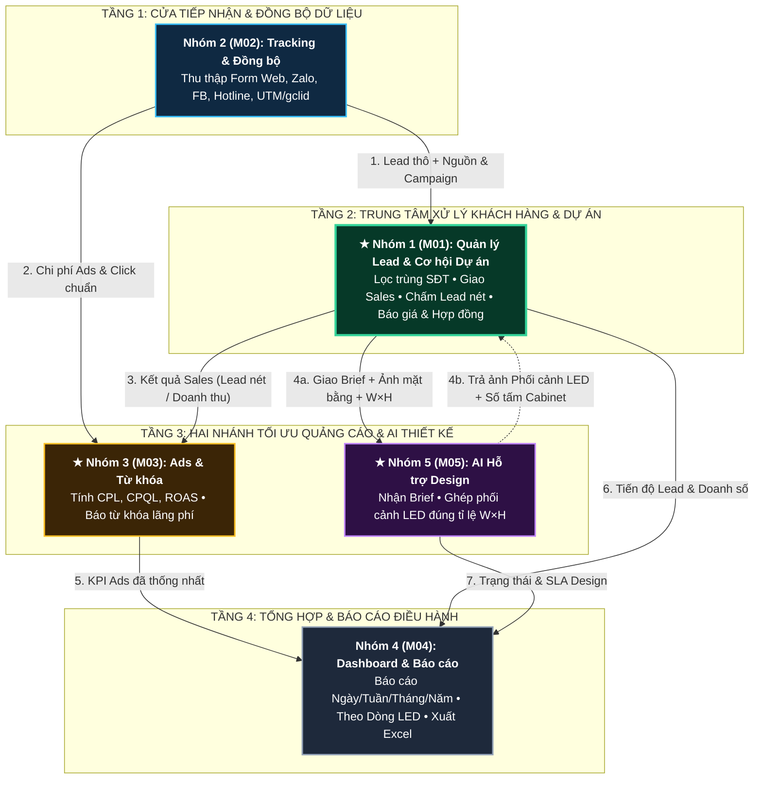

---

## ★ Sơ đồ 00B – Trọng tâm Phối hợp 3 Module Cốt lõi: `M03 (Ads)` ⇄ `M01 (Lead)` ⇄ `M05 (AI Design)`

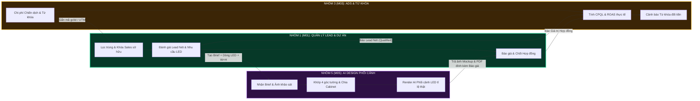

---

## ★ Sơ đồ 00C – Nền tảng Chung (`Core`) Phục vụ 5 Module (Tách riêng để không rối dây)

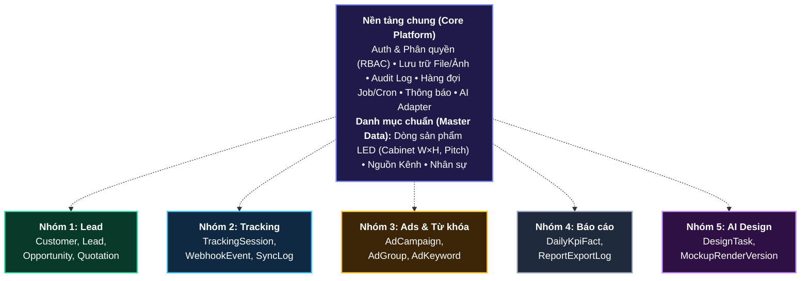

---

**Đọc thêm 7 sơ đồ chi tiết theo từng khía cạnh dưới đây:**

| # | Sơ đồ | Trả lời câu hỏi |
| :---: | :--- | :--- |
| 1 | Toàn cảnh hệ thống | Hệ thống gồm những lớp nào? |
| 2 | Người dùng ↔ Module | Phòng ban nào dùng module nào? |
| 3 | Dòng chảy dữ liệu chính | Dữ liệu chạy qua 5 module theo thứ tự nào? |
| 4 | Vòng đời một dự án LED | Một khách hàng đi qua hệ thống từ đầu đến cuối ra sao? |
| 5 | Module gọi nhau (hiện tại & mục tiêu) | Module nào phụ thuộc module nào? |
| 6 | Dữ liệu thuộc module nào | Bảng dữ liệu nằm ở đâu, nối với nhau thế nào? |
| 7 | Kết nối bên ngoài | Hệ thống lấy/gửi dữ liệu với Google, Facebook, Zalo, AI ra sao? |

---

## Sơ đồ 1 – Toàn cảnh hệ thống (4 lớp)

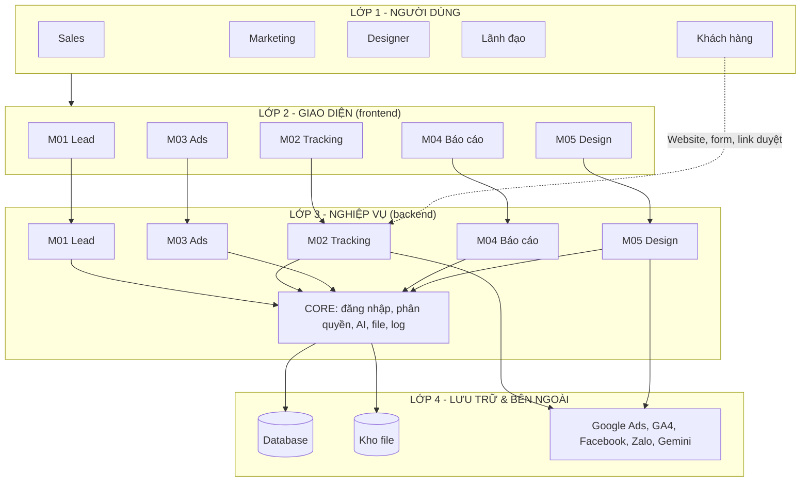

**Ý nghĩa:**
- Mỗi module có **2 phần**: giao diện (frontend) và nghiệp vụ (backend), cùng mã M01–M05 → nhóm nào phụ trách module nào thì sở hữu cả 2 phần.
- **CORE** là phần dùng chung (đăng nhập, phân quyền, kết nối AI, lưu file, ghi log) – không chứa nghiệp vụ riêng của module nào.
- Chỉ **M02** và **M05** nói chuyện trực tiếp với hệ thống bên ngoài.

---

## Sơ đồ 2 – Người dùng ↔ Module

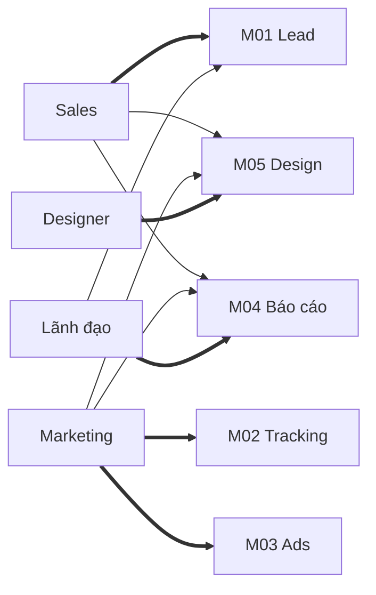

| Người dùng | Dùng chính (mũi tên đậm) | Dùng thêm |
| :--- | :--- | :--- |
| **Sales** | M01 – nhận khách, chăm sóc, báo giá | M05 tạo phối cảnh cho khách; M04 xem kết quả cá nhân |
| **Marketing** | M02 nguồn khách; M03 hiệu quả quảng cáo | M04 báo cáo Marketing; M05 đặt thiết kế quảng cáo |
| **Designer** | M05 – nhận Brief, làm thiết kế | – |
| **Lãnh đạo** | M04 – dashboard, dự báo doanh thu | M01 duyệt giá, xem dự án lớn |

---

## Sơ đồ 3 – Dòng chảy dữ liệu chính qua 5 module

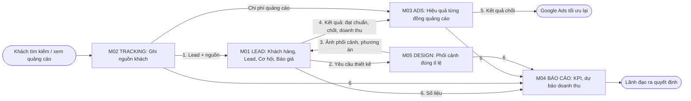

| Bước | Từ → Đến | Dữ liệu | Nếu thiếu bước này |
| :---: | :--- | :--- | :--- |
| 1 | M02 → M01 | Lead kèm nguồn, chiến dịch, từ khóa, gclid | Không biết khách đến từ đâu |
| 2 | M01 → M05 | Thông tin khách, dòng LED, kích thước, ảnh khảo sát | Designer phải hỏi lại Sales, dễ sai thông số |
| 3 | M05 → M01 | Ảnh phối cảnh, phương án khách chọn | Phối cảnh và báo giá lệch nhau |
| 4 | M01 → M03 | Lead đạt chuẩn, đơn chốt, doanh thu | Chỉ đo được click, không đo được tiền thật |
| 5 | M03 → Google Ads | Danh sách khách đã chốt (chuyển đổi offline) | Google mang về nhiều Lead rác |
| 6 | Tất cả → M04 | Số liệu từng module | Phải tổng hợp báo cáo thủ công |

---

## Sơ đồ 4 – Vòng đời một dự án LED trong hệ thống

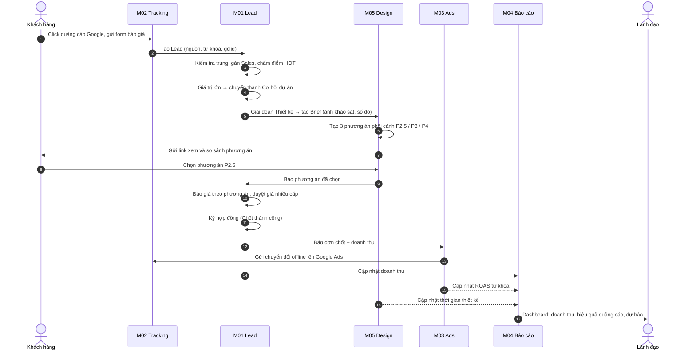

---

## Sơ đồ 5 – Module gọi nhau

### 5a. Hiện tại trong code (đã kiểm tra tự động bằng `scripts/check-architecture.mjs`)

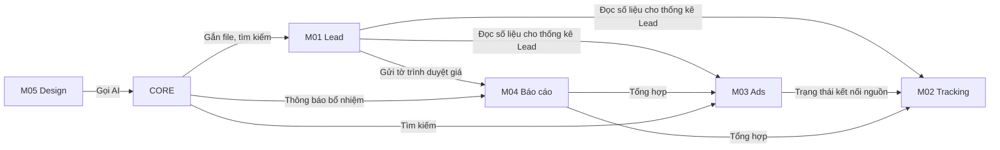

- Các module **chỉ gọi nhau qua cổng công khai** (`public.ts` ở backend, `index.ts` ở frontend).
- **Không có vòng lặp phụ thuộc** (A gọi B, B lại gọi A) – được kiểm tra tự động mỗi lần build.

### 5b. Mục tiêu khi hệ thống lớn: gọi trực tiếp + sự kiện

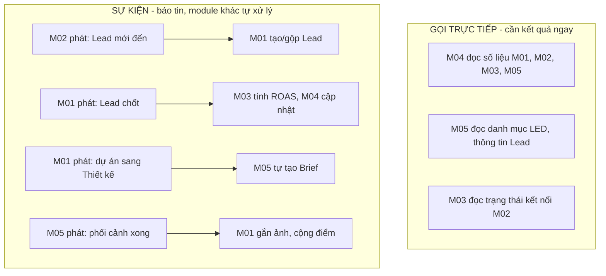

| Cách liên kết | Dùng khi | Ví dụ |
| :--- | :--- | :--- |
| **Gọi trực tiếp** (`public.ts`) | Cần dữ liệu ngay để hiển thị | Dashboard M04 đọc số Lead của M01 |
| **Sự kiện** | Báo "đã xảy ra việc gì", module khác xử lý sau, không cần chờ | Lead chốt → M03 tính lại ROAS |

**Lợi ích của sự kiện:** nhóm M01 không cần biết M03, M04, M05 làm gì với tin "Lead chốt" → 5 nhóm làm độc lập, thêm tính năng không phải sửa module khác.

---

## Sơ đồ 6 – Dữ liệu thuộc module nào và nối với nhau ra sao

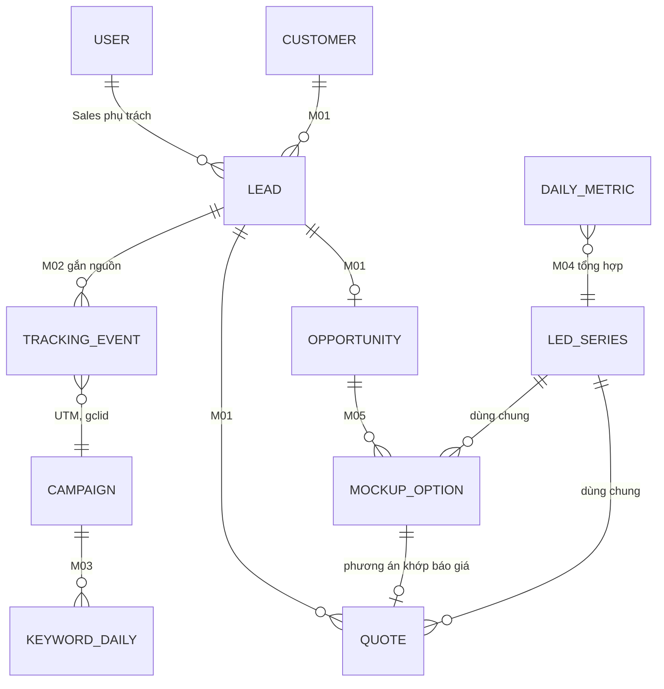

| Bảng | Module sở hữu (được ghi) | Module khác dùng (chỉ đọc) |
| :--- | :--- | :--- |
| Khách hàng, Lead, Cơ hội, Báo giá | **M01** | M03, M04, M05 |
| Sự kiện tracking, nguồn, đồng bộ | **M02** | M01, M03, M04 |
| Chiến dịch, từ khóa, chi phí | **M03** | M04 |
| Bảng tổng hợp, chỉ tiêu, báo cáo | **M04** | – |
| Brief, phối cảnh, tài sản thiết kế | **M05** | M01, M04 |
| Dòng LED, người dùng, phòng ban | **CORE** | Tất cả |

> **Quy tắc vàng:** mỗi bảng **chỉ một module được ghi**. Module khác muốn thay đổi phải gọi qua cổng công khai của module sở hữu.

**Các "sợi dây" nối dữ liệu giữa module:**
| Khóa nối | Nối giữa | Dùng để |
| :--- | :--- | :--- |
| `leadId` / `opportunityId` | M01 ↔ M02, M05 | Biết nguồn của Lead, phối cảnh của dự án |
| `gclid`, `utm_campaign`, `utm_term` | M02 ↔ M03 | Biết Lead đến từ chiến dịch/từ khóa nào |
| `ledSeriesId` (dòng LED) | M01 ↔ M05 ↔ M03 ↔ M04 | Báo giá, phối cảnh, quảng cáo, báo cáo cùng một dòng sản phẩm |
| `quoteOptionId` | M01 ↔ M05 | Phương án phối cảnh khớp phương án báo giá |
| `userId` (Sales) | Tất cả | Báo cáo theo người phụ trách |

---

## Sơ đồ 7 – Kết nối với hệ thống bên ngoài

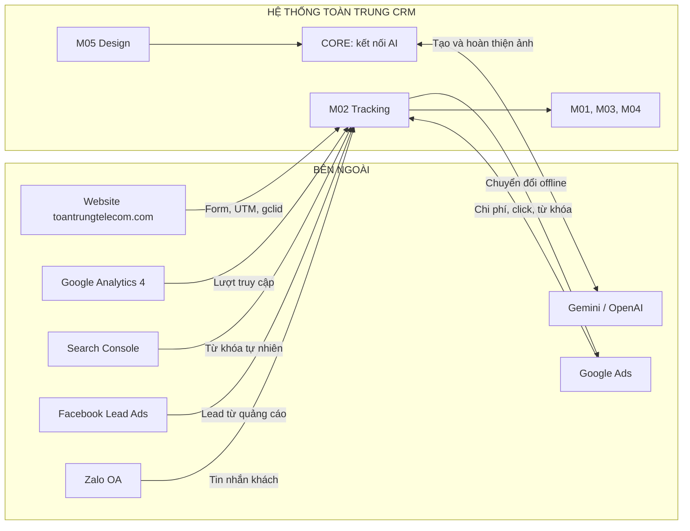

| Hệ thống ngoài | Đi qua module | Chiều | Trạng thái hiện tại |
| :--- | :--- | :---: | :--- |
| Website (form) | M02 | Vào | Có API nhận, chưa gắn script lên website thật |
| Google Ads | M02 | Vào + Ra | Chưa cấu hình (hiển thị đúng "Chưa cấu hình") |
| GA4, Search Console | M02 | Vào | Chưa cấu hình |
| Facebook, Zalo | M02 | Vào | Chưa có |
| Gemini | CORE (M01 AI nhập Lead, M05 Design) | Vào + Ra | **Đang hoạt động** khi có `GEMINI_API_KEY` |

> **Nguyên tắc:** mọi kết nối quảng cáo/kênh đi qua **M02** (một cửa), mọi kết nối AI đi qua **CORE** → đổi nhà cung cấp chỉ sửa một chỗ.

---

## Tóm tắt một trang

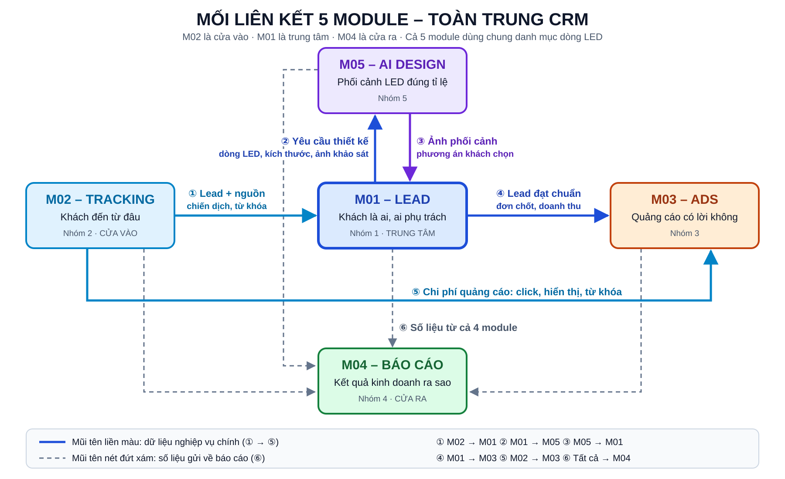

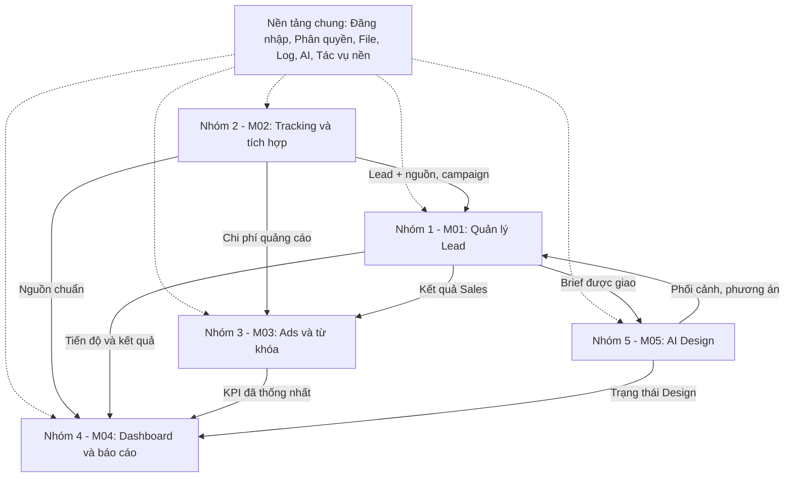

| Module | Một câu | Nhận từ | Gửi cho |
| :--- | :--- | :--- | :--- |
| **M02** | Khách đến từ đâu | Website, quảng cáo, Zalo | M01 (Lead + nguồn), M03 (chi phí), M04 |
| **M01** | Khách là ai, ai phụ trách, chốt được không | M02, M05 | M03 (kết quả bán), M05 (yêu cầu thiết kế), M04 |
| **M05** | Cho khách thấy trước màn LED trong không gian thật | M01 | M01 (phối cảnh, phương án), M04 |
| **M03** | Mỗi đồng quảng cáo mang về bao nhiêu | M02, M01 | Google Ads (qua M02), M04 |
| **M04** | Kết quả kinh doanh ra sao | Cả 4 module | Lãnh đạo, các phòng |
