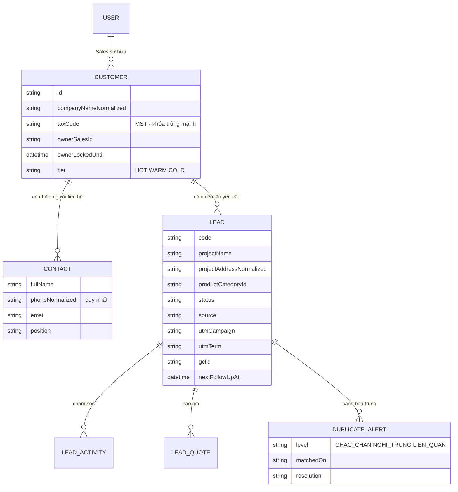
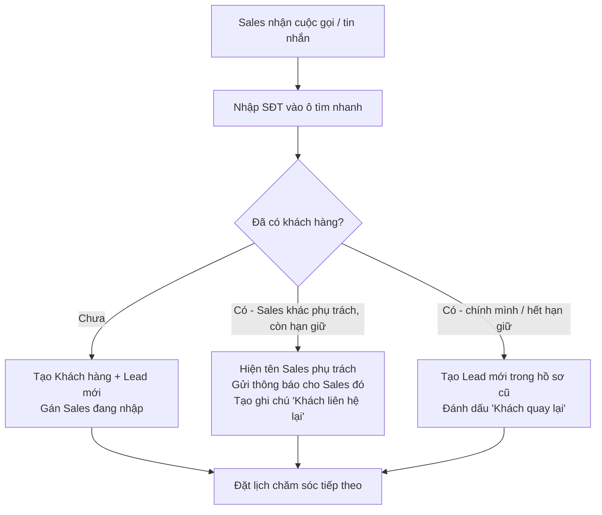
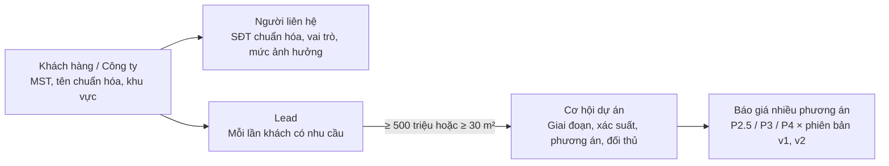

# M01 – Quản lý Lead (Nhóm 1) ⭐ Trọng tâm

## 1. Mục tiêu

| Mục | Nội dung |
| :--- | :--- |
| **Yêu cầu nghiên cứu** | Tiếp nhận/tạo Lead; kiểm tra trùng; phân loại sản phẩm & nguồn; phân công/chuyển Sales; trạng thái & báo giá; lịch sử, file đính kèm, lý do thất bại; phân quyền |
| **Mục đích cuối cùng** | Quản lý Lead xuyên suốt từ lúc tiếp nhận đến khi chốt thành công hoặc thất bại, **tránh trùng khách** và **rõ người phụ trách** |
| **Đầu ra cần có** | Quy trình hoạt động; chức năng cần xây; dữ liệu cần lưu; API; giao diện dự kiến |

### Yêu cầu trực tiếp từ Marketing
1. Tìm ra **sự trùng lặp** theo SĐT, dự án, sản phẩm…
2. Sales nhận thông tin xong **lưu trực tiếp vào hệ thống** – kể cả khách hỏi lại sau **1, 3, 6, 12 tháng** mà chưa mua.
3. **Cảnh báo trùng** để tránh nhiều Sales cùng tiếp cận một khách, **biết Sales nào đang phụ trách**.
4. **Phân loại, đánh giá** mức độ tiềm năng của khách hàng.

---

## 2. Hiện trạng hệ thống (đã rà soát code)

| Hạng mục | Đã có | Hạn chế cần khắc phục |
| :--- | :--- | :--- |
| Tạo Lead, nhập Excel, AI nhập nhanh | ✅ | – |
| Kiểm tra trùng | ✅ So SĐT, email, tên khách, tên công ty | ⚠️ **Chỉ quét 100 Lead đầu tiên** (`take: 100`) → khi dữ liệu lớn sẽ **bỏ sót trùng**. Chưa so theo dự án/địa chỉ, sản phẩm, MST. So tên bằng "chứa chuỗi" dễ báo nhầm ("An" khớp "Hoàng An", "Lan Anh") |
| Chuẩn hóa SĐT | ⚠️ Chỉ bỏ dấu cách, chấm, gạch | Chưa quy đổi `+84`/`84` → `0`, chưa có cột SĐT chuẩn hóa có chỉ mục |
| Khách quay lại sau nhiều tháng | ❌ | Mỗi lần hỏi lại là một Lead mới hoặc bị chặn trùng – **không có khái niệm "Khách hàng" tách khỏi "Lead/yêu cầu"** |
| Người phụ trách | ✅ `salesPersonId`, lịch sử bàn giao | Chưa có quy tắc giữ khách (bao lâu thì được chuyển), chưa báo cho Sales chủ khi người khác đụng vào khách |
| Phân loại tiềm năng | ✅ Điểm 0–100, HOT/WARM/COLD | Điểm tính một lần lúc tạo, chưa cập nhật theo hành vi (gọi lại, xem báo giá, quay lại) |
| Pipeline | ✅ 5 trạng thái: Vừa nhận thông tin → Đang soạn báo giá → Đã gửi báo giá → Chốt thành công / Thất bại | Thiếu trạng thái "Tạm hoãn – chăm sóc lại" cho khách chưa mua |

---

## 3. Đề xuất thay đổi mô hình dữ liệu (thay đổi quan trọng nhất)

Tách **"Khách hàng"** (người/công ty – tồn tại lâu dài) khỏi **"Lead / Yêu cầu"** (mỗi lần khách có nhu cầu):

**Lợi ích:**
- Khách hỏi lại sau 6 tháng → hệ thống nhận ra **khách cũ**, tạo **Lead mới trong hồ sơ cũ**, vẫn giữ toàn bộ lịch sử trao đổi, báo giá cũ.
- Một công ty có nhiều người liên hệ (giám đốc, kỹ thuật, kế toán) → không bị tính là nhiều khách.
- Báo cáo phân biệt được **khách mới** và **khách quay lại**.

> Migration: tạo `Customer`, `Contact` từ dữ liệu Lead hiện có (gộp theo SĐT chuẩn hóa + tên công ty chuẩn hóa), giữ nguyên Lead cũ, chỉ thêm `customerId`. Không xóa dữ liệu.

---

## 4. Hướng phát triển chi tiết

### 4.1. Chống trùng nhiều tầng (Must)

**Bước chuẩn hóa trước khi so:**
| Trường | Cách chuẩn hóa | Ví dụ |
| :--- | :--- | :--- |
| SĐT | Bỏ ký tự lạ, `+84`/`84` → `0`, tách nhiều số trong một ô | `+84 909.111.222` → `0909111222` |
| Email | Chữ thường, bỏ khoảng trắng | `Contact@ABC.vn` → `contact@abc.vn` |
| Tên công ty | Bỏ dấu, chữ thường, bỏ "công ty, TNHH, CP, cổ phần, MTV, JSC, Co.,Ltd" | `CÔNG TY TNHH Ánh Sáng Việt` → `anh sang viet` |
| Mã số thuế | Chỉ giữ số | `0312-345-678` → `0312345678` |
| Địa chỉ dự án | Bỏ dấu, chuẩn hóa "P.", "Q.", "TP." | `Q.1, TP.HCM` → `quan 1 ho chi minh` |

**Ba mức cảnh báo:**

| Mức | Điều kiện | Hành động của hệ thống |
| :--- | :--- | :--- |
| 🔴 **Chắc chắn trùng** | Trùng SĐT chuẩn hóa, email, hoặc MST | **Chặn tạo mới**. Gợi ý: "Thêm yêu cầu mới vào hồ sơ khách này" hoặc "Gửi yêu cầu chuyển khách cho quản lý" |
| 🟠 **Nghi trùng** | Tên công ty giống ≥ 85% **và** cùng tỉnh/thành; hoặc cùng địa chỉ dự án + cùng dòng sản phẩm trong 90 ngày | Cho tạo nhưng **bắt buộc chọn lý do** (khác dự án / khác chi nhánh / không phải trùng), quản lý nhận thông báo |
| 🟡 **Có liên quan** | Cùng công ty nhưng khác người liên hệ | Gợi ý gắn vào cùng hồ sơ khách hàng |

**Kỹ thuật:**
- Thêm cột `phoneNormalized`, `emailNormalized`, `taxCode`, `companyNameNormalized` có **chỉ mục** → tra cứu toàn bộ dữ liệu, không giới hạn 100 bản ghi.
- So tên gần đúng bằng độ tương đồng chuỗi (trigram/Levenshtein) thay cho "chứa chuỗi".
- Kiểm tra trùng **ngay khi gõ SĐT** (debounce 300 ms) và **khi nhập Excel** (báo cáo dòng trùng trước khi lưu).
- Lưu mỗi lần cảnh báo vào `DuplicateAlert` để đo tỉ lệ trùng và xử lý tranh chấp.

### 4.2. Hồ sơ khách hàng & chăm sóc lại 1–3–6–12 tháng (Must)

**Quy trình khi Sales nhận thông tin:**

**Chăm sóc lại khách chưa mua:**
- Thêm trạng thái **"Tạm hoãn – chăm sóc lại"** với lý do (chưa có ngân sách, chờ dự án, đang so sánh giá…).
- Khi Lead chuyển "Thất bại" hoặc "Tạm hoãn", hệ thống **tự tạo lịch nhắc** sau **1, 3, 6, 12 tháng** (cấu hình được theo lý do).
- Đến hạn: Sales nhận nhắc việc trên hệ thống; nếu Sales đã nghỉ việc → chuyển quản lý phân lại.
- Khi khách quay lại, Sales thấy ngay: lần hỏi trước, báo giá cũ, lý do chưa mua, ai từng phụ trách.

### 4.3. Quyền sở hữu khách & cảnh báo tranh chấp (Must)

| Quy tắc | Đề xuất (MKT/BA chốt lại) |
| :--- | :--- |
| Ai sở hữu khách mới | Sales tạo/nhận Lead đầu tiên, hoặc người được quản lý phân công |
| Thời hạn giữ khách | **30 ngày** kể từ lần tương tác gần nhất (gọi, gửi báo giá, gặp mặt) |
| Hết hạn không chăm sóc | Khách về **kho chung**, quản lý phân lại hoặc Sales khác nhận |
| Sales khác tìm thấy khách đang có chủ | Chỉ thấy **tên Sales phụ trách + trạng thái**, không thấy SĐT đầy đủ/báo giá (nếu không có quyền) |
| Tranh chấp | Sales gửi "Yêu cầu chuyển khách" → quản lý duyệt; mọi thao tác được ghi lịch sử |
| Thông báo | Sales chủ nhận thông báo ngay khi có người khác tạo/tra cứu khách của mình |

### 4.4. Chấm điểm & phân loại tiềm năng (Should)

Giữ thang **HOT / WARM / COLD** hiện có, nhưng điểm được **cập nhật liên tục**:

| Nhóm tiêu chí | Ví dụ điểm |
| :--- | :--- |
| **Thông tin dự án** | Diện tích LED ≥ 20 m² (+15), có ngân sách rõ (+10), thời gian lắp ≤ 30 ngày (+15) |
| **Loại khách** | Doanh nghiệp/cơ quan có MST (+10), đại lý/nhà thầu (+5) |
| **Nguồn** | Giới thiệu (+10), Google Ads từ khóa "báo giá" (+8), Facebook (+3) |
| **Hành vi** | Nghe máy & trao đổi (+10), yêu cầu báo giá (+15), yêu cầu phối cảnh M05 (+10), khách quay lại (+10) |
| **Suy giảm** | Không phản hồi 14 ngày (−10), 30 ngày (−20) |

- Ngưỡng đề xuất: **HOT ≥ 70**, **WARM 40–69**, **COLD < 40**.
- Giai đoạn sau: dùng dữ liệu Lead đã chốt/thất bại để **học lại trọng số** (thống kê tỉ lệ chốt theo từng tiêu chí).

### 4.5. Phân công Sales (Should)
- Chia tự động theo **vòng tròn** (đã có khi import) + thêm chia theo **dòng sản phẩm, khu vực, tải hiện tại** của Sales.
- Lead HOT chưa được liên hệ trong **15 phút** → nhắc Sales; **2 giờ** → báo quản lý (SLA).

### 4.6. Lý do thất bại chuẩn hóa (Must)
Danh sách cố định để báo cáo: Giá cao, Chọn đối thủ, Chưa có ngân sách, Dự án hoãn, Không liên lạc được, Thông tin rác, Khác (ghi rõ). Bắt buộc chọn khi chuyển "Thất bại" (đã có kiểm tra bắt buộc, cần chuẩn hóa danh sách).

---

## 5. API đề xuất

| Phương thức | Đường dẫn | Mô tả |
| :--- | :--- | :--- |
| `GET` | `/api/customers/lookup?phone=&email=&taxCode=&company=` | Tra cứu nhanh khách khi Sales nhập liệu, trả mức trùng + Sales phụ trách |
| `POST` | `/api/customers/{id}/leads` | Tạo yêu cầu mới trong hồ sơ khách cũ |
| `POST` | `/api/leads/check-duplicate` | (Nâng cấp) trả về `level`, `matchedOn`, danh sách khớp |
| `POST` | `/api/leads/{id}/transfer-requests` | Gửi yêu cầu chuyển khách |
| `PATCH` | `/api/transfer-requests/{id}` | Quản lý duyệt/từ chối |
| `GET` | `/api/leads/follow-ups?due=today` | Danh sách khách cần chăm sóc lại hôm nay |
| `GET` | `/api/duplicate-alerts` | Thống kê, xử lý cảnh báo trùng |

## 6. Giao diện dự kiến
1. **Ô tìm nhanh khách** ở đầu trang Lead: gõ SĐT/tên công ty → hiện thẻ khách (Sales phụ trách, số lần hỏi, lần cuối liên hệ, trạng thái).
2. **Hộp cảnh báo trùng** màu đỏ/cam/vàng ngay trong form tạo Lead.
3. **Trang hồ sơ khách hàng**: dòng thời gian toàn bộ các lần hỏi, báo giá, phối cảnh, Sales từng phụ trách.
4. **Danh sách "Cần chăm sóc hôm nay"** cho từng Sales.
5. **Trang tranh chấp/chuyển khách** cho quản lý.

## 7. KPI đo hiệu quả

| KPI | Cách tính | Mục tiêu gợi ý |
| :--- | :--- | :--- |
| Tỉ lệ Lead trùng lọt vào hệ thống | Lead bị gộp sau khi tạo / tổng Lead | < 2% |
| Số vụ 2 Sales cùng gọi 1 khách | Số tranh chấp / tháng | Giảm 80% sau 3 tháng |
| Thời gian liên hệ đầu tiên | Từ lúc tạo Lead đến hoạt động đầu tiên | HOT < 15 phút |
| Tỉ lệ khách quay lại được nhận diện | Lead "khách quay lại" / Lead của khách đã có | Theo dõi tăng dần |
| Doanh thu từ khách chăm sóc lại | Doanh thu Lead có nguồn "chăm sóc lại 1–3–6–12 tháng" | Đo mới |

## 8. Liên kết với module khác
- **Nhận từ M02:** nguồn, UTM, `gclid`, trang đích → lưu trên Lead.
- **Gửi cho M03:** trạng thái Lead, Lead đạt chuẩn, doanh thu chốt.
- **Gửi/nhận M05:** yêu cầu phối cảnh (dòng LED, kích thước, ảnh khảo sát) ↔ ảnh phối cảnh, trạng thái thiết kế.
- **Cung cấp M04:** số Lead theo kỳ, theo nguồn, theo dòng sản phẩm, theo Sales, tỉ lệ chốt, lý do thất bại.

## 9. Lộ trình
| Giai đoạn | Nội dung |
| :--- | :--- |
| GĐ1 (2 tuần) | Chuẩn hóa SĐT/email/MST + chỉ mục, sửa lỗi quét 100 bản ghi, 3 mức cảnh báo, ô tìm nhanh khách |
| GĐ2 (2 tuần) | Mô hình Khách hàng – Lead, migration dữ liệu cũ, trạng thái "Tạm hoãn", lịch nhắc 1–3–6–12 tháng |
| GĐ3 (2 tuần) | Quyền sở hữu & thời hạn giữ khách, yêu cầu chuyển khách, chấm điểm theo hành vi, SLA |

## 10. Rủi ro
- **Gộp nhầm khách** khi migration → chạy thử trên bản sao dữ liệu, cho quản lý duyệt danh sách gộp.
- Sales **né cảnh báo** bằng cách nhập sai SĐT → bắt buộc định dạng SĐT hợp lệ, đối soát định kỳ.
- Quy tắc giữ khách gây tranh cãi nội bộ → MKT/BA và trưởng phòng Kinh doanh phải chốt bằng văn bản.

## 11. Câu hỏi cần chốt với MKT/BA
1. Thời hạn giữ khách là bao lâu? Tính từ lúc tạo hay từ lần tương tác cuối?
2. Có thu thập **Mã số thuế** khách doanh nghiệp không?
3. "Trùng dự án" được hiểu là gì: cùng địa chỉ, cùng tên dự án, hay cùng chủ đầu tư?
4. Lịch chăm sóc lại 1–3–6–12 tháng áp dụng cho mọi lý do thất bại hay chỉ một số lý do?
5. Sales khác có được thấy SĐT của khách đang có chủ không?

---

## 12. NÂNG CẤP CHO DỰ ÁN LỚN

> Phần này mở rộng M01 để chịu được **quy mô lớn** (hàng trăm nghìn khách, nhiều chi nhánh, nhiều Sales) và **dự án LED giá trị lớn** (đấu thầu, công trình nhiều bên, chốt 3–12 tháng).

### 12.1. Mô hình dữ liệu 4 tầng

- **Đơn nhỏ** giữ quy trình nhanh hiện tại (Lead → Báo giá → Chốt).
- **Dự án lớn** chuyển sang **Cơ hội dự án** với quy trình riêng.

### 12.2. Quy trình Cơ hội dự án lớn
| Giai đoạn | Xác suất mặc định | Việc bắt buộc trước khi sang giai đoạn sau |
| :--- | :---: | :--- |
| Khảo sát | 10% | Có ảnh khảo sát + số đo (phục vụ M05) |
| Thiết kế & phối cảnh | 20% | Có ít nhất 1 phối cảnh M05 được duyệt nội bộ |
| Báo giá | 30% | Báo giá đã gửi khách (khóa phiên bản) |
| Đấu thầu / Đàm phán | 60% | Ghi nhận đối thủ, người quyết định |
| Ký hợp đồng | 90% | Hợp đồng đính kèm, giá trị cuối |
| Thi công → Nghiệm thu | 100% | Biên bản nghiệm thu |
| Thất bại | 0% | Lý do + đối thủ thắng |

*Xác suất cấu hình được trong trang quản trị. Doanh thu dự báo = giá trị × xác suất (cung cấp cho M04).*

### 12.3. Bảng nâng cấp chi tiết
| # | Hạng mục | Nội dung | Mức |
| :---: | :--- | :--- | :---: |
| 1 | **Chống trùng quy mô lớn** | Cột chuẩn hóa có chỉ mục; tìm tên gần đúng bằng `pg_trgm` (PostgreSQL); phản hồi < 200 ms; **bỏ giới hạn quét 100 bản ghi hiện tại** | Must |
| 2 | **Nhiều bên liên quan** | Chủ đầu tư, người quyết định, tư vấn kỹ thuật, nhà thầu chính, kế toán, ban QLDA; mức ảnh hưởng (cao/trung bình/thấp), thái độ (ủng hộ/trung lập/phản đối) | Must |
| 3 | **Báo giá nhiều phương án & phiên bản** | Mỗi Cơ hội có nhiều phương án, mỗi phương án nhiều phiên bản; so sánh song song; khóa bản đã gửi; liên kết phương án phối cảnh M05 | Must |
| 4 | **Duyệt giá nhiều cấp** | ≤ 5% Sales; 5–10% Trưởng phòng; > 10% Giám đốc; ngưỡng cấu hình; lịch sử duyệt | Must |
| 5 | **Mốc thời gian & nhắc việc** | Hạn nộp thầu, hạn báo giá, lịch khảo sát; nhắc trước 3 ngày và 1 ngày | Must |
| 6 | **Bộ quy tắc chia khách cấu hình được** | Theo dòng SP, khu vực, tải Sales, giá trị dự án (dự án lớn giao Sales cấp cao) | Must |
| 7 | **Nhóm bán hàng dự án** | Sales chính + kỹ thuật + Designer + quản lý; phân vai, cùng xem tiến độ | Should |
| 8 | **Phân quyền theo nhóm/khu vực/chi nhánh** | Sales thấy khách của mình; quản lý thấy khu vực; ẩn một phần SĐT với người không phụ trách | Should |
| 9 | **Nhập Excel lớn chạy nền** | Hàng nghìn dòng, xem trước, báo dòng lỗi/trùng, không treo giao diện | Should |
| 10 | **Đối thủ & lý do thắng/thua** | Danh mục đối thủ, giá đối thủ, lý do; thống kê tỉ lệ thắng theo đối thủ | Should |
| 11 | **Sau hợp đồng** | Thời hạn bảo hành, lịch bảo trì → nhắc bán thêm, xin giới thiệu khách mới | Could |

### 12.4. Dữ liệu bổ sung
| Bảng | Trường chính |
| :--- | :--- |
| `Opportunity` | customerId, leadId, tên dự án, địa chỉ, giá trị dự kiến, giai đoạn, xác suất, ngày dự kiến chốt, Sales chính |
| `OpportunityStakeholder` | opportunityId, contactId, vai trò, mức ảnh hưởng, thái độ |
| `QuoteOption` / `QuoteVersion` | phương án, phiên bản, dòng LED, kích thước, tổng giá, trạng thái (nháp/đã gửi/khóa) |
| `ApprovalRequest` | đối tượng, cấp duyệt, người duyệt, kết quả, ghi chú |
| `Competitor` / `OpportunityCompetitor` | đối thủ, giá, kết quả |
| `AssignmentRule` | điều kiện (dòng SP, khu vực, giá trị), cách chia, thứ tự ưu tiên |

### 12.5. Sự kiện phát ra cho module khác
| Sự kiện | Module nhận | Mục đích |
| :--- | :--- | :--- |
| `LeadCreated`, `LeadQualified` | M03, M04 | Tính CPL/CPQL, cập nhật báo cáo |
| `LeadWon`, `LeadLost` | M03, M04 | ROAS, chuyển đổi offline, báo cáo lý do thất bại |
| `OpportunityStageChanged` | M04, M05 | Dự báo doanh thu; giai đoạn "Thiết kế" tự tạo Brief M05 |

### 12.6. KPI quy mô lớn
| KPI | Mục tiêu |
| :--- | :--- |
| Thời gian kiểm tra trùng | < 200 ms |
| Tỉ lệ Lead trùng | < 2% |
| Tỉ lệ thắng Cơ hội dự án lớn | Đo và tăng theo quý |
| Độ chính xác dự báo doanh thu quý | Sai lệch < 20% |
| Thời gian duyệt giá | < 24 giờ |

### 12.7. Lộ trình nâng cấp
| Giai đoạn | Nội dung |
| :--- | :--- |
| GĐ1 (tuần 1–4) | Chống trùng quy mô lớn, mô hình Khách hàng – Lead, chăm sóc lại 1–3–6–12 tháng |
| GĐ2 (tuần 5–8) | Cơ hội dự án lớn, nhiều bên liên quan, báo giá nhiều phương án, duyệt nhiều cấp, mốc thời gian |
| GĐ3 (tuần 9+) | Phân quyền khu vực/chi nhánh, đối thủ, nhóm bán hàng dự án, sau hợp đồng |
