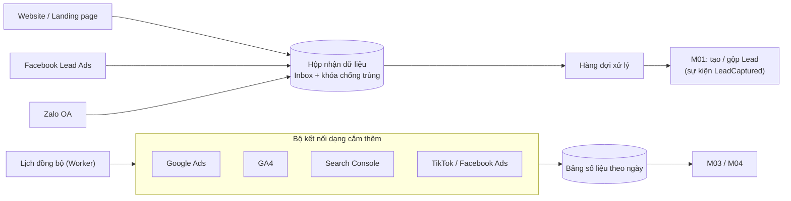

# M02 – Tracking & đồng bộ đa kênh (Nhóm 2)

## 1. Mục tiêu

| Mục | Nội dung |
| :--- | :--- |
| **Yêu cầu nghiên cứu** | Nguồn Lead; UTM; Campaign; Landing Page; Website; thiết bị; Google Ads; GA4; Search Console; đồng bộ tự động; nghiên cứu n8n |
| **Mục đích cuối cùng** | Biết chính xác Lead đến từ đâu, chiến dịch nào, website nào; **tự động đồng bộ dữ liệu thay vì nhập tay** |
| **Đầu ra cần có** | Nguồn dữ liệu cần kết nối; dữ liệu cần lấy; cách kết nối API; cách lưu DB; quy trình đồng bộ |

## 2. Hiện trạng hệ thống

| Hạng mục | Đã có | Hạn chế |
| :--- | :--- | :--- |
| Bảng `TrackingEvent` (nguồn, medium, campaign, trang đích, thiết bị, UTM dạng JSON) | ✅ | Chưa có `gclid`/`fbclid`, `utm_term` (từ khóa) chưa tách riêng; chưa có script gắn trên website thật |
| API ghi sự kiện `POST /api/tracking` (có khóa `x-tracking-key`) | ✅ | – |
| Bảng `SyncJob` cho GOOGLE_ADS, GA4, SEARCH_CONSOLE | ✅ | Trạng thái **"Chưa cấu hình"** – chưa kết nối API thật (đúng nguyên tắc không làm giả số liệu) |
| Gắn nguồn vào Lead | ⚠️ Lead chỉ có trường `source` dạng chữ | Chưa lưu chiến dịch/từ khóa/gclid trên Lead → **M03 không nối được chi phí với Lead** |

## 3. Hướng phát triển

### 3.1. Thu thập nguồn trên website (Must)
1. Gắn **script tracking nhỏ** lên website `toantrungtelecom.com`:
   - Khi khách vào trang: đọc `utm_source`, `utm_medium`, `utm_campaign`, `utm_term`, `utm_content`, `gclid`, `fbclid`, trang đích, referrer, thiết bị.
   - Lưu vào cookie **90 ngày** (chu kỳ mua B2B dài) theo nguyên tắc **"chạm đầu tiên" + "chạm cuối cùng"**.
2. Khi khách gửi form báo giá/để lại SĐT → gửi kèm toàn bộ thông tin nguồn sang `POST /api/leads` (qua webhook có khóa bảo mật).
3. Nút gọi Hotline/Zalo trên website: ghi sự kiện "click gọi" kèm nguồn để đối chiếu Lead nhập tay sau đó.

### 3.2. Quy ước UTM thống nhất (Must)
| Tham số | Quy ước | Ví dụ |
| :--- | :--- | :--- |
| `utm_source` | Nền tảng | `google`, `facebook`, `zalo`, `tiktok` |
| `utm_medium` | Loại | `cpc`, `paid_social`, `organic`, `email` |
| `utm_campaign` | Mã chiến dịch trùng với M03 | `GG_LED_HOITRUONG_Q4` |
| `utm_term` | Từ khóa (Google tự điền bằng `{keyword}`) | `bao gia man hinh led p2.5` |
| `utm_content` | Mẫu quảng cáo / vị trí | `banner_a`, `video_15s` |

### 3.3. Đồng bộ dữ liệu từ nền tảng (Should)
| Nguồn | Dữ liệu cần lấy | Tần suất | Cách kết nối |
| :--- | :--- | :--- | :--- |
| **Google Ads API** | Chi phí, click, hiển thị theo ngày × chiến dịch × nhóm quảng cáo × từ khóa; báo cáo cụm từ tìm kiếm | Hằng ngày (sáng sớm) + lấy lại 7 ngày gần nhất | OAuth2 + Developer Token |
| **GA4 Data API** | Phiên, người dùng, trang đích, chuyển đổi theo nguồn | Hằng ngày | Service Account |
| **Search Console API** | Từ khóa tự nhiên, click, hiển thị, vị trí trung bình | Hằng ngày (dữ liệu trễ 2–3 ngày) | Service Account |
| **Facebook Lead Ads / Zalo OA** | Lead từ form quảng cáo, tin nhắn | Theo thời gian thực (webhook) | Webhook + Access Token |

### 3.4. Code trong hệ thống hay dùng n8n?
| Tiêu chí | Viết trong hệ thống | n8n |
| :--- | :--- | :--- |
| Tốc độ làm thử | Chậm hơn | **Nhanh** (có sẵn node Google Ads, GA4, Facebook) |
| Kiểm soát lỗi, log, phân quyền | **Tốt** (dùng chung logger, DB) | Phải tự quản lý thêm một hệ thống |
| Chi phí vận hành | Không thêm | Thêm máy chủ n8n |
| **Đề xuất** | Dùng cho luồng **lõi**: tạo Lead từ website, lưu UTM/gclid | Dùng để **thử nghiệm nhanh** các kết nối phụ (Zalo, Facebook, Google Sheet) rồi chuyển vào hệ thống khi ổn định |

### 3.5. Quy trình đồng bộ & xử lý lỗi (Must)
- Mỗi lần đồng bộ ghi `SyncJob`: thời gian, số bản ghi, lỗi.
- Lỗi xác thực (token hết hạn) → báo quản trị viên, **không hiển thị số liệu cũ như số mới**.
- Đồng bộ lại an toàn: cùng ngày × chiến dịch × từ khóa thì **ghi đè**, không cộng dồn (tránh nhân đôi chi phí).

## 4. Dữ liệu cần bổ sung
- Trên **Lead**: `utmSource`, `utmMedium`, `utmCampaign`, `utmTerm`, `utmContent`, `gclid`, `fbclid`, `landingPage`, `firstTouchAt`, `lastTouchSource`.
- Bảng **`SyncJob`** mở rộng: `rangeFrom`, `rangeTo`, `durationMs`, `errorCode`.

## 5. KPI
| KPI | Mục tiêu gợi ý |
| :--- | :--- |
| % Lead có nguồn chính xác (không phải "Không rõ") | ≥ 90% với Lead từ website |
| % Lead từ Google Ads có `gclid` | ≥ 95% |
| Thời gian từ khách gửi form đến Lead có trên hệ thống | < 1 phút |
| Tỉ lệ đồng bộ thành công | ≥ 99% / tháng |

## 6. Liên kết với module khác
- **→ M01:** tạo Lead kèm đầy đủ nguồn.
- **→ M03:** chi phí, click, hiển thị theo từ khóa/chiến dịch; nhận danh sách chuyển đổi offline để đẩy ngược lên Google Ads.
- **→ M04:** số liệu truy cập, nguồn, tình trạng đồng bộ.

## 7. Câu hỏi cần chốt
1. Website hiện chạy trên nền tảng gì (WordPress, tự code)? Ai có quyền gắn script?
2. Công ty đã có tài khoản Google Ads MCC, GA4, Search Console chưa? Ai giữ quyền quản trị?
3. Có chạy Facebook Lead Ads, Zalo OA không?

---

## 8. NÂNG CẤP CHO DỰ ÁN LỚN

> Mục tiêu: nhận dữ liệu từ **nhiều kênh, nhiều website, nhiều tài khoản quảng cáo** mà **không mất, không trùng, không phụ thuộc người nhập tay**.

### 8.1. Kiến trúc thu nhận dữ liệu

### 8.2. Bảng nâng cấp chi tiết
| # | Hạng mục | Nội dung | Mức |
| :---: | :--- | :--- | :---: |
| 1 | **Hộp nhận dữ liệu (Inbox)** | Mọi webhook ghi vào bảng nhận trước, có **khóa chống trùng** (mã sự kiện của nền tảng) → nền tảng gửi lại nhiều lần cũng không nhân đôi Lead; lỗi xử lý thì chạy lại | Must |
| 2 | **Bộ kết nối chuẩn chung (adapter)** | Mỗi nền tảng một adapter cùng giao diện: `xác thực`, `lấy dữ liệu theo khoảng ngày`, `chuẩn hóa`, `ghi`. Thêm kênh mới không sửa lõi | Must |
| 3 | **Đồng bộ chạy nền theo lịch** | Worker chạy hằng ngày/hằng giờ; lấy lại 7 ngày gần nhất (dữ liệu nền tảng thay đổi trễ); ghi đè an toàn theo ngày × chiến dịch × từ khóa | Must |
| 4 | **Chạm đầu & chạm cuối** | Cookie 90 ngày; Lead lưu cả nguồn đầu tiên và nguồn cuối cùng để M03 phân tích công bằng | Must |
| 5 | **Từ điển nguồn thống nhất** | Bảng quy đổi: "fb", "facebook.com", "Facebook Ads" → `facebook`; nguồn lạ đưa vào danh sách chờ MKT xác nhận | Must |
| 6 | **Nhiều tài khoản & nhiều website** | Tài khoản quản lý MCC, nhiều landing page, nhiều thương hiệu/chi nhánh | Should |
| 7 | **Giám sát chất lượng dữ liệu** | Cảnh báo khi % Lead "không rõ nguồn" tăng, đồng bộ trễ > 24 giờ, token sắp hết hạn | Should |
| 8 | **Đồng ý thu thập dữ liệu** | Thông báo cookie/đồng ý trên website (Nghị định 13/2023) | Should |
| 9 | **Gửi chuyển đổi offline** | Nhận danh sách từ M03, đẩy lên Google Ads/Facebook | Should |

### 8.3. Dữ liệu bổ sung
| Bảng | Trường chính |
| :--- | :--- |
| `InboundEvent` | kênh, mã sự kiện gốc (duy nhất), dữ liệu thô, trạng thái (chờ/đã xử lý/lỗi), số lần thử |
| `Connector` | nền tảng, tài khoản, trạng thái kết nối, hạn token |
| `SourceDictionary` | giá trị gốc → mã nguồn chuẩn |
| `SyncJob` (mở rộng) | khoảng ngày, thời gian chạy, số bản ghi, mã lỗi |

### 8.4. Sự kiện
| Sự kiện | Module nhận |
| :--- | :--- |
| `LeadCaptured` (kèm nguồn, UTM, gclid) | M01 |
| `AdsDataSynced` (ngày, nền tảng) | M03, M04 |

### 8.5. KPI quy mô lớn
| KPI | Mục tiêu |
| :--- | :--- |
| Lead bị mất / nhân đôi từ webhook | 0 |
| Thời gian từ khách gửi form đến Lead trong hệ thống | < 1 phút |
| Thời gian thêm một kênh mới | < 1 tuần |
| Đồng bộ thành công | ≥ 99% |

### 8.6. Lộ trình nâng cấp
| Giai đoạn | Nội dung |
| :--- | :--- |
| GĐ1 (tuần 1–4) | Script website, UTM/gclid vào Lead, Inbox webhook, từ điển nguồn |
| GĐ2 (tuần 5–8) | Adapter Google Ads, GA4, GSC; đồng bộ chạy nền |
| GĐ3 (tuần 9+) | Facebook/TikTok/Zalo, nhiều tài khoản, giám sát chất lượng, gửi chuyển đổi offline |
