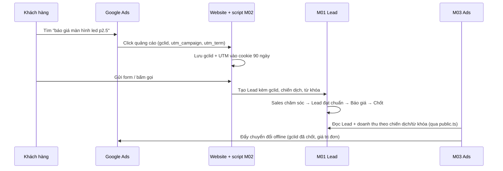
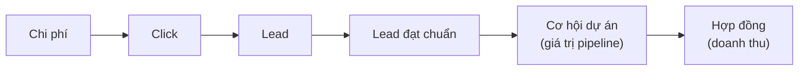

# M03 – Ads & phân tích từ khóa (Nhóm 3) ⭐ Trọng tâm

## 1. Mục tiêu

| Mục | Nội dung |
| :--- | :--- |
| **Yêu cầu nghiên cứu** | Campaign Google Ads; Keyword; CPC; Click; Impression; CTR; chi phí; Conversion; Search Console; Google Trends; **liên kết Ads với Lead thật** |
| **Mục đích cuối cùng** | Biết chiến dịch/từ khóa nào hiệu quả, từ khóa nào **tốn chi phí nhưng không tạo Lead** để tối ưu ngân sách |
| **Đầu ra cần có** | Chỉ số cần theo dõi; KPI/công thức; dữ liệu đầu vào; cách phân tích; giao diện Ads/Keyword dự kiến |

> **Điểm mấu chốt:** với LED B2B, một click rẻ chưa chắc tốt. Thước đo đúng là **chi phí trên mỗi Lead đạt chuẩn** và **doanh thu chốt trên mỗi đồng quảng cáo**. Muốn vậy phải **nối được chi phí (Google Ads) ↔ Lead (M01) ↔ doanh thu (báo giá chốt)**.

---

## 2. Hiện trạng hệ thống

| Hạng mục | Đã có | Hạn chế |
| :--- | :--- | :--- |
| `MarketingCampaign` (nền tảng, ngân sách, đã chi, trạng thái) | ✅ | Nhập tay, chưa đồng bộ từ Google Ads |
| `AdsPerformance` (hiển thị, click, chi phí, chuyển đổi, CPC, CTR theo ngày × chiến dịch) | ✅ | Chưa có cấp **nhóm quảng cáo** và **từ khóa** |
| `KeywordMetric` (từ khóa, click, CPC, vị trí, lượng tìm kiếm) | ✅ | **Không gắn với chiến dịch**, không có chi phí/chuyển đổi theo từ khóa, không gắn với Lead |
| Giao diện Ads & từ khóa | ✅ | Chỉ hiển thị số liệu quảng cáo, **chưa có Lead/doanh thu thật** |
| Liên kết Lead ↔ từ khóa | ❌ | Lead chưa lưu `utm_term`/`gclid` (cần M02) |

---

## 3. Bộ chỉ số & công thức

### 3.1. Chỉ số quảng cáo (lấy từ Google Ads)
| Chỉ số | Công thức | Ý nghĩa |
| :--- | :--- | :--- |
| Hiển thị (Impression) | – | Mức độ tiếp cận |
| Click | – | Lượng truy cập |
| **CTR** | Click ÷ Hiển thị | Mẫu quảng cáo có hấp dẫn không |
| **CPC** | Chi phí ÷ Click | Giá mỗi lượt truy cập |
| Tỉ lệ hiển thị bị mất do ngân sách/thứ hạng | Google Ads cung cấp | Có nên tăng ngân sách không |

### 3.2. Chỉ số kinh doanh (nối với M01) – **quan trọng nhất**
| Chỉ số | Công thức | Ý nghĩa |
| :--- | :--- | :--- |
| **CVR Lead** | Lead ÷ Click | Trang đích có chuyển đổi tốt không |
| **CPL** | Chi phí ÷ Số Lead | Giá mỗi Lead |
| **CPQL** | Chi phí ÷ Số **Lead đạt chuẩn** (không rác, đúng nhu cầu) | Giá mỗi Lead có giá trị |
| **Tỉ lệ chốt** | Lead chốt ÷ Lead | Chất lượng Lead của từ khóa |
| **CPA** | Chi phí ÷ Số đơn chốt | Giá mỗi khách hàng |
| **ROAS** | Doanh thu chốt ÷ Chi phí | Mỗi 1 đồng quảng cáo mang về bao nhiêu đồng doanh thu |
| **Giá trị pipeline** | Tổng giá trị báo giá đang mở từ chiến dịch | Doanh thu tiềm năng (do chu kỳ bán dài) |

> **Lead đạt chuẩn** cần MKT định nghĩa rõ, ví dụ: có SĐT hợp lệ, không trùng, đúng nhu cầu LED, Sales xác nhận sau cuộc gọi đầu.

### 3.3. Cửa sổ ghi nhận
Chu kỳ bán LED dài → doanh thu được tính về chiến dịch **trong 90 ngày** kể từ ngày Lead được tạo. Báo cáo ROAS tháng gần nhất sẽ **thấp hơn thực tế** và tăng dần khi Lead được chốt – phải ghi chú rõ trên giao diện.

---

## 4. Hướng phát triển chi tiết

### 4.1. Nối Ads với Lead thật (Must)

- Lead tạo tay (khách gọi hotline sau khi xem quảng cáo): Sales chọn "Nguồn: Google Ads" + chiến dịch; có thể đối chiếu với sự kiện "click gọi" của M02 theo thời gian.

### 4.2. Đồng bộ dữ liệu Google Ads theo từ khóa (Must)
Mở rộng dữ liệu xuống cấp **nhóm quảng cáo, từ khóa và cụm từ tìm kiếm thực tế**:

| Bảng đề xuất | Trường chính |
| :--- | :--- |
| `AdGroup` | campaignId, tên, trạng thái |
| `KeywordDaily` | ngày, campaignId, adGroupId, từ khóa, kiểu đối sánh, hiển thị, click, chi phí, chuyển đổi Google, điểm chất lượng |
| `SearchTermDaily` | ngày, cụm từ khách gõ thật, từ khóa kích hoạt, click, chi phí |

`KeywordMetric` hiện tại giữ lại cho dữ liệu **Search Console (từ khóa tự nhiên)** để tách bạch quảng cáo trả phí và SEO.

### 4.3. Phát hiện từ khóa lãng phí & gợi ý tối ưu (Must)
Quy tắc tự động (ngưỡng MKT chốt):

| Cảnh báo | Điều kiện ví dụ | Gợi ý |
| :--- | :--- | :--- |
| 🔴 **Đốt tiền** | Chi > 2 triệu trong 30 ngày, 0 Lead đạt chuẩn | Tạm dừng hoặc giảm giá thầu |
| 🟠 **Lead rác** | Có Lead nhưng tỉ lệ đạt chuẩn < 20% | Xem lại trang đích, đối sánh từ khóa |
| 🟡 **Cụm từ không liên quan** | Cụm từ tìm kiếm chứa "miễn phí", "tuyển dụng", "sửa chữa", "cũ", "giá rẻ nhất"… | Thêm **từ khóa phủ định** |
| 🟢 **Đáng tăng ngân sách** | CPQL thấp hơn trung bình 30% và bị mất hiển thị do ngân sách | Tăng ngân sách |
| 🔵 **Cơ hội SEO** | Từ khóa có nhiều hiển thị tự nhiên (Search Console) nhưng vị trí 8–20 | Viết/ tối ưu bài viết |

### 4.4. Chuyển đổi offline lên Google Ads (Should)
- Định kỳ đẩy lên Google Ads danh sách `gclid` đã thành **Lead đạt chuẩn** và **đơn chốt (kèm giá trị)**.
- Google Ads sẽ **tối ưu giá thầu theo khách chất lượng** thay vì theo số lượt gửi form → giảm Lead rác rõ rệt.

### 4.5. Google Trends & tính mùa vụ (Could)
- Theo dõi xu hướng các nhóm từ khóa: "màn hình led sân khấu", "led hội trường", "bảng led quảng cáo ngoài trời"…
- Google Trends **không có API chính thức** → lấy thủ công hằng tháng hoặc qua dịch vụ bên thứ ba; dùng để **lập kế hoạch ngân sách theo mùa** (cuối năm sự kiện, tiệc cưới, khai trương).

### 4.6. Phân tích theo dòng sản phẩm (Should)
Gắn mỗi chiến dịch/nhóm quảng cáo với **dòng LED** trong danh mục dùng chung → biết ROAS của từng dòng (P2.5 Indoor, P3 Outdoor, bảng tỷ giá…) để phân bổ ngân sách.

---

## 5. Giao diện dự kiến
1. **Tổng quan Ads**: Chi phí, Lead, Lead đạt chuẩn, CPQL, Đơn chốt, ROAS – so sánh với kỳ trước.
2. **Bảng chiến dịch**: chi phí → click → Lead → đạt chuẩn → chốt → doanh thu (dạng phễu theo từng dòng).
3. **Bảng từ khóa** với nhãn cảnh báo (Đốt tiền / Lead rác / Đáng tăng ngân sách), lọc theo dòng sản phẩm.
4. **Danh sách cụm từ tìm kiếm** đề xuất thêm từ khóa phủ định.
5. **Xem chi tiết từ khóa**: danh sách Lead thật đến từ từ khóa đó, trạng thái hiện tại.

## 6. KPI đo hiệu quả của module
| KPI | Mục tiêu gợi ý |
| :--- | :--- |
| % chi phí quảng cáo nối được với Lead | ≥ 90% |
| CPQL | Giảm 20% sau 3 tháng tối ưu |
| Chi phí cho từ khóa "đốt tiền" | Giảm 50% sau 2 tháng |
| ROAS theo dòng sản phẩm | Có số liệu hằng tháng cho lãnh đạo |

## 7. Liên kết với module khác
- **Nhận từ M02:** chi phí/click/hiển thị đồng bộ, UTM/gclid trên Lead.
- **Nhận từ M01:** trạng thái Lead, Lead đạt chuẩn, doanh thu chốt (qua `public.ts`).
- **Gửi M02:** danh sách chuyển đổi offline để đẩy lên Google Ads.
- **Cung cấp M04:** CPL, CPQL, ROAS, chi phí theo kênh/dòng sản phẩm.

## 8. Lộ trình
| Giai đoạn | Nội dung |
| :--- | :--- |
| GĐ1 | Thống nhất UTM, định nghĩa "Lead đạt chuẩn", nhập chi phí theo chiến dịch (tay/Excel) + nối Lead → tính CPL/CPQL/ROAS |
| GĐ2 | Đồng bộ Google Ads API cấp từ khóa + cụm từ tìm kiếm, cảnh báo từ khóa lãng phí |
| GĐ3 | Chuyển đổi offline, Search Console, Google Trends, gợi ý phân bổ ngân sách theo dòng sản phẩm |

## 9. Rủi ro
- Lead tạo tay không ghi nguồn → số liệu thiếu. **Bắt buộc chọn nguồn** khi tạo Lead.
- Quyền Google Ads API (Developer Token) cần thời gian Google duyệt → đăng ký sớm.
- Hiểu sai ROAS tháng gần nhất do chu kỳ bán dài → ghi chú rõ trên giao diện.

## 10. Câu hỏi cần chốt
1. Định nghĩa **Lead đạt chuẩn** là gì? Ai xác nhận, trong bao lâu?
2. Ngân sách quảng cáo hiện tại theo tháng, theo kênh? Có chạy ngoài Google không?
3. Doanh thu tính theo **giá trị báo giá chốt** hay **giá trị hợp đồng/thực thu**?
4. Ngưỡng cảnh báo "đốt tiền" bao nhiêu là hợp lý?

---

## 11. NÂNG CẤP CHO DỰ ÁN LỚN

> Với dự án LED lớn, **một dự án thắng có thể bằng hàng trăm đơn nhỏ**. Vì vậy M03 phải đo **giá trị dự án mà quảng cáo tạo ra**, không chỉ đếm Lead hay click.

### 11.1. Phễu đo lường mở rộng

| Chỉ số mới | Công thức | Ý nghĩa |
| :--- | :--- | :--- |
| **Giá trị pipeline / chi phí** | Tổng giá trị Cơ hội tạo ra ÷ Chi phí | Hiệu quả quảng cáo với dự án lớn, đo được sớm trước khi chốt |
| **Chi phí trên mỗi Cơ hội** | Chi phí ÷ Số Cơ hội dự án | Giá để có một dự án lớn đáng theo |
| **ROAS dự báo** | Σ(giá trị Cơ hội × xác suất) ÷ Chi phí | Dự báo hiệu quả khi chưa chốt |
| **ROAS thực** | Doanh thu hợp đồng ÷ Chi phí | Hiệu quả thực tế |

### 11.2. Bảng nâng cấp chi tiết
| # | Hạng mục | Nội dung | Mức |
| :---: | :--- | :--- | :---: |
| 1 | **Kho số liệu theo ngày cấp từ khóa** | Ngày × tài khoản × chiến dịch × nhóm quảng cáo × từ khóa × cụm từ tìm kiếm; chỉ mục theo ngày; xử lý hàng triệu dòng | Must |
| 2 | **Nối chi phí ↔ Lead ↔ Cơ hội ↔ doanh thu** | Qua gclid/UTM; cửa sổ ghi nhận **90 ngày** (đơn nhỏ) và **180 ngày** (dự án lớn) | Must |
| 3 | **Đo theo giá trị pipeline** | Thêm chỉ số ở mục 11.1 vào mọi bảng chiến dịch/từ khóa | Must |
| 4 | **Bộ quy tắc cảnh báo cấu hình được** | MKT tự đặt ngưỡng "đốt tiền", "Lead rác", "đáng tăng ngân sách"; lưu lịch sử cảnh báo và hành động đã làm | Must |
| 5 | **Chuyển đổi offline có giá trị** | Đẩy Lead đạt chuẩn, Cơ hội lớn (kèm giá trị dự kiến), Hợp đồng (kèm doanh thu) lên Google Ads → thuật toán ưu tiên khách giá trị cao | Should |
| 6 | **Đa nền tảng chung bộ chỉ số** | Google, Facebook, TikTok, Zalo qua adapter M02; so sánh hiệu quả giữa các kênh | Should |
| 7 | **Kế hoạch ngân sách** | Phân bổ theo dòng LED × tháng dựa trên ROAS lịch sử + mùa vụ (Google Trends); so kế hoạch với thực chi | Should |
| 8 | **Thử nghiệm A/B** | Mẫu quảng cáo, trang đích (dùng phối cảnh M05 làm hình quảng cáo) | Could |

### 11.3. Dữ liệu bổ sung
| Bảng | Trường chính |
| :--- | :--- |
| `AdAccount` | nền tảng, mã tài khoản, đơn vị tiền |
| `KeywordDaily`, `SearchTermDaily` | như mục 4.2 + accountId |
| `AlertRule` / `AlertEvent` | điều kiện, ngưỡng, đối tượng, thời điểm, hành động |
| `BudgetPlan` | tháng × dòng LED × kênh, ngân sách kế hoạch |
| `OfflineConversionUpload` | gclid, loại chuyển đổi, giá trị, thời điểm, trạng thái gửi |

### 11.4. Sự kiện
| Nhận | Phát |
| :--- | :--- |
| `LeadQualified`, `LeadWon`, `OpportunityStageChanged` (M01); `AdsDataSynced` (M02) | `BudgetAlertRaised` (→ M04), danh sách chuyển đổi offline (→ M02) |

### 11.5. KPI quy mô lớn
| KPI | Mục tiêu |
| :--- | :--- |
| % chi phí nối được với Lead/Cơ hội | ≥ 90% |
| Giá trị pipeline / chi phí | Theo dõi tăng theo quý |
| Chi phí trên mỗi Cơ hội dự án lớn | Giảm theo quý |
| Thời gian từ cảnh báo đến hành động tối ưu | < 3 ngày |

### 11.6. Lộ trình nâng cấp
| Giai đoạn | Nội dung |
| :--- | :--- |
| GĐ1 (tuần 1–4) | Định nghĩa Lead đạt chuẩn, nối chi phí ↔ Lead, CPL/CPQL/ROAS |
| GĐ2 (tuần 5–8) | Kho số liệu cấp từ khóa, chỉ số pipeline, bộ quy tắc cảnh báo |
| GĐ3 (tuần 9+) | Chuyển đổi offline có giá trị, đa nền tảng, kế hoạch ngân sách, A/B |
