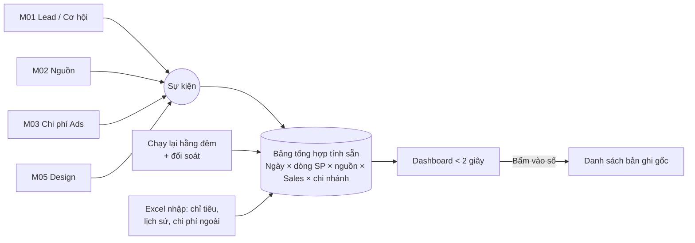

# M04 – Dashboard & báo cáo (Nhóm 4)

## 1. Mục tiêu

| Mục | Nội dung |
| :--- | :--- |
| **Yêu cầu nghiên cứu** | Dashboard tổng quan; báo cáo Sales/Marketing/Ads/Design; 7 ngày, 30 ngày, tùy chọn; xuất Excel; phân quyền báo cáo |
| **Mục đích cuối cùng** | Tự động hóa báo cáo để lãnh đạo và từng phòng theo dõi kết quả **mà không cần tổng hợp thủ công** |
| **Đầu ra cần có** | Danh sách KPI; loại báo cáo; quyền xem; nguồn dữ liệu; giao diện Dashboard dự kiến |

### Yêu cầu trực tiếp từ Marketing
- Báo cáo số liệu theo **ngày / tuần / tháng / năm**, **chính xác**.
- **Phân rõ ràng từng mặt hàng / dòng sản phẩm**.
- **Xuất + nhập file Excel**.

## 2. Hiện trạng
| Hạng mục | Đã có | Hạn chế |
| :--- | :--- | :--- |
| Dashboard tổng quan (`OverviewView`) | ✅ | Tính phần lớn trên danh sách Lead đang tải ở giao diện, chưa có lọc kỳ chuẩn ngày/tuần/tháng/năm |
| Báo cáo phòng ban, tờ trình, đánh dấu đã đọc | ✅ | Là báo cáo dạng văn bản, chưa phải báo cáo số liệu tự động |
| Xuất Excel | ✅ Một số danh sách | Chưa có **nhập Excel** cho báo cáo; chưa có mẫu cố định |
| Phân theo dòng sản phẩm | ⚠️ Lead có `categoryId` | Danh mục sản phẩm chưa thống nhất với báo giá và quảng cáo |

## 3. Hướng phát triển

### 3.1. Từ điển KPI – định nghĩa một lần, dùng mọi nơi (Must)
| KPI | Định nghĩa | Nguồn |
| :--- | :--- | :--- |
| Lead mới | Lead tạo trong kỳ (không tính Lead gộp trùng) | M01 |
| Khách quay lại | Lead mới thuộc khách đã có trước đó | M01 |
| Lead đạt chuẩn | Theo định nghĩa thống nhất ở M03 | M01 |
| Báo giá đã gửi / giá trị | Số và tổng giá trị báo giá trong kỳ | M01 |
| Đơn chốt / doanh thu | Lead chuyển "Chốt thành công" trong kỳ, theo ngày chốt | M01 |
| Tỉ lệ chốt | Đơn chốt ÷ Lead | M01 |
| Chi phí quảng cáo, CPL, CPQL, ROAS | Theo công thức M03 | M03 |
| Lượt truy cập, nguồn | Theo M02 | M02 |
| Số yêu cầu thiết kế, thời gian hoàn thành | Theo M05 | M05 |

> **Quy tắc thời gian:** Lead tính theo **ngày tạo**, doanh thu tính theo **ngày chốt**, chi phí theo **ngày phát sinh**. Phải ghi rõ trên mỗi biểu đồ để tránh hiểu nhầm.

### 3.2. Bộ lọc & kỳ báo cáo (Must)
- Kỳ: **Hôm nay, 7 ngày, 30 ngày, Tuần, Tháng, Quý, Năm, Tùy chọn**; có **so sánh với kỳ trước** và cùng kỳ năm trước.
- Lọc: **dòng sản phẩm**, nguồn, Sales, phòng ban, khu vực.
- Mọi bảng cho phép **xem chi tiết** xuống danh sách Lead/đơn tạo nên con số (để kiểm chứng tính chính xác).

### 3.3. Báo cáo theo dòng sản phẩm (Must)
Bảng chuẩn: Dòng LED × (Lead, Lead đạt chuẩn, Báo giá, Đơn chốt, Doanh thu, m² bán ra, Chi phí Ads, ROAS) theo kỳ. Yêu cầu **danh mục dòng LED dùng chung** (xem `00_TONG_QUAN_VA_LIEN_KET.md`).

### 3.4. Xuất & nhập Excel (Must)
| Chức năng | Mô tả |
| :--- | :--- |
| **Xuất** | Theo đúng bộ lọc đang xem; mẫu cố định có tiêu đề, kỳ, người xuất, thời điểm; giới hạn theo quyền (không xuất SĐT nếu không có quyền); ghi log mỗi lần xuất |
| **Nhập** | Dùng **mẫu Excel có sẵn** để nhập: số liệu lịch sử trước khi có hệ thống, **chỉ tiêu/kế hoạch** theo tháng × dòng SP × Sales, chi phí kênh chưa kết nối API (Facebook, in ấn, triển lãm) |
| Kiểm tra khi nhập | Xem trước, báo dòng lỗi (sai định dạng, mã sản phẩm không tồn tại, trùng kỳ), chỉ lưu khi người dùng xác nhận |

### 3.5. Phân quyền báo cáo (Must)
| Vai trò | Được xem |
| :--- | :--- |
| Giám đốc, Admin | Toàn bộ |
| Trưởng phòng | Phòng mình |
| Sales | Số liệu của chính mình + xếp hạng chung (không xem chi tiết người khác) |
| Marketing | Nguồn, Ads, Lead (không xem doanh thu chi tiết nếu không được phép) |
| Designer | Báo cáo Design |

### 3.6. Báo cáo tự động gửi định kỳ (Should)
Gửi tóm tắt sáng thứ Hai (tuần) và ngày 1 (tháng) qua email/Zalo cho lãnh đạo.

## 4. Giao diện dự kiến
1. **Dashboard lãnh đạo**: Doanh thu, Đơn chốt, Lead, Tỉ lệ chốt, Chi phí Ads, ROAS + biểu đồ theo kỳ + bảng theo dòng sản phẩm.
2. **Báo cáo Sales**: xếp hạng, phễu theo Sales, Lead quá hạn chăm sóc.
3. **Báo cáo Marketing/Ads**: theo nguồn, chiến dịch, từ khóa (lấy từ M03).
4. **Báo cáo Design**: số yêu cầu, thời gian xử lý, số lần chỉnh sửa (lấy từ M05).
5. **Trung tâm Excel**: tải mẫu, nhập, lịch sử nhập/xuất.

## 5. KPI của module
| KPI | Mục tiêu |
| :--- | :--- |
| Thời gian lập báo cáo tháng | Từ vài ngày → < 5 phút |
| Chênh lệch số liệu giữa báo cáo và thực tế | 0 (có thể truy xuất đến từng Lead) |
| % lãnh đạo/trưởng phòng dùng dashboard hằng tuần | ≥ 80% |

## 6. Liên kết
Chỉ **đọc** dữ liệu qua `public.ts` của M01, M02, M03, M05; **ghi** dữ liệu riêng của M04 (chỉ tiêu, dữ liệu nhập Excel, báo cáo phòng ban).

## 7. Câu hỏi cần chốt
1. Nhập Excel dùng cho những loại dữ liệu nào (lịch sử, chỉ tiêu, chi phí ngoài)?
2. Danh sách dòng sản phẩm chính thức để phân loại báo cáo?
3. Tuần bắt đầu thứ Hai hay Chủ nhật? Năm tài chính có trùng năm dương lịch không?
4. Mẫu báo cáo Excel lãnh đạo đang dùng hiện tại (gửi để làm theo đúng mẫu)?

---

## 8. NÂNG CẤP CHO DỰ ÁN LỚN

> Mục tiêu: dashboard **mở dưới 2 giây** dù dữ liệu lớn, **mọi con số kiểm chứng được**, và lãnh đạo **nhìn thấy doanh thu tương lai** từ các dự án lớn.

### 8.1. Kiến trúc số liệu

### 8.2. Bảng nâng cấp chi tiết
| # | Hạng mục | Nội dung | Mức |
| :---: | :--- | :--- | :---: |
| 1 | **Bảng tổng hợp tính sẵn** | Cập nhật ngay khi có sự kiện + chạy lại toàn bộ hằng đêm; dashboard chỉ đọc bảng này | Must |
| 2 | **Dự báo doanh thu** | Từ Cơ hội dự án lớn (M01): giá trị × xác suất theo giai đoạn; theo tháng/quý, theo dòng SP, theo Sales | Must |
| 3 | **Báo cáo dự án lớn** | Pipeline theo giai đoạn, tỉ lệ thắng thầu, lý do thua, đối thủ, top dự án đang theo, dự án sắp đến hạn | Must |
| 4 | **Xem chi tiết đến bản ghi gốc** | Mọi con số bấm được để ra danh sách Lead/Cơ hội/đơn tạo nên nó | Must |
| 5 | **Phân quyền nhiều cấp** | Giám đốc / chi nhánh / phòng / cá nhân; áp dụng cả khi xuất Excel | Must |
| 6 | **Excel chạy nền** | Xuất file lớn (hàng chục nghìn dòng) gửi link tải khi xong; nhập theo mẫu có kiểm tra lỗi, xem trước, ghi log | Must |
| 7 | **Đối soát tự động** | Hằng đêm so bảng tổng hợp với dữ liệu gốc, báo lệch cho quản trị | Should |
| 8 | **So sánh kỳ & chỉ tiêu** | Kỳ trước, cùng kỳ năm trước, chỉ tiêu nhập từ Excel; % hoàn thành | Should |
| 9 | **Báo cáo tự gửi** | Email/Zalo sáng thứ Hai, ngày 1 hằng tháng; cảnh báo bất thường (doanh thu tụt, chi phí tăng đột biến) | Should |
| 10 | **Báo cáo đa chi nhánh** | Khi mở rộng chi nhánh/khu vực: so sánh giữa các chi nhánh | Could |

### 8.3. Dữ liệu bổ sung
| Bảng | Trường chính |
| :--- | :--- |
| `DailyMetricFact` | ngày, dòng SP, nguồn, Sales, chi nhánh, Lead, Lead đạt chuẩn, báo giá, đơn chốt, doanh thu, chi phí |
| `PipelineSnapshot` | ngày chụp, Cơ hội, giai đoạn, giá trị, xác suất (để xem xu hướng pipeline theo thời gian) |
| `Target` | kỳ, dòng SP, Sales/phòng, chỉ tiêu |
| `ImportJob` / `ExportJob` | loại, người thực hiện, trạng thái, số dòng, số lỗi, file |
| `ReconciliationResult` | ngày, chỉ số, giá trị tổng hợp, giá trị gốc, chênh lệch |

### 8.4. KPI quy mô lớn
| KPI | Mục tiêu |
| :--- | :--- |
| Thời gian mở dashboard | < 2 giây |
| Chênh lệch số liệu khi đối soát | 0 |
| Độ chính xác dự báo doanh thu quý | Sai lệch < 20% |
| Thời gian lập báo cáo tháng | < 5 phút |

### 8.5. Lộ trình nâng cấp
| Giai đoạn | Nội dung |
| :--- | :--- |
| GĐ1 (tuần 1–4) | Từ điển KPI, báo cáo theo kỳ & dòng SP, xuất Excel theo quyền |
| GĐ2 (tuần 5–8) | Bảng tổng hợp tính sẵn, dự báo doanh thu, báo cáo dự án lớn, Excel chạy nền |
| GĐ3 (tuần 9+) | Đối soát tự động, chỉ tiêu, báo cáo tự gửi, đa chi nhánh |
