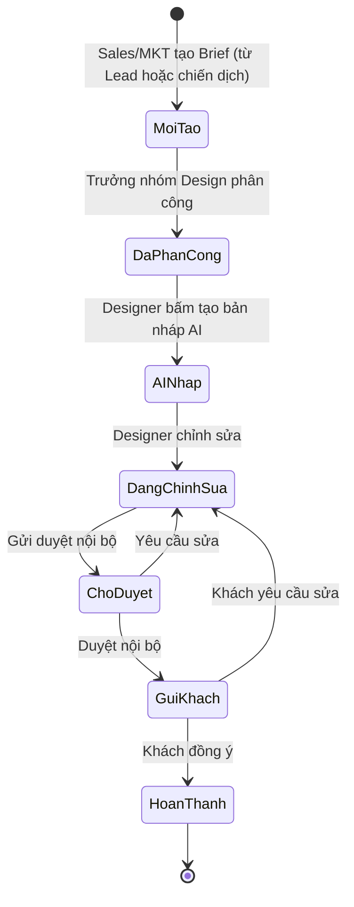
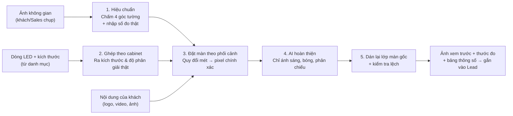
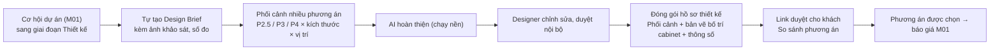

# M05 – AI hỗ trợ Design (Nhóm 5) ⭐ Trọng tâm

## 1. Mục tiêu

| Mục | Nội dung |
| :--- | :--- |
| **Yêu cầu nghiên cứu** | Design Brief; phân công Designer; AI tạo hình/banner; mockup LED; storyboard/video ngắn; Gemini/OpenAI; lưu kết quả; theo dõi trạng thái Design |
| **Mục đích cuối cùng** | Dùng AI giúp Designer **tạo bản nháp nhanh hơn**, sau đó Designer chỉnh sửa và hoàn thiện |
| **Đầu ra cần có** | Quy trình Design; AI/API đề xuất; dữ liệu đầu vào/ra; chức năng cần xây; giao diện Design dự kiến |

### Yêu cầu trực tiếp từ Marketing
> Dùng AI tạo ảnh sản phẩm sau lắp đặt: **khách gửi ảnh không gian**, dùng **sản phẩm của công ty phối vào không gian**, đưa ra **ảnh mẫu xem trước đúng tỉ lệ thật nhất**.

Module gồm **2 trụ cột**:
- **Trụ cột A – Quy trình Design:** Brief → phân công → AI nháp → Designer hoàn thiện → duyệt → gửi khách.
- **Trụ cột B – Phối cảnh LED đúng tỉ lệ thật** (yêu cầu ưu tiên của Marketing, phục vụ trực tiếp bán hàng).

---

## 2. Hiện trạng hệ thống

| Hạng mục | Đã có | Hạn chế |
| :--- | :--- | :--- |
| 3 chế độ: Banner, Storyboard, Mockup | ✅ Gọi Gemini | – |
| Mockup từ ảnh công trình | ✅ | ⚠️ **Không gửi kích thước màn** cho AI; AI **không biết tường rộng bao nhiêu mét** → màn to nhỏ tùy ý, **không đúng tỉ lệ** |
| Banner theo kích thước m × m | ⚠️ Chỉ ghi số đo vào câu lệnh | AI tạo ảnh không tính toán theo số đo; chữ tiếng Việt do AI vẽ dễ sai chính tả |
| Danh mục dòng LED | ⚠️ Chỉ có tên + đơn giá (dùng cho báo giá) | Thiếu **pitch, kích thước cabinet, viền, độ dày** |
| Lưu kết quả | ⚠️ Ghi tạm vào `AuditLog` | Chưa có bảng riêng, chưa có phiên bản, chưa gắn Lead |
| Design Brief, phân công Designer, trạng thái | ❌ | Chưa có |

---

## 3. Trụ cột A – Quy trình Design

### 3.1. Luồng công việc

### 3.2. Mẫu Design Brief (bắt buộc điền trước khi làm)
| Trường | Ví dụ |
| :--- | :--- |
| Loại yêu cầu | Phối cảnh LED / Banner nội dung màn / Storyboard video / Ấn phẩm MKT |
| Lead/khách liên kết | TT-LED-2610-0001 – Ánh Sáng Việt |
| Mục đích | Gửi khách duyệt trước khi ký hợp đồng |
| Thông số | Dòng LED, kích thước, tỉ lệ khung, độ phân giải |
| Tài liệu khách cung cấp | Ảnh không gian, logo, màu thương hiệu, nội dung chữ |
| Hạn cần | 24 giờ |
| Mức ưu tiên | Theo HOT/WARM/COLD của Lead |

### 3.3. Chức năng
| Chức năng | Mức |
| :--- | :--- |
| Tạo Brief từ hồ sơ Lead (tự điền thông tin khách, dòng LED trong báo giá) | Must |
| Phân công Designer theo tải công việc, nhận thông báo | Must |
| Bảng Kanban trạng thái Design + hạn chót (SLA) | Must |
| Lưu **phiên bản** (v1, v2…) và nhận xét từng phiên bản | Must |
| Designer tải file hoàn thiện (PSD/AI/PNG/MP4) | Must |
| Link xem trước gửi khách, khách bấm "Đồng ý / Yêu cầu sửa" | Should |
| Thư viện mẫu đã duyệt để tái sử dụng | Should |

### 3.4. Nguyên tắc dùng AI cho banner & storyboard
- **AI tạo nền/hình minh họa, chữ tiếng Việt đặt bằng mẫu (template)** → tránh lỗi chính tả, đúng font thương hiệu.
- Kích thước banner xuất theo **độ phân giải thật của màn** (tính từ dòng LED + kích thước), ví dụ màn 7,68 × 4,32 m P2.5 → **3072 × 1728 px**.
- Storyboard: AI viết kịch bản cảnh; giai đoạn sau mới thử AI tạo video ngắn (chi phí cao, cần đánh giá).

---

## 4. Trụ cột B – Phối cảnh LED đúng tỉ lệ thật ⭐

### 4.1. Vì sao không thể chỉ dùng AI
AI tạo ảnh **không hiểu đơn vị mét**. Câu lệnh "màn 8m × 4,5m" không có giá trị đo lường → mỗi lần tạo một kích thước khác. Giải pháp là **kết hợp hai lớp**:

> **Lớp tính toán quyết định kích thước & vị trí (chính xác tuyệt đối) – lớp AI chỉ làm ảnh trông thật (ánh sáng, đổ bóng, phản chiếu).**

### 4.2. Quy trình 5 bước

| Bước | Mô tả | Công nghệ |
| :--- | :--- | :--- |
| **1. Hiệu chuẩn** | Sales kéo 4 điểm góc tường/vùng lắp, nhập chiều rộng thật (và chiều cao nếu có). Giai đoạn sau AI gợi ý 4 góc, Sales chỉnh | Canvas trên trình duyệt |
| **2. Ghép cabinet** | Làm tròn kích thước theo cabinet thật. VD: muốn 8 × 4,5 m, P2.5 cabinet 640×480 mm → **12 × 9 cabinet = 7,68 × 4,32 m**, 3072 × 1728 px | Tính toán từ danh mục |
| **3. Đặt màn** | Tính phép biến đổi phối cảnh (homography) từ mặt tường (mét) sang ảnh (pixel); vẽ màn đúng kích thước tại vị trí "cách mép trái X m, cách sàn Y m", có viền, đường ghép cabinet, nội dung khách | Canvas / thư viện xử lý ảnh |
| **4. AI hoàn thiện** | Gửi ảnh đã ghép + vùng xung quanh màn cho AI chỉnh sửa ảnh, yêu cầu chỉ thêm ánh sáng hắt lên tường, đổ bóng, phản chiếu, cân màu | Gemini 2.5 Flash Image (đang dùng) hoặc OpenAI gpt-image-1 |
| **5. Kiểm soát** | Dán lại lớp màn gốc lên ảnh AI → **màn luôn đúng 100%**; nếu AI làm xô lệch bố cục quá ngưỡng → dùng ảnh bước 3 | So sánh vùng ảnh |

### 4.3. Đầu vào chuẩn

**a) Danh mục dòng LED (công ty chuẩn bị một lần – dùng chung với báo giá M01):**

| Trường | Ví dụ | Bắt buộc |
| :--- | :--- | :---: |
| Mã, tên dòng | P2.5-IN – LED P2.5 Indoor | ✅ |
| Pixel pitch (mm) | 2.5 | ✅ |
| Kích thước cabinet (mm) | 640 × 480 | ✅ |
| Kích thước module (mm) | 320 × 160 | ✅ |
| Độ dày, độ rộng viền (mm) | 80 / 15 | ✅ |
| Indoor/Outdoor, chuẩn IP | Indoor | ✅ |
| Độ sáng (nit), công suất (W/m²), trọng lượng (kg/m²) | 800 / 650 / 28 | Nên có |
| Ảnh cabinet thật (mặt trước, viền) | – | Nên có |
| Đơn giá/m² | 15,5 triệu | ✅ |

**b) Ảnh không gian – hướng dẫn chụp cho Sales/khách:**
- Chụp **thẳng chính diện**, máy ngang tầm mắt, **ống kính 1x** (không dùng góc rộng 0.5x).
- **Thấy đủ 4 góc** vùng lắp; lùi xa, có sàn và trần nếu được.
- Đủ sáng, không ngược sáng; gửi **ảnh gốc** (không nén qua Zalo).
- Nên có thêm 1 ảnh từ **vị trí khán giả đứng xem**.
- *(Khuyến nghị)* dán **tờ A4** lên tường khi chụp làm mốc kích thước.

**c) Số đo thực tế:**
| Trường | Mức |
| :--- | :---: |
| **Chiều rộng tường/vùng lắp (m)** | ✅ Bắt buộc |
| Chiều cao trần/vùng lắp (m) | Rất nên có (để đối chiếu sai số) |
| Khoảng cách xem gần nhất/xa nhất (m) | Nên có (tư vấn pitch) |
| Bề mặt, kết cấu, trong nhà/ngoài trời | Nên có |

**d) Yêu cầu màn:** dòng LED, kích thước mong muốn, vị trí (cách sàn, cách mép), kiểu lắp (treo tường/chân đứng/cong), viền ốp, **nội dung thật của khách**, bối cảnh (ngày/đêm/sự kiện).

### 4.4. Đầu ra gửi khách
- Ảnh phối cảnh độ phân giải cao, **có thước đo** (chiều rộng, chiều cao, khoảng cách sàn) – có bản có thước và bản không thước.
- Bảng thông số: dòng LED, số cabinet, kích thước thật, độ phân giải, khoảng cách xem tối thiểu, công suất, trọng lượng.
- Ghi chú "Ảnh minh họa theo số liệu khảo sát".
- Tự lưu vào hồ sơ Lead, liên kết báo giá cùng thông số.

### 4.5. Độ chính xác & giới hạn
- Đo đúng + tường phẳng: sai số khoảng **±3–5%**.
- Sai số tăng khi: ảnh góc rộng, tường cong/không phẳng, chụp xiên nhiều. Hệ thống **cảnh báo** khi 2 số đo đối chiếu lệch > 5%.
- AI ước lượng chiều sâu từ một ảnh chỉ dùng để gợi ý, **không dùng để đo**.

---

## 5. Lựa chọn AI/API

| Nhu cầu | Đề xuất | Ghi chú |
| :--- | :--- | :--- |
| Hoàn thiện ánh sáng phối cảnh, chỉnh sửa ảnh | **Gemini 2.5 Flash Image** (đang tích hợp) | Rẻ, nhanh; dự phòng: OpenAI gpt-image-1 |
| Tạo nền banner, hình minh họa | Gemini / Imagen | Chữ đặt bằng template |
| Kịch bản storyboard, mô tả kỹ thuật | Gemini 2.5 Flash (văn bản) | Đã có |
| Gợi ý 4 góc tường | Gemini (trả tọa độ) hoặc mô hình phân vùng ảnh | Sales luôn xác nhận lại |
| Video ngắn | Đánh giá sau (Veo…) | Chi phí cao |

**Kiểm soát chi phí:** hạn mức số lần tạo/người/ngày, lưu cache kết quả, chỉ gọi AI ở bước 4 (bước 1–3 chạy trên trình duyệt, không tốn phí).

## 6. Dữ liệu đề xuất
| Bảng | Trường chính |
| :--- | :--- |
| `DesignBrief` | loại, leadId, mục đích, thông số, hạn, ưu tiên, trạng thái, người tạo, Designer |
| `DesignVersion` | briefId, số phiên bản, file, nguồn (AI/Designer), nhận xét, trạng thái duyệt |
| `MockupSpec` | ảnh gốc, 4 góc, số đo tham chiếu, dòng LED, số cabinet, kích thước thật, vị trí, sai số ước tính |
| `LedProductSeries` (Core – dùng chung) | mã, pitch, cabinet, module, viền, độ dày, độ sáng, công suất, trọng lượng, đơn giá |

> Thay việc ghi tạm vào `AuditLog` bằng các bảng riêng (migration giữ nguyên dữ liệu cũ).

## 7. Giao diện dự kiến
1. **Kanban Design**: cột theo trạng thái, thẻ hiển thị hạn chót, Designer, Lead.
2. **Trình tạo phối cảnh**: tải ảnh → chấm 4 góc → chọn dòng LED & kích thước → kéo thả vị trí màn → xem trước tức thì → "Hoàn thiện bằng AI".
3. **Trang Brief**: thông tin yêu cầu, các phiên bản, bình luận, nút gửi khách.
4. **Link xem trước cho khách**: ảnh + thông số + nút đồng ý/yêu cầu sửa.

## 8. KPI đo hiệu quả
| KPI | Mục tiêu gợi ý |
| :--- | :--- |
| Thời gian từ Brief đến bản nháp đầu | < 30 phút (phối cảnh), < 4 giờ (banner) |
| Số lần chỉnh sửa trung bình | ≤ 2 |
| Thời gian Sales tự tạo phối cảnh | < 10 phút/công trình |
| **Tỉ lệ chốt của Lead có phối cảnh so với không có** | Theo dõi để chứng minh hiệu quả |
| Chi phí AI/tháng | Trong ngân sách đặt trước |

## 9. Liên kết với module khác
- **M01:** tạo Brief từ Lead; ảnh phối cảnh và thông số trả về hồ sơ Lead; dùng chung danh mục dòng LED với báo giá; hành vi "khách yêu cầu phối cảnh" cộng điểm tiềm năng.
- **M03:** ảnh/banner đã duyệt dùng làm mẫu quảng cáo; đo mẫu nào hiệu quả.
- **M04:** báo cáo số yêu cầu, thời gian xử lý, hiệu quả chốt đơn.

## 10. Lộ trình
| Giai đoạn | Nội dung | Kết quả |
| :--- | :--- | :--- |
| **GĐ1 (2 tuần)** | Danh mục dòng LED đủ thông số; trình tạo phối cảnh (chấm góc, ghép cabinet, đặt màn đúng tỉ lệ, thước đo) – **chưa cần AI**; lưu vào Lead | Đã đúng tỉ lệ thật |
| **GĐ2 (2 tuần)** | AI hoàn thiện ánh sáng + dán lại lớp màn gốc; Design Brief, phân công, Kanban, phiên bản | Ảnh trông thật, quy trình Design có kiểm soát |
| **GĐ3** | AI gợi ý góc tường; link duyệt cho khách; thư viện mẫu; thử nghiệm video | Thao tác nhanh, khách tự duyệt |

## 11. Rủi ro
- Khách/Sales chụp ảnh không đúng chuẩn → hướng dẫn chụp ngay trong ứng dụng, cảnh báo ảnh mờ/góc rộng.
- Khách hiểu ảnh là cam kết chính xác tuyệt đối → luôn ghi chú "minh họa theo số liệu khảo sát".
- AI thay đổi chính sách/giá → thiết kế lớp kết nối AI dùng chung (`core/ai`) để đổi nhà cung cấp dễ dàng.

## 12. Câu hỏi cần chốt
1. Danh sách dòng LED chính thức kèm kích thước cabinet từng dòng?
2. Ai được tạo phối cảnh: chỉ Designer hay cả Sales tự làm?
3. Bộ phận Design hiện có bao nhiêu người, nhận yêu cầu qua kênh nào?
4. Có cần đóng dấu logo Toàn Trung lên ảnh gửi khách không?
5. Ngân sách AI hằng tháng tối đa?

---

## 13. NÂNG CẤP CHO DỰ ÁN LỚN

> Dự án LED lớn cần **nhiều phương án để khách so sánh**, **bộ hồ sơ thiết kế để nộp thầu**, và hệ thống phải **xử lý nhiều yêu cầu AI cùng lúc** mà không chậm hay vượt ngân sách.

### 13.1. Luồng thiết kế cho Cơ hội dự án lớn

### 13.2. Bảng nâng cấp chi tiết
| # | Hạng mục | Nội dung | Mức |
| :---: | :--- | :--- | :---: |
| 1 | **Nhiều phương án trên một không gian** | Hiệu chuẩn ảnh một lần, tạo nhiều phương án (dòng LED, kích thước, vị trí, kiểu lắp); xem song song; mỗi phương án liên kết một phương án báo giá M01 | Must |
| 2 | **Tác vụ AI chạy nền** | Yêu cầu vào hàng đợi → trạng thái "đang xử lý" → thông báo khi xong; giới hạn số yêu cầu đồng thời; tự thử lại khi lỗi | Must |
| 3 | **Kho tài sản thiết kế** | Lưu trên object storage; phiên bản; phân quyền theo dự án; tìm kiếm theo dòng SP, loại công trình, khách | Must |
| 4 | **Bản vẽ bố trí cabinet** | Tự sinh sơ đồ lưới cabinet (số hàng × cột, kích thước, vị trí bộ xử lý) từ thông số phương án | Must |
| 5 | **Bộ hồ sơ thiết kế gửi thầu** | Xuất PDF: trang bìa, phối cảnh các phương án, bản vẽ bố trí, bảng thông số, ghi chú kỹ thuật | Should |
| 6 | **Link duyệt cho khách** | Khách xem/so sánh phương án, bình luận, bấm chọn phương án; hết hạn sau N ngày | Should |
| 7 | **Quản lý chi phí AI** | Hạn mức theo người/ngày và theo dự án; cache kết quả; báo cáo chi phí AI/tháng; đổi nhà cung cấp qua `core/ai` | Must |
| 8 | **Phân công Designer theo năng lực** | Dự án lớn giao Designer cấp cao; cân bằng tải; SLA theo mức ưu tiên Cơ hội | Should |
| 9 | **Thư viện mẫu theo loại công trình** | Hội trường, sân khấu, mặt tiền, showroom, sân vận động – tái sử dụng bố cục, nội dung | Could |
| 10 | **Mô phỏng ngày/đêm & khoảng cách xem** | Cùng phương án xem ở điều kiện ánh sáng khác nhau, từ các vị trí khán giả | Could |

### 13.3. Dữ liệu bổ sung
| Bảng | Trường chính |
| :--- | :--- |
| `MockupScene` | ảnh gốc, 4 góc, số đo tham chiếu, sai số ước tính, opportunityId/leadId |
| `MockupOption` | sceneId, dòng LED, số cabinet hàng × cột, kích thước thật, vị trí, kiểu lắp, ảnh kết quả, quoteOptionId |
| `DesignJob` | loại (AI/xuất PDF), trạng thái hàng đợi, số lần thử, chi phí AI, thời gian xử lý |
| `DesignAsset` | file, loại, phiên bản, dự án, thẻ phân loại |
| `ClientReviewLink` | mã link, hạn, phương án được chọn, bình luận khách |

### 13.4. Sự kiện
| Nhận | Phát |
| :--- | :--- |
| `OpportunityStageChanged` = Thiết kế (M01) → tự tạo Brief | `MockupCompleted`, `DesignApproved`, `ClientOptionSelected` (→ M01 cập nhật phương án báo giá, cộng điểm tiềm năng; → M04 báo cáo) |

### 13.5. KPI quy mô lớn
| KPI | Mục tiêu |
| :--- | :--- |
| Thời gian tạo bộ phương án cho dự án lớn | < 1 ngày làm việc |
| Thời gian xuất hồ sơ thiết kế gửi thầu | < 10 phút |
| Tỉ lệ thắng Cơ hội có hồ sơ thiết kế so với không có | Đo để chứng minh hiệu quả |
| Chi phí AI trên mỗi dự án | Trong hạn mức đặt trước |
| Tỉ lệ yêu cầu AI lỗi / timeout | < 2% |

### 13.6. Lộ trình nâng cấp
| Giai đoạn | Nội dung |
| :--- | :--- |
| GĐ1 (tuần 1–4) | Danh mục LED đầy đủ, phối cảnh đúng tỉ lệ (1 phương án), lưu vào Lead |
| GĐ2 (tuần 5–8) | Nhiều phương án, AI chạy nền, Brief – Kanban – phiên bản, kho tài sản, bản vẽ bố trí cabinet |
| GĐ3 (tuần 9+) | Hồ sơ gửi thầu PDF, link duyệt cho khách, thư viện mẫu, mô phỏng ngày/đêm |
