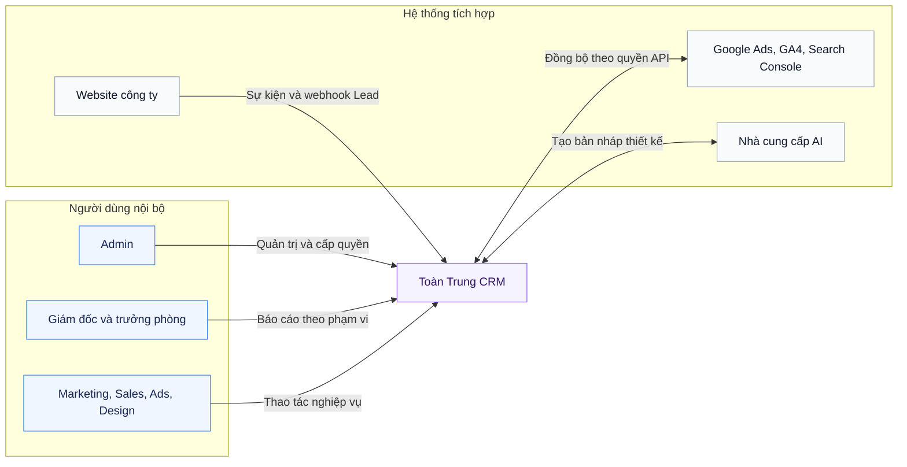
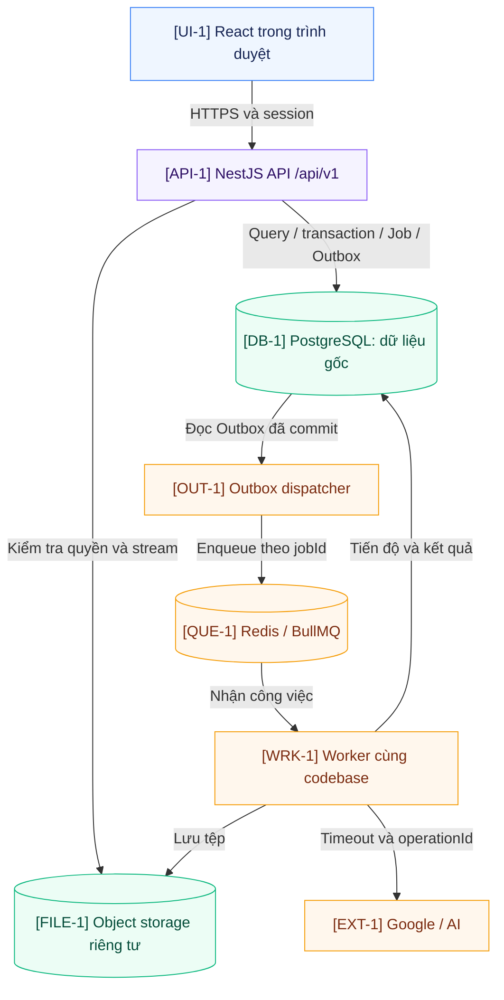
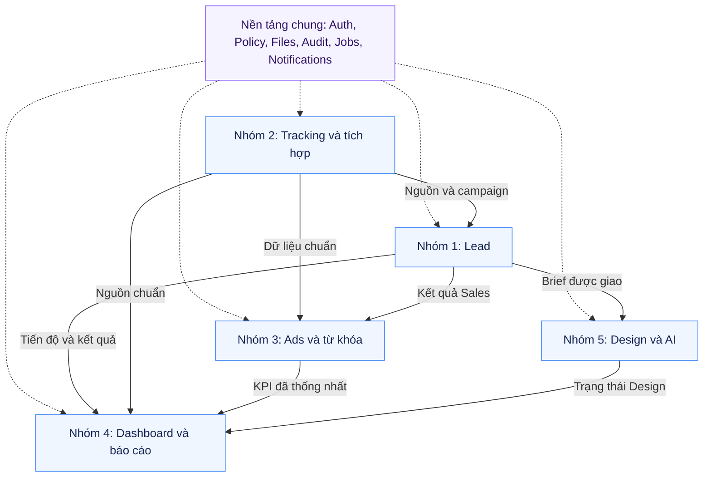
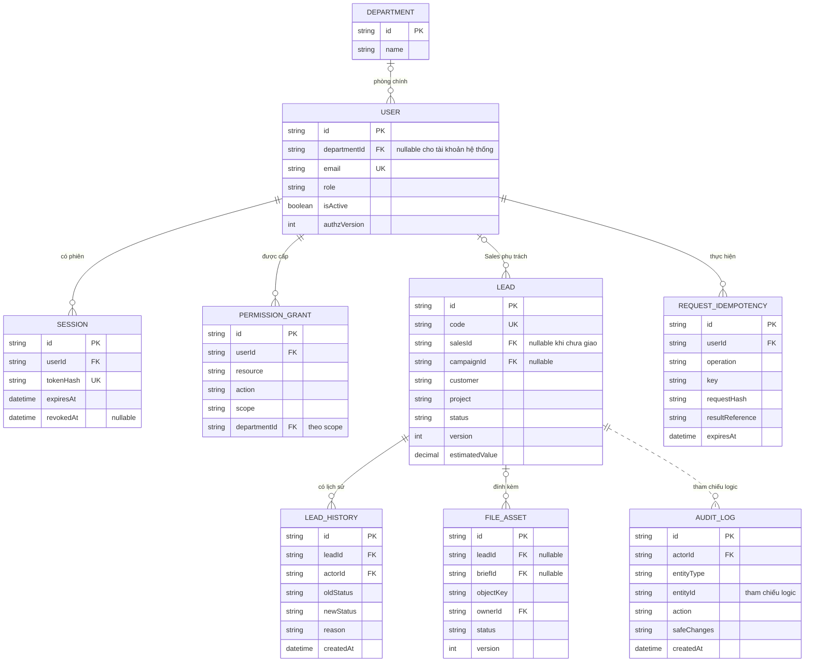
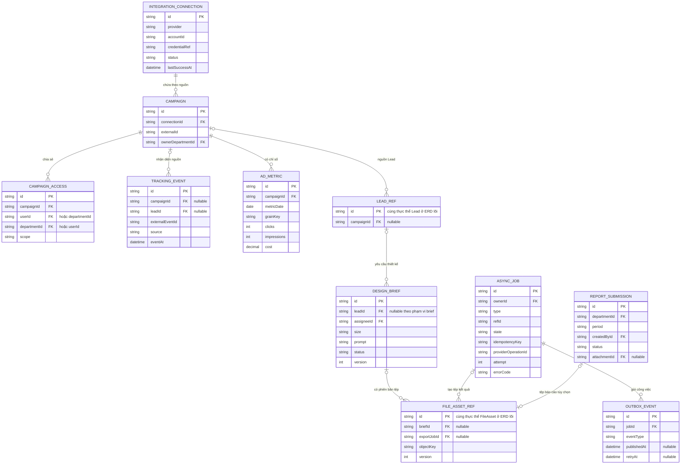
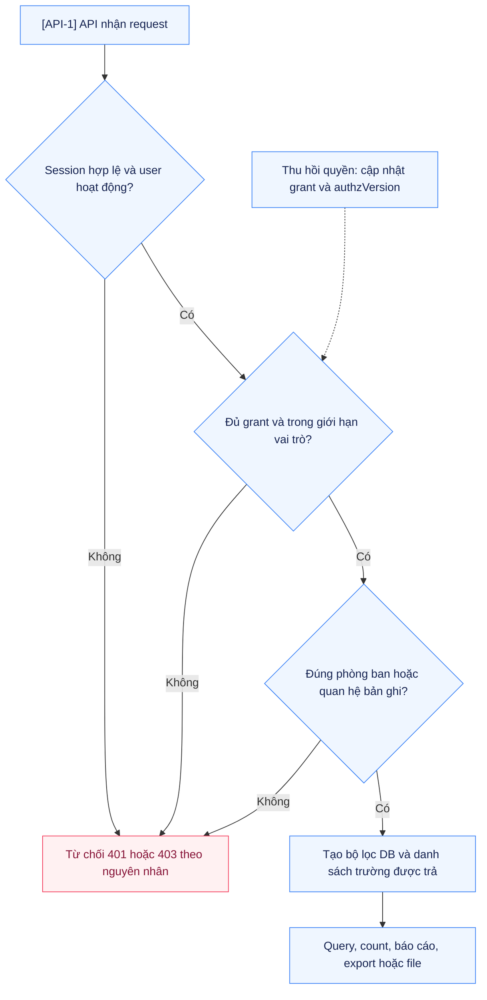
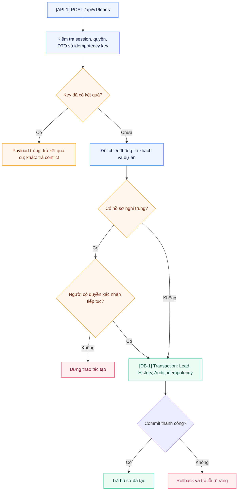
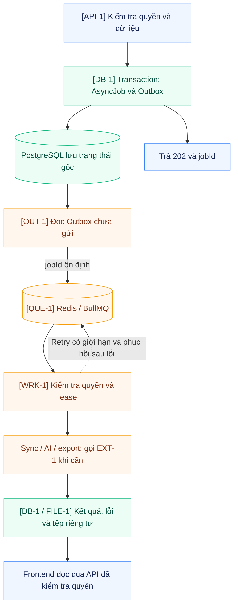

# Kiến trúc hệ thống Toàn Trung

**Bản kỹ thuật theo bố cục v1 · 31/10/2026**

Giữ đầy đủ phạm vi hệ thống, kiến trúc ứng dụng, ranh giới 5 module, hai ERD, phân quyền, giao dịch Lead và công việc nền của v1. Phần bổ sung tập trung vào khóa/index, transaction, request/job, điểm quan sát và cách chứng minh nguyên nhân lỗi.

Đây là thiết kế đích để đối chiếu source local mới nhất. Quan sát website ở v1 chỉ tới trang đăng nhập; bản này không kiểm chứng lại backend, cấu hình Render hay tải thực tế. Công nghệ/phần chưa có bằng chứng trong code vẫn là đề xuất.

| Muốn xem | Mục |
| --- | --- |
| Ai dùng hệ thống, kết nối với bên nào | 1 |
| Thành phần chạy và nơi bắt đầu tìm lỗi | 2–3 |
| Bảng, quan hệ, khóa, index và quyền dữ liệu | 4–5 |
| Lead lưu/cập nhật hoặc AI/sync chạy ra sao | 6–7 |
| Deploy, file, log, đo tải và kiểm thử lỗi | 8–9 |
| Ghép nhóm, mở rộng và đối chiếu với code | 10 |

### Công nghệ đã chọn và thành phần đề xuất

| Lớp | Công nghệ | Trạng thái |
| --- | --- | --- |
| Frontend | React, Vite, TypeScript, Tailwind CSS, shadcn/ui | Nhóm đã chọn |
| Thư viện frontend | React Router, TanStack Query, Axios, Zod, Recharts, Lucide | Theo lựa chọn đã trao đổi |
| Backend | NestJS, TypeScript | Nhóm đã chọn |
| Database và ORM | PostgreSQL, Prisma | Đề xuất, cần đối chiếu database local |
| Tác vụ nền | Redis, BullMQ, worker cùng codebase NestJS, Transactional Outbox | Đề xuất |
| Tệp | Object storage riêng tư và metadata trong PostgreSQL | Đề xuất |

Phiên bản thư viện và dịch vụ cụ thể phải lấy từ source/lockfile thực tế hoặc được nhóm chốt khi triển khai; tài liệu không tự ấn định phiên bản.

## 1. Phạm vi hệ thống

Quản lý Lead; Tracking và đồng bộ; Ads và từ khóa; Dashboard và báo cáo; AI hỗ trợ Design. Thành phần chung gồm tài khoản, phòng ban, cấp quyền, nhận diện/tài sản thương hiệu, upload, thông báo và audit. Khách hàng là dữ liệu được quản lý. V1 giả định mỗi nhân sự thuộc một phòng chính; quyền làm việc liên phòng được cấp có phạm vi.

### Sơ đồ 01 — Phạm vi hệ thống



### Actor, dữ liệu và hệ thống bên ngoài

| Thành phần | Vai trò trong phạm vi |
| --- | --- |
| Marketing, Sales, Ads, Design | Nhân sự thao tác nghiệp vụ theo quyền và bản ghi được giao/chia sẻ |
| Trưởng phòng | Giao việc/duyệt khi được cấp, báo cáo của phòng mình |
| Giám đốc và Admin | Giám đốc xem báo cáo theo grant; Admin quản trị tài khoản, cấp quyền và cấu hình theo permission |
| Dữ liệu khách hàng | Hồ sơ khách/công ty/dự án được quản lý trong Lead; không phải tài khoản sử dụng hệ thống |
| Website công ty | Gửi tracking event và webhook Lead qua hai cơ chế tiếp nhận riêng |
| Google Ads, GA4, Search Console | Nguồn ngoài, được đồng bộ qua tài khoản/quyền API phù hợp |
| Nhà cung cấp AI | Nhận tác vụ tạo bản nháp; Designer kiểm tra và hoàn thiện kết quả |

Phạm vi chức năng gồm 5 module, phân quyền, file/brand assets, thông báo và lịch sử. Khi mở rộng chức năng mới, cập nhật actor, use case, dữ liệu và quan hệ với các module hiện có.

### Điểm cần kiểm soát ở ranh giới hệ thống

| Điểm vào | Kiểm soát kỹ thuật | Dấu hiệu cần kiểm tra |
| --- | --- | --- |
| Trình duyệt → API | Session, CSRF cho mutation, DTO, scope/phòng/bản ghi | 401/403, sai scope, request không tới đúng route |
| Website → collector | Dữ liệu chưa tin cậy, validate/rate-limit/chống trùng | Event rác, eventId trùng, nguồn không nhận diện được |
| Server website → webhook Lead | Chữ ký, timestamp và eventId chống replay; secret ở server | Chữ ký sai, request quá hạn, gửi lại tạo nhiều Lead |
| Worker → Google/AI | Credential server, timeout, hạn mức, phân loại retry | 401/403/quota từ nguồn, timeout, chưa rõ kết quả AI |

Origin của collector là lớp lọc, không chứng minh người gửi đáng tin. Tracking event không được tự coi là Sales đã chốt thành công.

## 2. Kiến trúc ứng dụng và triển khai

### Sơ đồ 02 — Kiến trúc ứng dụng và lưu trữ



### Cách đọc sơ đồ

Browser chạy React và chỉ gọi API. Nest kiểm tra session, quyền và dữ liệu trước khi làm việc với DB hoặc storage. Worker cùng codebase đọc Outbox, dùng hàng đợi và gọi dịch vụ ngoài. Credentials Google/AI chỉ đặt phía server; phía FE chỉ biết trạng thái kết nối và kết quả được phép xem.

Frontend và backend vẫn tách source, build và giao tiếp bằng API. Đề xuất triển khai cùng origin là lựa chọn v1 để giảm lỗi cookie/CORS; nếu nhóm bắt buộc tách thành hai dịch vụ public, cần chốt reverse proxy/origin và cơ chế cookie trước khi triển khai. Không giả định hai host *.onrender.com tự chia sẻ cookie.

Frontend build được phục vụ cùng origin với API trong phương án triển khai đầu. Sơ đồ thể hiện thành phần chạy và đường trao đổi dữ liệu; DB là nơi lưu dữ liệu, dispatcher chủ động đọc Outbox. Worker/dispatcher cùng codebase backend, có thể được tổ chức trong một process worker.

### Bản đồ điểm quan sát

Các mã trong sơ đồ là **vị trí kiểm tra**, không phải tên dịch vụ mới phải xây thêm.

| Mã | Cần quan sát | Khi có vấn đề |
| --- | --- | --- |
| `UI-1` | Network, payload, trạng thái query và render | Không gửi request; API đúng nhưng UI cũ; tải quá nhiều dữ liệu |
| `API-1` | requestId, action, kết quả xác thực/quyền/validation, duration | 400/401/403/404/409/500; request lặp hoặc xử lý chậm |
| `DB-1` | Transaction, số dòng cập nhật, version, constraint và query duration | Mất lịch sử, conflict, ghi trùng hoặc query chậm |
| `OUT-1` | Outbox chưa gửi, số lần thử và thời điểm dispatch | API đã trả 202 nhưng công việc chưa được đưa vào queue |
| `QUE-1` | Job waiting/active/failed và thời gian chờ | Job đã enqueue nhưng chưa có worker xử lý |
| `WRK-1` | jobId, attempt, lease/heartbeat và providerOperationId | Job treo, nhận lại job hoặc timeout phía nhà cung cấp |
| `FILE-1` | FileAsset, objectKey, trạng thái upload và quyền tải | Metadata có nhưng object thiếu; upload chưa hoàn tất; download bị từ chối |
| `EXT-1` | HTTP/status của nguồn, quota, timeout, lần thành công gần nhất | Google/AI lỗi; tránh biến dữ liệu thiếu thành 0 |

Một request có requestId; job lưu requestId nguồn/correlation phù hợp và có jobId riêng để tìm tiếp sau khi HTTP đã kết thúc. API/worker ghi releaseId để biết bản code đang chạy khi lỗi xuất hiện.

### Các quyết định nền tảng giữ từ v1

| Quyết định | Mục đích và giới hạn |
| --- | --- |
| Một backend chia module | Một codebase NestJS; ranh giới module rõ; API và worker có thể chạy thành hai process. Giảm số dịch vụ phải tự phối hợp. |
| Dữ liệu gốc ở PostgreSQL | Trạng thái Lead, quyền, session, chỉ số nhập, job và audit nằm trong DB. Redis phục vụ hàng đợi, không thay thế dữ liệu nghiệp vụ. |
| Frontend và API cùng origin | Tách source/build FE và BE. V1 đề xuất Nest phục vụ FE build và /api/v1 trên cùng host để đơn giản hóa cookie và vận hành. |
| Công việc lâu chạy nền | Đồng bộ, xuất dữ liệu lớn và AI dùng AsyncJob + Outbox; UI nhận jobId và theo dõi tiến độ. |
| Quyền nằm ở server | Grant, phòng ban và quan hệ với bản ghi quyết định quyền; bộ lọc áp dụng trước truy vấn, tổng hợp, xuất và tải tệp. |
| Lưu tệp bền vững | File riêng tư ở object storage, metadata ở DB; API kiểm tra quyền trước khi stream tệp. Logo công khai được quản lý riêng. |

## 3. Ranh giới module, source và hợp đồng API

| Nhóm | Sở hữu dữ liệu và chức năng | Cung cấp hoặc sử dụng |
| --- | --- | --- |
| 1 Lead | Hồ sơ Lead/dự án, phân công Sales, trạng thái, lý do, lịch sử và liên kết tài liệu. | Cấp tiến độ cho Reports/Ads; gửi yêu cầu cho Design; liên kết campaign từ Tracking. |
| 2 Tracking | Tài khoản tích hợp, Campaign, quyền chia sẻ campaign, sự kiện, tiến trình đồng bộ và dữ liệu nguồn chuẩn hóa. | Là đầu mối connector Google. Cung cấp dữ liệu chuẩn cho Ads và Reports. |
| 3 Ads | Từ khóa, định nghĩa chỉ số, ngân sách và dịch vụ phân tích. | Dùng nguồn chuẩn nhóm 2 và kết quả Lead nhóm 1; thống nhất KPI với nhóm 4. |
| 4 Reports | Định nghĩa truy vấn báo cáo, bộ lọc, báo cáo nộp theo phòng và export. | Tổng hợp trên nguồn dữ liệu gốc; không duy trì bộ Lead/Ads nhập lại riêng. |
| 5 Design | Design Brief, phân công Designer, yêu cầu AI, phiên bản và tài sản đầu ra. | Dùng hồ sơ/tệp được giao và bộ nhận diện chung; ghi kết quả về đúng brief. |
| Nền tảng | Auth, AccessPolicy, Files, Jobs/Outbox, Audit, Notifications, cấu hình và migration chung. | Lead giao một đầu mối kỹ thuật chịu trách nhiệm; các nhóm đóng góp qua review. |

### Sơ đồ 03 — Ranh giới năm module



### API đề xuất ở mức hợp đồng

| Nhóm route | Ví dụ và quy tắc |
| --- | --- |
| `/api/v1/auth/*`, `/api/v1/me` | Đăng nhập/đăng xuất, CSRF, session và quyền hiện tại; lỗi 401 khác 403. |
| `/api/v1/leads/*` | Danh sách phân trang; tạo với idempotency key; cập nhật có version; status/assign bắt buộc lý do theo nghiệp vụ. |
| `/api/v1/campaigns/*`, `/api/v1/integrations/*` | Dữ liệu được cấp quyền; trạng thái/lần đồng bộ; tạo job đồng bộ thay vì chờ lâu trên request. |
| `/collector/events`, `/webhooks/leads` | Ingress tách rõ: sự kiện public bị xem là dữ liệu chưa tin cậy; webhook Lead từ server website xác thực chữ ký, thời gian và chống replay. |
| `/api/v1/ads/*`, `/api/v1/reports/*` | Khoảng ngày, timezone, bộ lọc và quyền nhất quán; dashboard và export dùng cùng định nghĩa. |
| `/api/v1/design/*`, `/api/v1/jobs/*` | Brief, phiên bản và AI job; trả 202 + jobId cho xử lý lâu; GET tiến độ có kiểm tra chủ sở hữu/phạm vi. |
| `/api/v1/files/*`, `/api/v1/admin/*` | Upload/download theo quyền bản ghi; Admin quản lý tài khoản/grant và nhận diện theo quyền riêng. |

Các nhóm route trên là đề xuất; ký hiệu `/*` bao gồm route gốc và các route con phù hợp. Mỗi hợp đồng ghi method, URL, permission/scope, request/response, lỗi, phân trang, trường được trả và test case. OpenAPI là điểm tham chiếu cho 5 nhóm. Chọn một cách validation ở backend; frontend có thể dùng Zod nhưng server vẫn kiểm tra độc lập. Route cũ cần adapter hoặc kế hoạch chuyển đổi khi đối chiếu source local.

### Ranh giới source và hướng gọi

Sơ đồ 03 mô tả **luồng dữ liệu nghiệp vụ**. Hướng import phải giữ một chiều: Tracking dùng nền tảng; Lead dùng contract campaign hẹp của Tracking; Design đọc Lead; Ads đọc Tracking/Lead; Reports đọc các contract tổng hợp. Controller webhook Lead thuộc Lead; Tracking không import ngược LeadService.

Module khác chỉ gọi service được export công khai. Repository và Prisma model nội bộ không được truyền sang module khác hoặc frontend. Reports dùng query theo lô/aggregate hoặc view đọc có owner/scope được review, tránh một query cho mỗi dòng.

| Đường dẫn đề xuất | Trách nhiệm |
| --- | --- |
| `apps/web/src/features/<module>/` | Pages, form, hook/query và API adapter của module |
| `apps/web/src/shared/` | UI, HTTP client, chuẩn lỗi và theme light/dark dùng chung |
| `apps/server/src/modules/<module>/` | Controller → service/use case → repository; policy và DTO của module |
| `apps/server/src/platform/` | Auth, quyền, Database, Files, Jobs/Outbox, Audit và config |
| `apps/server/src/main.ts`, `main.worker.ts` | Khởi động API và worker từ cùng codebase |
| `apps/server/prisma/` | Schema và migration chung có đầu mối review |
| `docs/modules/<module>.md` | Owner, dữ liệu, public contract, dependency và cách kiểm tra lỗi |

Ví dụ với Lead: controller xử lý HTTP; service quyết định transaction và quy tắc trạng thái; policy tạo DB scope/projection; repository update có scope/version; DTO kiểm tra request/response. Khi hai module phải cùng ghi trong một giao dịch, chỉ định use case điều phối và transaction context rõ ràng. Hiệu ứng Google/AI/thông báo chạy sau commit.

Một DB account dùng chung chưa tự tạo cách ly giữa module. Review/CI cần kiểm tra import vòng, deep import và truy cập bảng ngoài ownership.

## 4. Kiến trúc dữ liệu và ràng buộc

ERD dưới đây là mô hình logic cốt lõi; schema vật lý, tên trường và migration được chốt sau khi kiểm kê bản local. Những trường dưới đây nêu ràng buộc cần giữ, không thay thế việc đối chiếu dữ liệu hiện hữu.

| Thực thể | Trường hoặc quy tắc quan trọng |
| --- | --- |
| User và Department | Email unique; isActive; role Admin/Director/Manager/Staff; departmentId; authzVersion. Nhân sự theo phòng chính; tài khoản cấp toàn hệ thống có thể không gắn phòng. |
| Session | Token ngẫu nhiên; DB chỉ lưu tokenHash unique, userId, hạn và trạng thái thu hồi. Truy vấn session/grant có index phù hợp. |
| PermissionGrant | userId, resource, action, scope, departmentId và người cấp; allow-list, mặc định từ chối. Role phục vụ template và giới hạn nghiệp vụ, không tự suy ra toàn quyền. |
| Lead | ID nội bộ và code unique; salesId, campaignId tùy chọn; trạng thái, version; thông tin khách/dự án và giá trị dự kiến có kiểu số. |
| LeadHistory và AuditLog | Actor, thời gian, thay đổi và lý do. Ghi cùng transaction với thay đổi nghiệp vụ; không ghi password, token hoặc toàn bộ payload nhạy cảm. |
| RequestIdempotency | Khóa theo user + operation + key; requestHash và kết quả; cùng key khác payload trả conflict. Xử lý đồng thời bằng ràng buộc DB. |
| Campaign và kết nối | IntegrationConnection giữ provider/account, credentialRef, trạng thái và lần sync tốt. Campaign unique theo nguồn; CampaignAccess chia sẻ cho user/phòng. Refresh token được bảo vệ phía server. |
| TrackingEvent và AdMetric | Khóa sự kiện và khóa hạt dữ liệu unique. Chỉ số ngày/keyword/campaign được upsert theo grain đã định nghĩa; không cộng lại sau mỗi lần đồng bộ. |
| DesignBrief và FileAsset | Liên kết Lead, người giao/nhận, kích thước và trạng thái. File có objectKey, owner, phiên bản và liên kết bản ghi hợp lệ. |
| AsyncJob và OutboxEvent | Job có owner/ref, state, attempt và providerOperationId; Outbox có jobId/eventType/publishedAt để khôi phục việc gửi queue sau lỗi. |
| ReportSubmission | Phòng sở hữu, kỳ báo cáo, người tạo, trạng thái nộp và tệp tùy chọn. Số liệu tổng hợp vẫn lấy từ nguồn đã chuẩn hóa. |

### Sơ đồ 04 — ERD logic tài khoản và Lead



### Sơ đồ 05 — ERD logic tích hợp và công việc nền



### Lưu ý khi đọc hai ERD

- `LEAD_REF` và `FILE_ASSET_REF` là ký hiệu tham chiếu đến `LEAD` và `FILE_ASSET` ở sơ đồ lõi; không tạo thêm bảng chỉ vì tên trong sơ đồ khác nhau.
- Kiểu `string`, `datetime`, `decimal` ở đây là kiểu logic. Kiểu vật lý, nullability, tên bảng và chính sách xóa cần đối chiếu source local.
- Các trường có ghi `nullable` biểu thị quan hệ tùy chọn. ERD chỉ hiển thị một phần foreign key để dễ đọc; ví dụ `actorId` và `createdById` tham chiếu User.
- Khóa idempotency là unique tổ hợp `(userId, operation, key)`, không phải unique riêng từng trường.
- Campaign unique theo phạm vi nguồn/kết nối, ví dụ `(connectionId, externalId)` khi connector bảo đảm externalId unique trong phạm vi đó.
- CampaignAccess phải chỉ rõ chia sẻ theo user hoặc phòng; dùng ràng buộc phù hợp để tránh bản ghi không có đối tượng nhận hoặc có hai đối tượng mâu thuẫn.
- AdMetric unique theo khóa hạt dữ liệu đầy đủ đã chốt, gồm campaign, ngày và các chiều nguồn/keyword/device cần thiết; không gộp các chiều không tương thích.
- AuditLog là nhật ký nhiều loại thực thể. `entityId` là tham chiếu logic; không mặc định coi nó là foreign key duy nhất tới Lead.
- FileAsset có liên kết bản ghi hợp lệ và quyền thừa hưởng rõ ràng. Tệp nộp báo cáo có thể tham chiếu bằng `ReportSubmission.attachmentId`; không công khai objectKey.
- Tính bắt buộc của liên kết DesignBrief → Lead cần BA chốt nếu cho phép brief độc lập; luồng thiết kế từ Lead phải giữ liên kết và quyền phù hợp.

### Những quy tắc cần thống nhất

- Tên/SĐT/công ty trùng là tín hiệu cảnh báo, không phải unique constraint cấm một khách có nhiều dự án.

- Tiền dùng numeric/decimal hoặc đơn vị nguyên đã thống nhất; API trả giá trị máy đọc được. Phân biệt giá trị dự kiến, chốt thành công và doanh thu thực thu.

- Lưu thời điểm chuẩn UTC; báo cáo quy đổi theo Asia/Ho_Chi_Minh với khoảng đầu ngày đến trước đầu ngày kế tiếp.

- Dùng foreign key, unique, check và transaction cho quy tắc phù hợp. Index được bổ sung theo truy vấn, bộ lọc quyền và kết quả đo.

### Thiết kế khóa, index và truy vấn cần đo

Đây là ứng viên thiết kế, không phải danh sách index để tạo hàng loạt. Kiểm tra query thực tế, scope và execution plan trước khi chốt migration.

| Truy vấn hoặc ràng buộc | Khóa/index ứng viên | Điều cần xác minh |
| --- | --- | --- |
| Session theo token | `Session(tokenHash)` unique | Truy vấn một phiên; không log token gốc |
| Danh sách Lead của Sales | `Lead(salesId, createdAt, id)`; bổ sung status nếu phù hợp query | Scope được đẩy xuống DB; sort có id làm tie-breaker |
| Lịch sử Lead | `LeadHistory(leadId, createdAt, id)` | Phân trang/thứ tự ổn định, không query từng dòng trong bảng Lead |
| Tạo lại cùng thao tác | Unique `(userId, operation, key)` trong RequestIdempotency | Cùng key/payload trả một kết quả; khác payload conflict; xử lý race bằng DB |
| Campaign ngoài hệ thống | Unique `(connectionId, externalId)` nếu connector bảo đảm phạm vi này | Không nhầm cùng externalId của hai tài khoản/nguồn |
| Metric đồng bộ | Unique theo campaign, ngày và đầy đủ grain/dimensions nguồn đã chốt | Replay upsert không cộng trùng; không trộn Ads/GA4/GSC khác nghĩa |
| Outbox chờ gửi | Index theo điều kiện unpublished và thời điểm được retry | Không quét toàn bảng khi Outbox/history tăng |

Đối với scope phòng ban, phải chốt quyền sở hữu phòng của bản ghi. Có thể cần trường `ownerDepartmentId` hoặc quan hệ sở hữu phù hợp; không tự suy lịch sử từ phòng hiện tại của nhân viên khi họ đã chuyển phòng. Trường/schema/index liên quan cần đối chiếu dữ liệu local trước migration.

### Các bất biến để phát hiện dữ liệu sai

| Bất biến | Cách phát hiện |
| --- | --- |
| Lead thay đổi thì có history và audit bắt buộc | Test rollback giữa transaction; đối chiếu lịch sử khi điều tra một request |
| Mã Lead không trùng | Unique constraint; test hai request tạo đồng thời; không dùng đếm bản ghi + 1 |
| Idempotency không bị dùng cho payload khác | So request hash trong phạm vi actor/operation/key; trả conflict |
| Đồng bộ cùng cửa sổ không nhân đôi metric | So khóa grain, row count và tổng chỉ số trước/sau replay |
| Dashboard và export cùng ý nghĩa số liệu | Định nghĩa KPI, trường ngày, timezone, scope và mốc `asOf` giống nhau |
| Tệp tải được phải có object và quyền hợp lệ | Đối chiếu FileAsset/object, trạng thái hoàn tất và policy download |

Tiền lưu bằng kiểu decimal/numeric hoặc đơn vị nguyên đã chốt; quy định biểu diễn API rõ để frontend không làm sai độ chính xác. Date range báo cáo dùng khoảng nửa mở `[from, to)` theo timezone nghiệp vụ rồi quy đổi UTC; không nối tùy ý chuỗi ngày ở từng module.

Metric nguồn cần chuẩn hóa đơn vị cost và currency trước khi tính CPC/tổng chi phí. Không cộng trực tiếp các số tiền khác đơn vị hoặc loại tiền khi chưa có quy tắc chuyển đổi.

### Ví dụ truy vấn chẩn đoán

Ví dụ sau tìm Lead hoàn toàn chưa có history. Tên bảng/cột minh họa theo mô hình đề xuất, phải đối chiếu schema/mapping thực tế; legacy/import có thể có ngoại lệ cần giải thích.

```sql
SELECT l."id"
FROM "Lead" AS l
LEFT JOIN "LeadHistory" AS h ON h."leadId" = l."id"
WHERE h."id" IS NULL;
```

Khi query danh sách/báo cáo chậm, dùng execution plan của query SELECT với dữ liệu và scope đại diện, chẳng hạn `EXPLAIN (ANALYZE, BUFFERS)` trên môi trường kiểm thử. Xem thời gian, số dòng, số vòng join và lượng đọc trước khi thêm index. Sequential scan trên bảng nhỏ không tự chứng minh có lỗi. Query kiểm tra dữ liệu không thay thế test tính nguyên tử của transaction.

## 5. Đăng nhập, phân quyền và dữ liệu liên phòng

Đề xuất session phía server với cookie `__Host-tt_session` trong production HTTPS: HttpOnly, Secure, Path=/, SameSite=Lax và không đặt Domain. Cookie chỉ chứa token ngẫu nhiên; DB lưu hash. Chặn mutation sai Origin và dùng CSRF token cho thao tác thay đổi dữ liệu. Môi trường local có cấu hình riêng phù hợp.

Mật khẩu lưu bằng hash phù hợp như Argon2id/bcrypt theo cấu hình được duyệt; giới hạn thử đăng nhập theo IP/tài khoản và audit sự kiện xác thực. Lỗi đăng nhập không tiết lộ tài khoản có tồn tại hay không.

| Vai trò | Quyền mặc định đề xuất | Giới hạn bắt buộc |
| --- | --- | --- |
| Admin | Quản trị tài khoản, grant, cấu hình; quyền nghiệp vụ theo chính sách quản trị. | Thao tác nhạy cảm có audit; ngăn tự khóa/xóa tài khoản Admin hoạt động cuối cùng. |
| Giám đốc | Xem báo cáo tổng hợp toàn công ty theo quyền được cấp. | Quyền báo cáo không tự cấp quyền sửa tài khoản, cấu hình hoặc dữ liệu gốc. |
| Trưởng phòng | Giao việc/duyệt khi được cấp; xem báo cáo phòng mình. | Phạm vi báo cáo bị giới hạn theo departmentId; không tự nâng quyền. |
| Nhân viên | Làm việc với bản ghi được giao và tài liệu được chia sẻ. | Danh sách, chi tiết, số đếm, tìm kiếm và xuất dữ liệu đều áp dụng cùng phạm vi. |

### Chuỗi kiểm tra cho mọi thao tác

Session còn hiệu lực → user đang hoạt động → grant cho action/resource → giới hạn vai trò và phòng ban → quan hệ với bản ghi → bộ lọc DB và trường được trả. Kiểm tra trước truy vấn/aggregate, không tải toàn bộ rồi chỉ ẩn trên FE. Sơ đồ kiểm tra quyền được mô tả ngay dưới đây.

### Sơ đồ 06 — Chuỗi kiểm tra quyền



### Chia sẻ để phối hợp mà vẫn giữ đúng phạm vi

- Sales xem và cập nhật Lead được giao; trưởng phòng Sales có phạm vi phòng theo grant.

- Marketing/Ads xem phần tiến độ của Lead thuộc campaign được giao/chia sẻ. Trả projection riêng như mã, sản phẩm, nguồn, trạng thái và kết quả được phép xem; thông tin liên hệ, tài chính và ghi chú nội bộ cần quyền riêng.

- Design xem brief, ảnh hiện trạng và tệp của yêu cầu được giao. Người yêu cầu xem phần kết quả được chia sẻ theo chính sách.

- Trưởng phòng chỉ xem báo cáo phòng mình. Quyền xem tiến độ Lead liên quan không đồng nghĩa quyền mở toàn bộ báo cáo của Sales.

### Cấp và thu hồi quyền

Admin cấp grant từ template đã kiểm tra giới hạn. Thay đổi grant và authzVersion ghi cùng transaction và audit. Request sau đó kiểm tra quyền hiện tại; không tin role lưu lâu trong FE/JWT. Hủy session khi khóa tài khoản. Job kiểm tra quyền lại khi chạy; download kiểm tra lại tại thời điểm tải.

Trang public đang có lựa chọn tài khoản kiểm thử và đăng ký. Khi đưa vào môi trường làm việc, tài khoản mới cần Admin mời/duyệt; server không cho người đăng ký tự chọn quyền cao. Bộ tài khoản demo tách khỏi dữ liệu và cấu hình production.

### Cách xác minh lỗi phân quyền tại API-1

| Tình huống | Kết quả đúng | Bằng chứng cần xem |
| --- | --- | --- |
| Không có session hợp lệ | 401 | Session hết hạn/thu hồi; không ghi cookie/token vào log |
| Có session nhưng thiếu action | 403, hoặc chính sách che tài nguyên phù hợp | Grant hiện tại và action được yêu cầu |
| Có action nhưng sai phòng/bản ghi | Query không đọc/ghi được bản ghi ngoài scope | DB predicate và field projection; không chỉ kiểm tra guard HTTP |
| Admin vừa thu hồi quyền | Request tiếp theo kiểm tra quyền mới; job/download kiểm tra lại | authzVersion/grant, cache và request bắt đầu sau thay đổi |
| Trưởng phòng đổi filter sang phòng khác | Không đọc được report/count/export/file phòng khác | Scope vẫn được áp dụng trước query và aggregate |

AccessContext phải do server tạo. Client không tự quyết định actorId, role hoặc department scope. Dữ liệu tìm nghi trùng cũng phải theo chính sách chia sẻ; không lộ hồ sơ phòng khác qua cảnh báo. Request đã bắt đầu hoặc file đã tải trước khi thu hồi quyền cần chính sách xử lý phù hợp, không coi thu hồi là tự xóa được dữ liệu đã nhận.

## 6. Giao dịch Lead và cập nhật đồng thời

| Bước | Xử lý bắt buộc |
| --- | --- |
| Tiếp nhận | Validate DTO, kiểm tra quyền và idempotency key. Các trường do server quyết định như actor, quyền và mã hệ thống không lấy tùy ý từ client. |
| Đối chiếu trùng | Tìm theo tiêu chí BA; hiển thị hồ sơ liên quan. Nếu tiếp tục, ghi nhận xác nhận phù hợp. Một khách/công ty có thể có nhiều dự án hợp lệ. |
| Tạo và ghi lịch sử | Trong một transaction: sinh code an toàn, tạo Lead, History, Audit và kết quả idempotency. Lỗi làm rollback toàn bộ. |
| Cập nhật tiến độ | Client gửi version; server update theo id + version + scope. Không khớp thì kiểm tra bản ghi trong scope hiện tại: 404 theo chính sách nếu không có/ngoài quyền, 409 nếu version cũ; tránh ghi đè. |
| Đổi trạng thái | State machine được BA chốt. Thất bại phải có lý do; mở lại trạng thái kết thúc cần quyền/lý do. Ghi lịch sử actor/thời gian. |
| Bàn giao Sales | Kiểm tra người nhận đang hoạt động, thuộc phạm vi phù hợp; bắt buộc lý do. Đổi assignee, tăng version và ghi lịch sử trong một transaction. |
| Gắn tài liệu | Upload hoàn tất và file được kiểm tra; xác nhận quyền với Lead trước khi gắn fileId. Không nhận URL bất kỳ làm tài liệu tin cậy. |

### Sơ đồ 07 — Tạo Lead và xử lý lỗi



Sơ đồ mô tả luồng tạo Lead. Khi cập nhật, điều kiện `id + version + scope`, tăng version và ghi lịch sử phải nằm trong cùng transaction. Việc nhận lại cùng idempotency key vẫn phải được kiểm tra quyền hiện tại trước khi trả dữ liệu. Tranh chấp hai request cùng key cần được xử lý bằng unique constraint/transaction trong DB, không chỉ bằng bước kiểm tra trước.

### Tình huống đồng thời phải thử

- Hai request cùng thao tác tạo: trả cùng kết quả khi key/payload giống; mã Lead không trùng. Hai dự án hợp lệ của cùng khách vẫn tạo được sau đối chiếu.

- Hai Sales cập nhật cùng version: một thay đổi được ghi; thay đổi còn lại nhận conflict rõ ràng, không mất lịch sử.

- Không sinh code bằng số lượng bản ghi + 1. Dùng sequence/cơ chế DB phù hợp và unique constraint; chấp nhận khoảng trống mã khi giao dịch lỗi nếu dùng sequence.

- Khi API lỗi giữa giao dịch, không để Lead đổi trạng thái nhưng History/Audit bị thiếu. Gửi thông báo nền qua Outbox sau commit nếu có side effect.

### Chuẩn hóa trạng thái

Giữ luồng BA: Vừa nhận thông tin → Đang soạn báo giá → Đã gửi báo giá → Chốt thành công hoặc Thất bại. Quy tắc chuyển tắt, mở lại và sửa sau chốt cần BA xác nhận. Precheck trùng không tạo Lead; nếu xác nhận làm đổi payload tạo, client dùng idempotency key mới.

Nhóm 1 chịu trách nhiệm state machine và dữ liệu Lead. Nhóm 3/4 dùng cùng trạng thái và định nghĩa kết quả, không tự ánh xạ khác nhau trong báo cáo. Sơ đồ 07 mô tả phần tạo Lead; bảng quy tắc ở trên áp dụng thêm cho cập nhật và bàn giao.

### Sơ đồ 07B — Transaction cập nhật và các nhánh lỗi

Khi cập nhật, scope và version phải nằm trong điều kiện update nguyên tử, không chỉ đọc version rồi ghi đè sau đó. Transaction bao gồm thay đổi Lead, tăng version, history và audit bắt buộc. Side effect chạy nền cần ghi Outbox trong transaction tương ứng.

```mermaid
sequenceDiagram
    participant FE as React Lead
    participant API as API và policy
    participant S as LeadService
    participant R as Repository
    participant DB as PostgreSQL
    FE->>API: PATCH Lead với version 3
    API->>S: DTO, actor và scope do server xác định
    S->>R: Transaction, update theo id + scope + version
    R->>DB: Update Lead, tăng version, ghi History và Audit
    alt Một dòng khớp và mọi bước hợp lệ
        DB-->>R: Commit version 4
        R-->>S: Kết quả
        S-->>API: Projection được phép trả
        API-->>FE: 200 và version 4
    else Không có dòng khớp
        DB-->>R: Không update
        R-->>S: Kiểm tra tồn tại trong scope hiện tại
        S-->>API: 404 nếu ngoài scope; 409 nếu version cũ
        API-->>FE: Lỗi an toàn và requestId
    else History hoặc Audit lỗi
        DB-->>R: Rollback toàn transaction
        R-->>S: Không công bố cập nhật thành công
        S-->>API: Lỗi đã chuẩn hóa
        API-->>FE: Thông báo an toàn và requestId
    end
```

Không trả currentVersion hay chi tiết hồ sơ khi user không còn quyền xem. Một điều kiện update không khớp không tự chứng minh version cũ; bản ghi có thể đã mất hoặc ra ngoài scope.

| Điểm lỗi | Dấu hiệu | Cách xác minh |
| --- | --- | --- |
| UI-1 gửi version cũ | 409, người dùng khác vừa sửa | So request với history và version hiện tại trong scope |
| API-1 bỏ scope khi gọi repository | Có thể đọc/sửa bản ghi ngoài quyền | Test gọi API trực tiếp bằng ID phòng khác, kiểm tra predicate DB |
| DB-1 tách history khỏi transaction | Lead đổi nhưng history thiếu khi có lỗi | Chủ động gây lỗi ghi history trong test; Lead/version/audit phải rollback |
| DB-1 chỉ precheck idempotency ở application | Hai request cùng key cùng tạo thành công | Test đồng thời; unique/transaction phải trả cùng kết quả hoặc trạng thái đang xử lý theo contract |

Thời hạn giữ idempotency phải bao phủ cửa sổ retry được hỗ trợ. Trả kết quả đã lưu vẫn kiểm tra quyền hiện tại. Lỗi người dùng cần sửa payload không được tự retry cùng key với payload khác.

## 7. Đồng bộ, báo cáo lớn và AI chạy nền

### Sơ đồ 08 — Công việc nền và khôi phục sau lỗi



API tạo AsyncJob và Outbox trong một transaction ngắn, trả 202 + jobId. Không chờ Google/AI trong transaction DB. Dispatcher gửi queue bằng jobId ổn định; worker có thể nhận lại job, phải bỏ qua kết quả đã thành công và xử lý DB/tệp idempotent. Redis không là nơi duy nhất giữ trạng thái công việc.

- Trạng thái tối thiểu: queued, running, succeeded, failed; lưu tiến độ, attempt, mã lỗi và thời điểm. Khôi phục job bị treo bằng lease/heartbeat và quy tắc theo từng loại tác vụ.

- Sync Google dùng khóa nguồn và upsert, cửa sổ thời gian rõ; checkpoint chỉ tiến sau thành công. Lỗi từng nguồn giữ dữ liệu tốt gần nhất và ghi thời điểm cập nhật, không thay bằng 0.

- AI có timeout/budget và providerOperationId. Khi đã gửi nhưng chưa biết kết quả, kiểm tra operation hiện có nếu provider hỗ trợ; tránh tự gọi lại vô hạn gây tính phí trùng.

- Export lớn chạy nền với bộ lọc và quyền được kiểm tra lại; kết quả riêng tư. UI theo dõi job có nhịp hợp lý, không polling quá dày khi tab bị ẩn.

### Tìm lỗi theo chặng OUT-1 → QUE-1 → WRK-1 → FILE-1

| Chặng | Trạng thái mong đợi | Khi bị kẹt cần xem gì? |
| --- | --- | --- |
| DB commit → OUT-1 | Có AsyncJob và Outbox đã commit | Transaction đã commit chưa, Outbox có đủ jobId/type không |
| OUT-1 → QUE-1 | Outbox được enqueue với jobId ổn định | unpublished/retryAt/attempt, dispatcher hoạt động và kết nối Redis |
| QUE-1 → WRK-1 | Worker nhận đúng job type | Waiting age, consumer đăng ký, concurrency và worker có chạy không |
| WRK-1 → EXT-1 | Có timeout và mã operation của provider nếu hỗ trợ | Credential/quota, thời điểm bắt đầu, attempt, providerOperationId |
| WRK-1 → FILE-1/DB | Tệp hoàn tất, metadata/job được cập nhật nhất quán | Object tồn tại, trạng thái upload, lỗi DB hoặc quyền |
| API → UI-1 đọc job | User được phép xem trạng thái/kết quả thật | Job scope, polling, cache và lỗi download |

API trả 202 sau commit nghĩa là đã nhận công việc, chưa phải Google/AI đã chạy thành công. Khi Outbox chưa published, job có thể đang chờ dispatch dù DB đã ghi queued. Redis/worker lỗi phải được thể hiện ở tiến độ/lỗi vận hành phù hợp.

### Các tình huống lỗi cần xử lý rõ

- **Dispatcher dừng sau enqueue nhưng trước đánh dấu published:** có thể enqueue lại; jobId ổn định và DB idempotency ngăn hiệu ứng bị nhân đôi.
- **Outbox đã published nhưng queue mất công việc:** đối chiếu job DB chưa bắt đầu quá lâu với queue và trạng thái tác vụ; cơ chế reconciliation gửi lại an toàn. Published không có nghĩa job đã hoàn tất.
- **Worker dừng giữa tác vụ:** lease/heartbeat và quy tắc retry giúp nhận lại. Update kết quả dùng lease token/version để attempt cũ đã mất lease không ghi đè attempt hiện tại.
- **Google lỗi một nguồn:** giữ dữ liệu tốt gần nhất, lần sync thành công và lỗi theo nguồn; checkpoint chỉ tiến sau phần đã được xác nhận thành công.
- **Google cập nhật số liệu muộn:** connector cần cửa sổ quét lại/upsert phù hợp; không chỉ đọc các ngày mới rồi coi số liệu cũ không còn thay đổi.
- **AI đã nhận request nhưng client timeout:** kiểm tra operation/idempotency của provider trước khi gọi lại; giữ trạng thái cần đối chiếu nếu chưa rõ kết quả hoặc chi phí.
- **File tạo được nhưng cập nhật DB lỗi:** cần trạng thái trung gian và reconciliation/cleanup phù hợp, không báo succeeded khi tệp/kết quả chưa sẵn sàng.

Với consumer tạo thay đổi DB, khóa dedup theo event/job và thay đổi nghiệp vụ phải được commit nhất quán. Queue có thể giao lại; thiết kế không hứa exactly-once cho cả chuỗi có nhà cung cấp ngoài.

## 8. Lưu trữ, triển khai và khôi phục

| Thành phần | Thiết lập đích đề xuất |
| --- | --- |
| Public Web Service | Nest phục vụ FE build và /api/v1 qua HTTPS cùng origin. SPA fallback chỉ áp dụng route trang; /api, /health và tài nguyên không bị trả nhầm HTML. |
| Backend worker | Process riêng từ cùng codebase, cùng schema/policy; quyền mạng/credentials chỉ đủ cho jobs. API vẫn đáp ứng thao tác khi AI/sync chạy lâu. |
| PostgreSQL | Dữ liệu bền vững, connection pool và migration có đầu mối. Chọn gói có phương án backup/restore đáp ứng nhu cầu và kiểm thử khôi phục. |
| Redis và queue | Kết nối riêng; cấu hình độ bền/eviction phù hợp queue. DB Outbox hỗ trợ phục hồi việc gửi; không đánh đồng queue với nguồn dữ liệu gốc. |
| Object storage | Tệp khách hàng, bản vẽ và export riêng tư; API kiểm tra quyền rồi stream. Logo công khai dùng đường dẫn được công bố rõ, tách với tệp nội bộ. |
| Cấu hình và secrets | ENV theo môi trường; server giữ Google/AI credentials và bí mật session. Chỉ chia sẻ .env.example; dữ liệu mẫu, staging và production được phân biệt. |

### Triển khai an toàn cho bản đang có

Kiểm kê source local, cấu trúc DB, tệp và luồng hiện hữu; chốt baseline chung. Nếu chuyển từ stack cũ sang Vite/Nest, lập bảng giữ nguyên/chuyển đổi cho từng chức năng, route và dữ liệu. Tạo bản sao kiểm thử và backup trước migration; đối chiếu số lượng, quan hệ, quyền và tệp sau chuyển đổi.

Pipeline đề xuất: kiểm tra code và contract → build FE/BE/worker → chạy migration được review → triển khai staging → kiểm thử nghiệp vụ/quyền/tải → nghiệm thu → triển khai production. Có phương án rollback tương thích schema; migration phá hủy phải tách thành các bước chuyển đổi có kiểm soát.

### Vận hành và khả năng khôi phục

- Health/liveness kiểm tra process; readiness kiểm tra phụ thuộc cần thiết. Lỗi queue có thể làm job tạm dừng nhưng phải được hiển thị rõ, không che việc hỏng DB.

- Có requestId/jobId để nối log API và worker; log có cấu trúc và loại bỏ secret/PII không cần thiết.

- Thử phục hồi DB và tệp, không chỉ xác nhận đã tạo backup. RPO/RTO và thời gian lưu dữ liệu cần chủ dự án chốt theo nghiệp vụ.

Chưa xác minh gói Render đang dùng. Trước khi chốt vận hành, kiểm tra giới hạn CPU/RAM, chính sách ngủ, network, DB/Redis, vùng triển khai và lưu trữ bền vững của gói thực tế. Thiết kế không phụ thuộc việc ổ đĩa local của web service giữ tệp sau restart/deploy.

### Tiếp nhận từ website công ty

Collector public chỉ nhận sự kiện tối thiểu, validate/rate-limit và chống trùng; Origin là lớp lọc, không là bằng chứng xác thực. Webhook tạo Lead cần chữ ký từ server website, timestamp và eventId chống replay; secret không đưa vào JavaScript public. Sự kiện tracking không tự trở thành kết quả chốt Sales.

### Đối chiếu sự cố sau deploy

| Hiện tượng | Điểm kiểm tra | Kết quả cần chứng minh |
| --- | --- | --- |
| API trả HTML thay vì JSON | Route API và SPA fallback | API không bị fallback sang index.html |
| Login lặp hoặc mất phiên | HTTPS, cookie flags, origin và session DB | Cookie/session phù hợp với môi trường đang chạy |
| Restart mất file | FILE-1 và cấu hình storage | Tệp ở storage bền vững; metadata/object/quyền khớp |
| Job đứng sau deploy | Entrypoint worker, job schema/type và OUT-1 | Worker nhận được công việc, job cũ còn được xử lý đúng |
| Code mới lỗi với DB cũ | Migration và thứ tự rollout | Có đường chuyển đổi tương thích, không chỉ rollback code |

Backup cần đi kèm thử restore và đối chiếu DB + tệp. Job/API in-flight cần chính sách shutdown/khôi phục; không coi process restart là hoàn tất hoặc hủy được operation đã gửi sang AI.

## 9. Quan sát lỗi, hiệu năng và kiểm thử nghiệm thu

### Chuẩn phản hồi lỗi và log theo chặng

Response cho frontend giữ mã lỗi ổn định và requestId; chi tiết stack/SQL/provider nhạy cảm nằm trong log có quyền truy cập phù hợp.

```json
{
  "error": {
    "code": "LEAD_VERSION_CONFLICT",
    "message": "Dữ liệu vừa thay đổi. Hãy tải lại trước khi lưu."
  },
  "requestId": "req_demo_001"
}
```

Ví dụ log server tương ứng, với giá trị minh họa, không phải số đo trên website:

```json
{
  "timestamp": "2026-10-31T02:00:00Z",
  "level": "warn",
  "requestId": "req_demo_001",
  "module": "leads",
  "operation": "lead.update",
  "stage": "DB-1.update",
  "outcome": "conflict",
  "durationMs": 18,
  "errorCode": "LEAD_VERSION_CONFLICT",
  "releaseId": "example-build"
}
```

RequestId do server tạo/kiểm soát; log job bổ sung jobId, attempt và request/correlation nguồn. Mỗi chặng có duration riêng khi cần chẩn đoán, tránh lấy tổng HTTP duration để kết luận query DB chậm. Log không dump password, token, cookie hoặc toàn bộ payload khách hàng. Audit/history là dữ liệu nghiệp vụ riêng, log kỹ thuật không thay thế chúng.

### Đọc mã lỗi trước khi tìm nguyên nhân

| Mã/trạng thái | Bắt đầu ở đâu? | Cách xử lý |
| --- | --- | --- |
| 400 `VALIDATION_FAILED` | API-1, DTO | Sửa trường dữ liệu; không tự retry cùng payload |
| 401 `AUTH_REQUIRED` | API-1, Session | Kiểm tra hạn/thu hồi phiên và flow đăng nhập |
| 403/404 theo scope | API-1, Policy và query | Xác minh quyền hiện tại; không trả dữ liệu ngoài scope |
| 409 `LEAD_VERSION_CONFLICT` | DB-1, history | Đọc lại/so sánh, không tự ghi đè |
| 409 `IDEMPOTENCY_KEY_REUSED` | API-1/DB-1 | Cùng key khác payload; kiểm tra quản lý key của client |
| Job lỗi sync/AI | OUT-1/QUE-1/WRK-1/EXT-1 | Phân loại lỗi quyền/quota/timeout/trạng thái chưa rõ |
| Download lỗi | FILE-1, Policy | Phân biệt không có quyền với thiếu object hoặc metadata |
| 500/503 | requestId và stage lỗi | Điều tra chặng lỗi; response công khai không lộ nội bộ |

HTTP GET tiến độ job có thể trả 200 kèm job failed và mã lỗi; không trả 500 cho mọi lần người dùng đọc một job đã thất bại. Mutation chỉ retry khi đã bảo đảm idempotency và hiểu tình trạng thao tác trước.

### Đường khoanh vùng lỗi

| Triệu chứng | Chuỗi kiểm tra | Bằng chứng để kết luận |
| --- | --- | --- |
| Bấm nút không có request | UI-1: form → handler → API hook | Network/Console; request đã được gửi chưa |
| API 200 nhưng màn hình không đổi | Response → mapping → query key/invalidation | Response có version mới; query được làm mới đúng |
| Báo cáo lệch export | Scope → filters → KPI → timezone → asOf | Cùng định nghĩa và mốc dữ liệu, không chỉ so hai tổng số |
| Request chậm, job bình thường | UI-1 → API-1 → DB-1 | FE/HTTP/server/query duration và payload tương ứng |
| Job mãi queued | DB/Outbox → QUE-1 → worker | publishedAt, queue waiting và consumer hoạt động |
| Job mãi running | WRK-1 → EXT-1 → FILE-1/DB | Lease/heartbeat, operation và điểm commit cuối |
| Chỉ lỗi sau deploy | releaseId → config → migration → worker | Bản code, schema và job contract đang cùng hoạt động |

Các cảnh báo nên gắn lý do cụ thể: nghi trùng Lead, thiếu lý do thất bại/bàn giao, job hết retry hoặc treo, sync quá hạn, file thiếu, lỗi DB/restore. Ngưỡng thời gian/tải cần chốt từ nghiệp vụ và số đo; tránh gửi cảnh báo nghiêm trọng cho mọi lỗi nhập liệu.

### Đo hiệu năng theo từng lớp

| Lớp | Số đo cần có | Hướng kiểm tra |
| --- | --- | --- |
| Frontend | Thời gian render/tương tác, request lặp, payload | Route splitting, query key, bảng/chart và light/dark re-render |
| API | p50/p95, tỷ lệ lỗi, stage duration, số request | Phân biệt validation/policy/DB/provider; thống kê kèm sample count |
| PostgreSQL | Query duration/plan, query count, pool wait | Scope/index/N+1, pagination, lock/transaction quá dài |
| Job | Queue wait, run time, retry, age và số job lỗi | Worker/concurrency, provider latency, file upload và DB commit |

Kiến trúc đặt ranh giới để giảm lỗi; năng lực chịu tải phải được đo trên bản production build với dữ liệu và cấu hình đại diện. Không suy ra số người dùng hỗ trợ từ việc trang demo mở được.

| Phần | Điều cần thực hiện và đo |
| --- | --- |
| Frontend | Chia tải theo route/module; chỉ mount phần đang dùng; kiểm tra re-render, request lặp và tải chart/AI nặng. Theme bằng token, hiệu ứng ngắn, tránh tính lại toàn cây khi không cần. |
| API và DB | Pagination/filter/sort ở server; giới hạn pageSize; chỉ select trường cần. Đo p50/p95, query chậm, N+1, số kết nối, payload và tỷ lệ lỗi trước khi thêm cache/index. |
| Reports | Cùng bộ lọc/quyền/công thức cho màn hình và export. Tổng hợp theo khoảng ngày thống nhất; dữ liệu chưa có/lỗi không hiển thị như số 0 hợp lệ. |
| Jobs và nhà cung cấp | Đo độ dài queue, thời gian chờ/chạy, timeout, retry và chi phí AI. Giới hạn concurrency để job nặng không chiếm toàn bộ tài nguyên. |
| Kịch bản tải | Đề xuất dữ liệu mẫu 1.000 và 10.000 Lead; mức 10/30/50 phiên đồng thời nếu phù hợp quy mô dự kiến. Ghi máy, môi trường, API và thao tác; đây là kịch bản thử, không là cam kết năng lực. |

### Điều kiện nghiệm thu bắt buộc

| Mã | Tình huống và kết quả mong đợi |
| --- | --- |
| T01 | Người thiếu quyền không đọc được chi tiết, số đếm, tìm kiếm, báo cáo, export hoặc tệp ngoài phạm vi, kể cả gọi API trực tiếp. |
| T02 | Thu hồi quyền/khóa user có hiệu lực với request tiếp theo; job và download kiểm tra lại; dữ liệu cache trên FE được làm mới/xóa phù hợp. |
| T03 | Tạo Lead retry không tạo trùng thao tác; code unique khi đồng thời; cùng khách có hai dự án hợp lệ vẫn được xử lý theo cảnh báo. |
| T04 | Update bằng version cũ nhận conflict; trạng thái/lý do/bàn giao và lịch sử luôn nhất quán sau rollback. |
| T05 | Worker/dispatcher dừng giữa chừng: Outbox còn được xử lý lại; metric không cộng trùng; job không mất trạng thái. |
| T06 | Google lỗi một phần hoặc AI timeout: UI có trạng thái/lỗi/lần cập nhật; không giả thành công; không gọi AI tính phí lặp thiếu kiểm soát. |
| T07 | Báo cáo và export khớp dữ liệu gốc, timezone, đơn vị tiền, phân quyền và quy tắc attribution đã chốt. |
| T08 | Khởi động/deploy lại vẫn truy cập đúng DB/tệp; khôi phục thử thành công; FE route, API JSON và light/dark hoạt động đúng. |

### Kiểm thử lỗi tại đúng ranh giới

| Tình huống kỹ thuật | Cách tạo tình huống | Kết quả đúng |
| --- | --- | --- |
| History/Audit ghi lỗi | Giả lập lỗi trong transaction cập nhật Lead ở test tích hợp | Lead, version và các ghi liên quan rollback |
| Hai lần update cùng version | Gửi đồng thời hai request được phép | Một thành công; request còn lại nhận conflict theo scope |
| API commit nhưng queue gián đoạn | Dừng dispatch/kết nối queue trên môi trường kiểm thử rồi phục hồi | Job/Outbox còn trong DB, dispatch lại an toàn |
| Worker cũ trở lại sau mất lease | Cho attempt đầu quá hạn, attempt mới nhận rồi attempt cũ hoàn tất | Attempt cũ không ghi đè kết quả hiện tại |
| Provider timeout sau tiếp nhận | Mô phỏng chưa biết kết quả AI | Không tự lặp tác vụ tính phí; có operation/trạng thái đối chiếu |
| User bị thu hồi quyền | Thay grant trước request/job/download tiếp theo | Không đọc/ghi/tải ngoài quyền mới |

Đây là kế hoạch kiểm thử cần hiện thực trên code/môi trường phù hợp; tài liệu không xác nhận các kiểm tra đã được chạy trên hệ thống thật.

## 10. Triển khai theo nhóm và quyết định cần chốt

Lead giữ phạm vi BA và giao một đầu mối tích hợp/DB chung. Mỗi nhóm làm đặc tả, dữ liệu, API, FE, test của module; thay đổi nền tảng/schema đi qua review chung. Bắt đầu từ bản local mới nhất, không thay bằng repo cũ chưa được cập nhật.

| Đợt | Đầu ra và điều kiện chuyển bước |
| --- | --- |
| A Chốt nền tảng | Kiểm kê local; Use Case/Activity và ma trận quyền; ERD, API contract, stack và triển khai cùng origin. Chốt dữ liệu mẫu, owner và giới hạn phiên bản đầu. |
| B Chạy luồng lõi | Auth/Policy/Files/Audit; nhóm 1 hoàn thiện Lead; nhóm 2 cung cấp dữ liệu nguồn mẫu/connector; nhóm 4 ghép báo cáo. Chứng minh luồng nguồn → Lead → Sales → kết quả → báo cáo đúng quyền. |
| C Tích hợp tác vụ lâu | Job/Outbox/worker; nhóm 2 sync thực theo quyền có sẵn; nhóm 3 chỉ số/từ khóa; nhóm 5 brief/AI nháp; nhóm 4 export. Review retry, quyền, timeout và dữ liệu trùng. |
| D Nghiệm thu vận hành | Đo production build, kiểm thử role/concurrency/restore, chạy staging và đối chiếu dữ liệu. Kết nối tài khoản/dữ liệu thật theo kế hoạch BA và quyền doanh nghiệp cung cấp. |

### Bảy quyết định cần chốt với nhóm

- Database/ORM và phiên bản; giữ hay chuyển dữ liệu hiện tại; người chịu trách nhiệm migration.

- FE/BE tách source nhưng production cùng origin theo đề xuất, hoặc phương án proxy/cookie đã kiểm thử nếu tách dịch vụ.

- Ma trận grant theo phòng, trường dữ liệu Lead chia sẻ cho Marketing/Ads và quyền giá trị tài chính.

- Các trạng thái/chuyển trạng thái Lead, mở lại sau chốt, tiêu chí nghi trùng và quy tắc xác nhận.

- Attribution v1: nguồn được ghi nhận khi tạo Lead và quy tắc gán campaign; không tự điền nguồn khi thiếu bằng chứng. Ads conversion và Sales won là hai khái niệm riêng.

- Nhà cung cấp AI, operationId/idempotency khả dụng, giới hạn chi phí, dữ liệu được gửi và ưu tiên ảnh/banner trước các thử nghiệm video/3D.

- Quy mô người dùng/dữ liệu dự kiến, môi trường Render, mức dịch vụ, backup, RPO/RTO và tiêu chí hiệu năng được chấp nhận.

### Căn cứ và tài liệu đi kèm

Căn cứ nghiệp vụ: Đề tài Dự án.docx, phần Dự án 2; yêu cầu phân quyền và chia 5 nhóm đã thống nhất; các ảnh giao diện do người dùng cung cấp. Quan sát trang đăng nhập testtoantrung.onrender.com/login được kế thừa từ v1, không được lặp lại trong bản này. Các bước sau đăng nhập và cấu hình nội bộ cần kiểm chứng bằng source local/tài khoản kiểm thử được cấp phù hợp.

Liên kết kỹ thuật kế thừa để đối chiếu khi hiện thực: <https://docs.nestjs.com/modules> ; <https://docs.nestjs.com/openapi/introduction> ; <https://docs.nestjs.com/security/authorization> ; <https://vite.dev/guide/> ; <https://www.prisma.io/docs/orm/overview/databases/postgresql> .

Chín sơ đồ Mermaid trong tài liệu có thể chỉnh sửa trực tiếp, gồm 8 sơ đồ nền của v1 và luồng transaction cập nhật bổ sung. Đây là cơ sở thiết kế và nghiệm thu; mức độ ít lỗi phụ thuộc việc hiện thực, review và kiểm thử những điều kiện nêu trong tài liệu.

### Thêm hoặc gỡ module: theo dõi ngay trên bản đồ hiện có

| Thay đổi | Cập nhật ở đâu? | Kiểm tra tác động |
| --- | --- | --- |
| Thêm module | Bảng ownership, public API, thư mục FE/BE, quyền, schema/migration và tài liệu module | Dependency không vòng; luồng mới và luồng liên quan vẫn đúng |
| Tạm dừng | API/UI và scheduler không nhận việc mới; xử lý job đang chạy | Dữ liệu/history giữ nguyên; người có quyền đọc lịch sử theo chính sách |
| Gỡ runtime | Route, menu, import, worker/consumer, scheduler | Không còn job/operation không rõ kết quả hoặc consumer bắt buộc chưa thay thế |
| Gỡ dữ liệu | FK, view/báo cáo, file, retention và kế hoạch migration/restore | Không drop bảng chỉ vì đã ẩn menu; dữ liệu lịch sử có phương án rõ |

Ví dụ: tắt Ads không tự xóa metric do Tracking sở hữu. Gỡ Tracking phải xem lại contract campaign của Lead, dữ liệu Ads, FK và báo cáo lịch sử. Mỗi module cần một owner và README ghi điểm vào, dữ liệu, dependency, mã lỗi và cách kiểm tra; chưa cần xây thêm một hệ thống quản trị module riêng để thực hiện quy tắc này.

### Hướng dẫn cho AI đọc tài liệu cùng source

Đây là tài liệu kiến trúc và ràng buộc nghiệp vụ. Chỉ việc cung cấp file này cho AI không đồng nghĩa toàn bộ thành phần đề xuất đã được chốt hoặc đã có trong code.

1. Đọc hướng dẫn dự án, cấu hình package, lockfile, cấu trúc frontend/backend, schema và migration hiện có trước khi đề xuất chỉnh sửa. Tôn trọng thay đổi local chưa commit.
2. Lập bảng đối chiếu **đã có / còn thiếu / khác thiết kế / chưa kiểm chứng**. Gắn nhận định về code với file và symbol thực tế; không suy luận hiện trạng chỉ từ màn hình hay từ repo cũ.
3. Xác định chức năng và dữ liệu cần giữ. Mọi thay đổi schema, route hoặc cơ chế đăng nhập phải có phương án tương thích/chuyển đổi và kiểm tra hồi quy cho luồng liên quan.
4. Dùng một hợp đồng API, định nghĩa trạng thái Lead, timezone và công thức KPI thống nhất cho các nhóm. Bắt buộc kiểm tra ở backend dù frontend đã validate.
5. Áp dụng quyền trước query/count/export/download; không xử lý phân quyền bằng cách chỉ ẩn nút hoặc lọc trên frontend. Không tự nới quyền trưởng phòng sang báo cáo phòng khác.
6. Không thay API thật bằng dữ liệu giả hoặc báo thành công khi thao tác lỗi. Phân biệt dữ liệu mẫu, dữ liệu chưa có và lỗi nhà cung cấp.
7. Thực hiện theo từng luồng hoàn chỉnh và kiểm thử các điều kiện T01–T08 liên quan. Báo rõ thay đổi, bằng chứng kiểm tra và những phần chưa xác minh.
8. Với các quyết định còn mở, nêu giả định đang dùng và tác động; không biến đề xuất PostgreSQL/Prisma/queue hoặc nhà cung cấp AI thành sự thật về hệ thống hiện tại.

### Mẫu đầu ra khi AI đối chiếu code

| Hạng mục | Hiện trạng trong code | Yêu cầu trong kiến trúc | Chênh lệch | Hành động đề xuất | Bằng chứng hoặc kiểm thử |
| --- | --- | --- | --- | --- | --- |
| Auth và phân quyền | Điền từ code | Session, grant, scope, thu hồi quyền | Điền sau khi kiểm tra | Thay đổi nhỏ có phạm vi | File, symbol, kết quả kiểm tra |
| Lead | Điền từ code | Lịch sử, lý do, version, idempotency | Điền sau khi kiểm tra | Thay đổi nhỏ có phạm vi | File, symbol, kết quả kiểm tra |
| Tracking/Ads | Điền từ code | Nguồn chuẩn, grain, upsert, attribution | Điền sau khi kiểm tra | Thay đổi nhỏ có phạm vi | File, symbol, kết quả kiểm tra |
| Reports | Điền từ code | Cùng công thức, bộ lọc và scope với export | Điền sau khi kiểm tra | Thay đổi nhỏ có phạm vi | File, symbol, kết quả kiểm tra |
| Design/AI và jobs | Điền từ code | Quyền, trạng thái job, timeout, retry, tệp riêng tư | Điền sau khi kiểm tra | Thay đổi nhỏ có phạm vi | File, symbol, kết quả kiểm tra |

Thiết kế index/execution plan và transaction cần đối chiếu tài liệu chính thức tương ứng phiên bản đang dùng: [PostgreSQL EXPLAIN](https://www.postgresql.org/docs/current/using-explain.html), [Prisma transactions](https://www.prisma.io/docs/orm/prisma-client/queries/transactions). Nội dung cập nhật của các trang chưa được xác minh trong lượt này.

**Phạm vi hoàn thành:** tài liệu kiến trúc và điểm kiểm tra kỹ thuật. Source hiện tại, migration, cấu hình triển khai và các kiểm thử hệ thống thật cần được xác minh khi hiện thực.
