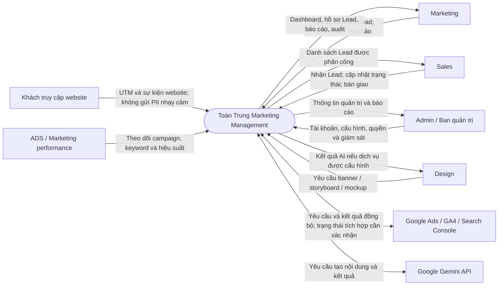
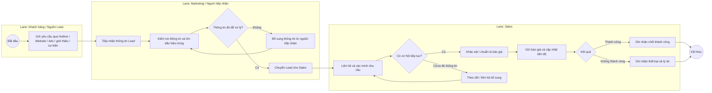
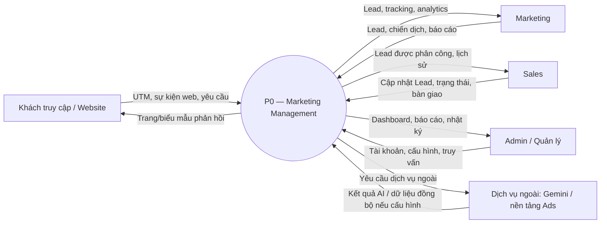
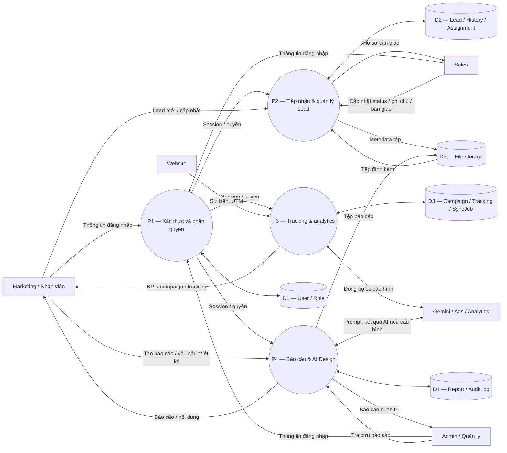
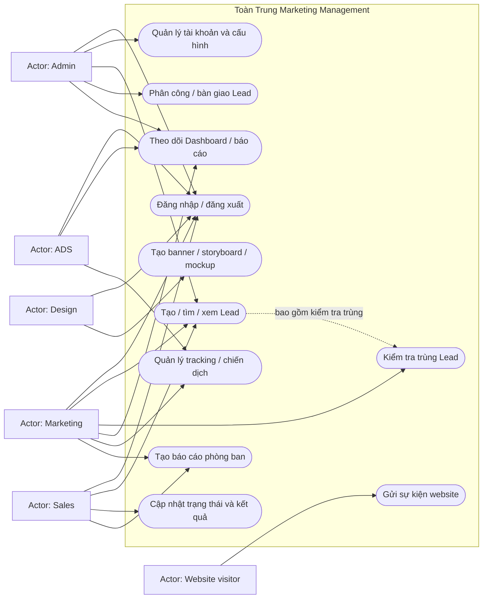
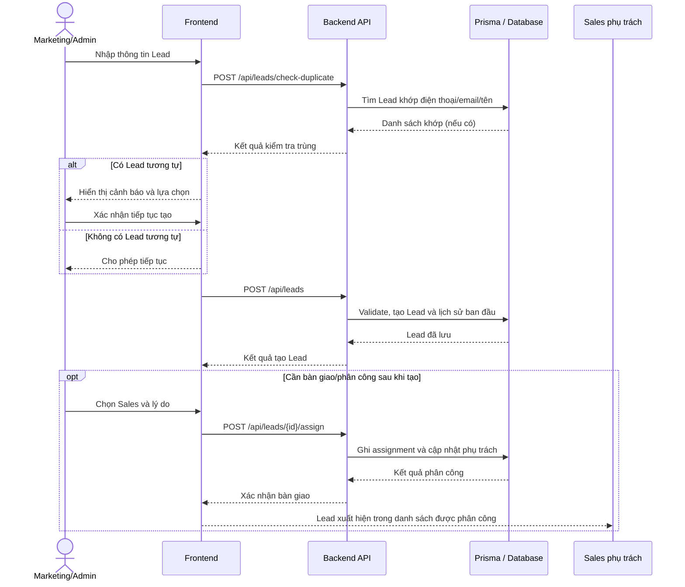
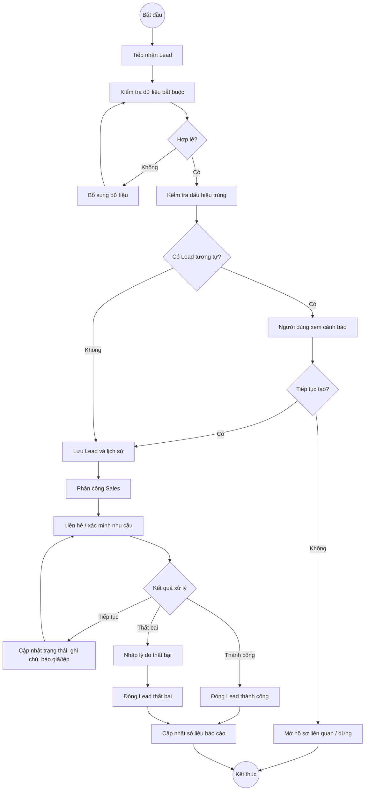

# Bộ sơ đồ

> **Lưu ý:** Đây là sơ đồ dự thảo để thảo luận, không phải bản As-Is đã được khảo sát. Đặc biệt, quy trình “hiện tại” dưới đây là giả thuyết dựa trên các trạng thái và chức năng được mô tả trong dự án; BA cần thay thế bằng quy trình vận hành thực tế. Các sơ đồ BPMN được biểu diễn bằng Mermaid flowchart theo lane để xem trực tiếp trong trình đọc Markdown hỗ trợ Mermaid; đây chưa phải file BPMN 2.0 XML.

## 1. Sơ đồ ngữ cảnh

## 2. BPMN dự thảo — quy trình hiện tại (As-Is giả định)

**Giả định để BA xác nhận:** Lead đến từ nhiều kênh; nhân viên ghi nhận thông tin, kiểm tra trùng và chuyển Sales xử lý; trạng thái nghiệp vụ được theo dõi theo tiến độ báo giá/kết quả. Chưa có căn cứ khẳng định quy trình ngoài hệ thống thực tế là thủ công hay công cụ nào đang được sử dụng.

## 3. BPMN dự thảo — quy trình đề xuất (To-Be)

```mermaid
flowchart LR
    subgraph Source["Lane: Website / Marketing"]
        A((Bắt đầu)) --> B["Lead phát sinh từ kênh hoặc được nhân viên tạo"]
        B --> C["Gửi thông tin và nguồn/UTM phù hợp"]
    end
    subgraph App["Lane: Hệ thống"]
        C --> D["Validate dữ liệu bắt buộc"]
        D --> E{"Dữ liệu hợp lệ?"}
        E -->|"Không"| F["Trả lỗi để người dùng bổ sung"]
        F --> C
        E -->|"Có"| G["Đối chiếu dấu hiệu trùng"]
        G --> H{"Có Lead tương tự?"}
        H -->|"Có"| I["Hiển thị cảnh báo và hồ sơ liên quan"]
        I --> J{"Người dùng xác nhận tiếp tục?"}
        J -->|"Không"| K["Mở hồ sơ liên quan / dừng tạo"]
        J -->|"Có"| L["Tạo Lead, ghi nguồn và lịch sử"]
        H -->|"Không"| L
        L --> M["Thông báo Lead đã được ghi nhận"]
    end
    subgraph Team["Lane: Marketing / Admin"]
        M --> N["Kiểm tra dữ liệu và phân Sales phụ trách"]
        N --> O["Bàn giao Lead; ghi lịch sử phân công"]
    end
    subgraph Sales["Lane: Sales"]
        O --> P["Liên hệ khách hàng và cập nhật tiến độ"]
        P --> Q{"Trạng thái xử lý"}
        Q -->|"Đang theo đuổi"| R["Cập nhật nhu cầu / báo giá / ghi chú / tệp"]
        R --> P
        Q -->|"Thành công"| S["Đóng Lead: chốt thành công"]
        Q -->|"Thất bại"| T["Bắt buộc nhập lý do thất bại"]
        T --> U["Đóng Lead: thất bại"]
    end
    subgraph Reports["Lane: Quản lý / Marketing"]
        S --> V["Tổng hợp dashboard và báo cáo"]
        U --> V
        V --> W((Kết thúc))
    end
```

## 4. DFD — Level 0 (Context)

## 5. DFD — Level 1

## 6. Use Case

> Use Case trên là tập hợp chức năng hiện diện trong source/tài liệu và giả thuyết vai trò. Cần chốt quyền truy cập theo ma trận role chính thức.

## 7. Sequence — tạo Lead, cảnh báo trùng và phân công

## 8. Activity — vòng đời Lead

