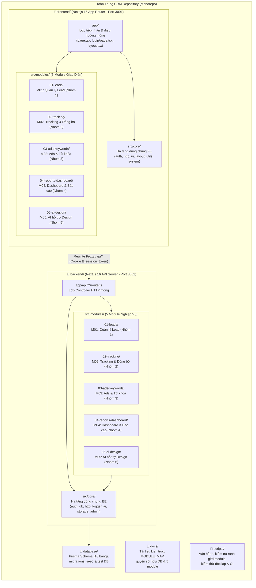
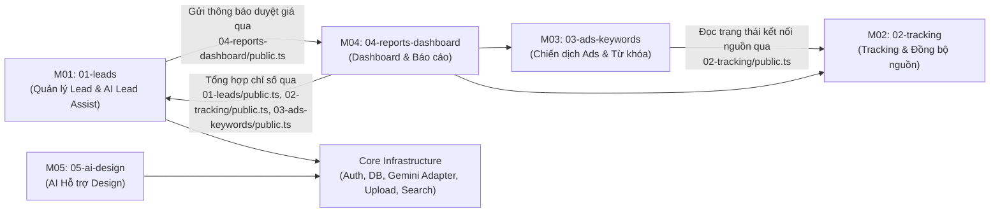

# Kiến Trúc Hệ Thống — Toàn Trung CRM (5-Visible-Modules + Core)

Tài liệu này mô tả kiến trúc thực tế của hệ thống **Toàn Trung CRM** sau khi tái cấu trúc theo mô hình **5 thư mục gốc** và **5 module nghiệp vụ đồng nhất (`M01` – `M05`) + `core`** ở cả Frontend và Backend.

---

## 1. Sơ Đồ Tổng Quan 5 Thư Mục Chính & Vị Trí 5 Module

---

## 2. Cấu Trúc 5 Thư Mục Chính Ở Root

| Thư mục | Vai trò | Chủ sở hữu chính |
| :--- | :--- | :--- |
| [`docs/`](file:///d:/HKDN/diua_login_fix_source/diua/docs) | Tài liệu kiến trúc hệ thống, bản đồ phân công 5 module (`MODULE_MAP.md`), quyền sở hữu bảng dữ liệu (`DATABASE_OWNERSHIP.md`) và hướng dẫn từng module (`docs/modules/<module>/README.md`). | Kiến trúc sư hệ thống & 5 Nhóm |
| [`frontend/`](file:///d:/HKDN/diua_login_fix_source/diua/frontend) | Giao diện người dùng Next.js 16 (`port 3001`), chia thành `app/` (entry point), `src/core/` và `src/modules/01-leads..05-ai-design`. | Nhóm 1 – Nhóm 5 (theo module) & Core Team |
| [`backend/`](file:///d:/HKDN/diua_login_fix_source/diua/backend) | Máy chủ API & nghiệp vụ Next.js 16 (`port 3002`), chia thành `app/api/` (route handlers mỏng), `src/core/` và `src/modules/01-leads..05-ai-design`. | Nhóm 1 – Nhóm 5 (theo module) & Core Team |
| [`database/`](file:///d:/HKDN/diua_login_fix_source/diua/database) | Quản lý tập trung Prisma Schema (`database/prisma/schema.prisma`), Prisma Client, script khởi tạo dữ liệu mẫu và kết nối SQLite/PostgreSQL. | Core / Database Owner (`@truongvanlong1905`) |
| [`scripts/`](file:///d:/HKDN/diua_login_fix_source/diua/scripts) | Các script vận hành (`predev.mjs`, `dev.mjs`, `cloud-build.mjs`, `cloud-start.mjs`), kiểm tra kiến trúc (`check-architecture.mjs`) và chạy kiểm thử (`run-tests.mjs`). | Core / DevOps Owner (`@truongvanlong1905`) |

---

## 3. Quy Ước Tổ Chức Bên Trong `frontend/` và `backend/`

### 3.1. Lớp `src/core/` (Hạ tầng dùng chung)

- **Backend (`backend/src/core/`)**:
  - `env.ts`: Đọc và kiểm tra cấu hình môi trường (`SESSION_SECRET`, `GEMINI_API_KEY`, `DATABASE_URL`).
  - `db/prisma.ts`: Kết nối Prisma Client Singleton dùng chung toàn bộ backend.
  - `logger.ts`: Chuẩn hóa log có cấu trúc (`requestId`, `moduleId`, `action`, `errorCode`, `timestamp`, `durationMs`, tự động che mật khẩu/token/API key).
  - `http.ts`: Chuẩn hóa phản hồi `{ success: true, data }` / `{ success: false, error, errorCode }` và xử lý lỗi tập trung (`AppError`, `handleRouteError`).
  - `auth/`: Xác thực phiên HttpOnly Cookie (`tt_session_token`), kiểm tra chữ ký HMAC-SHA256 trên Edge/Node, kiểm tra mật khẩu (`scrypt` + nâng cấp tự động từ legacy hash) và giới hạn tần suất đăng nhập (`login-rate-limit.ts`).
  - `ai/gemini.adapter.ts`: Adapter kỹ thuật dùng chung kết nối Google Gemini API cho cả M01 (`01-leads` - AI nhập nhanh & gợi ý kịch bản Sales) và M05 (`05-ai-design` - AI sinh thiết kế phối cảnh LED).
  - `storage/upload.service.ts`: Kiểm tra chữ ký byte (magic bytes) của tệp tải lên, lưu vào `public/uploads`, và ủy quyền việc gắn tệp vào hồ sơ Lead qua hàm công khai `attachUploadedFileToLead` của M01.
  - `admin/`: Các dịch vụ quản trị hệ thống dùng chung (`users.service.ts`, `departments.service.ts`, `promotions.service.ts`, `brand.service.ts`, `categories.service.ts`, `search.service.ts`, `health.service.ts`).

- **Frontend (`frontend/src/core/`)**:
  - `auth/`: Kiểm tra phiên phía Edge proxy (`auth-edge.ts`, `auth-types.ts`, `session-constants.ts`).
  - `http/`: `api-client.ts` và `shared-fetch.ts` (chống gọi trùng request đồng thời + TTL cache ngắn hạn).
  - `ui/`: Bộ component thiết kế cơ sở (`button`, `badge`, `card`, `modal`, `page-header`, `segmented-control`, `stat-card`, `toast`, `feedback-states`).
  - `layout/`: Khung ứng dụng (`Sidebar`, `Header`, `ThemeProvider`, `ToanTrungLogo`).
  - `system/`: Các màn hình quản trị hệ thống (`AdminUsersView`, `AdminBrandView`, `AdminSettingsView`, `NotificationsView`, `ProfileView`).
  - `utils/`: Hàm định dạng tiền tệ/giá trị Lead (`lead-value.ts`), xuất Excel (`excel-export.ts`), và tiện ích CSS (`utils.ts`).

### 3.2. Lớp `src/modules/<mã-tên-module>/` (5 Module Nghiệp Vụ)

Cả `frontend/src/modules/` và `backend/src/modules/` đều sử dụng đúng 5 thư mục có tên giống hệt nhau:

1. `01-leads/` — **M01: Quản lý Lead** (Nhóm 1)
2. `02-tracking/` — **M02: Tracking & đồng bộ đa kênh** (Nhóm 2)
3. `03-ads-keywords/` — **M03: Ads & phân tích từ khóa** (Nhóm 3)
4. `04-reports-dashboard/` — **M04: Dashboard & báo cáo** (Nhóm 4)
5. `05-ai-design/` — **M05: AI hỗ trợ Design** (Nhóm 5)

| Phía | Các thành phần bắt buộc trong mỗi module |
| :--- | :--- |
| **Frontend** (`frontend/src/modules/<module>/`) | `components/` (giao diện), `hooks/` (trạng thái & hành vi), `api.ts` (gọi API), `types.ts` (kiểu dữ liệu UI), `index.ts` (giao diện công khai của module), `tests/` (kiểm thử đơn vị), `README.md` (tài liệu module). |
| **Backend** (`backend/src/modules/<module>/`) | `service.ts` (quy tắc nghiệp vụ, có thể tách thêm `*.service.ts` theo chức năng con), `repository.ts` (truy cập Prisma DB), `policy.ts` (kiểm tra quyền RBAC), `contracts.ts` (schema & kiểu dữ liệu), `public.ts` (giao diện công khai cho module khác), `tests/` (kiểm thử), `README.md` (tài liệu module). |

---

## 4. Ranh Giới Nghiệp Vụ & Giao Tiếp Giữa Các Module

### Quy tắc ranh giới bắt buộc (được kiểm tra tự động bởi `scripts/check-architecture.mjs`):
1. **Không import nội bộ chéo module**:
   - Ở Backend, module A chỉ được import từ `@/src/modules/<module-B>/public`. Mọi import trực tiếp vào `repository.ts`, `service.ts`, `policy.ts`, `contracts.ts` của module khác đều bị chặn.
   - Ở Frontend, module A chỉ được import từ `@/src/modules/<module-B>` (tức `index.ts`). Mọi import sâu vào `components/`, `hooks/`, `api.ts` của module khác đều bị chặn.
2. **Không phụ thuộc vòng (No Circular Dependencies)**: Đồ thị phụ thuộc giữa các module là DAG một chiều.
3. **Frontend an toàn tuyệt đối**: Không chứa khóa bí mật máy chủ (`SESSION_SECRET`, `GEMINI_API_KEY`) và không bao giờ import `@prisma/client`, `@toantrung/database` hoặc code phía `backend/`.
4. **Thống nhất đầu mối kết nối nguồn dữ liệu quảng cáo**: M02 (`02-tracking`) sở hữu định nghĩa kết nối nguồn (`EXTERNAL_CONNECTOR_SPECS`, `getExternalConnectorStatus` trong `02-tracking/public.ts`) và cung cấp cho M03 (`03-ads-keywords`) sử dụng để tránh trùng lặp adapter.

---

## 5. Chuẩn Hóa Quan Sát & Truy Vết Lỗi (Structured Logging)

Mọi xử lý ở Backend đi qua `createLogger(moduleId)` (`backend/src/core/logger.ts`) với định dạng JSON chuẩn:
- `timestamp`: Thời điểm ISO-8601.
- `requestId`: Mã định danh truy vết request (`x-request-id` hoặc UUID sinh tự động).
- `moduleId`: Mã module phát sinh (`M01-LEADS`, `M02-TRACKING`, `M03-ADS-KEYWORDS`, `M04-REPORTS-DASHBOARD`, `M05-AI-DESIGN`, `CORE-AUTH`, `CORE-STORAGE`, `CORE-ADMIN`).
- `action`: Tên hành động nghiệp vụ (ví dụ `CREATE_LEAD`, `UPDATE_LEAD_STATUS`, `EXECUTE_SYNC_ACTION`, `GENERATE_AI_DESIGN`).
- `durationMs`: Thời gian xử lý tính bằng mili-giây.
- `errorCode`: Mã lỗi chuẩn hóa khi xảy ra sự cố (ví dụ `DUPLICATE_PHONE`, `LOST_REASON_REQUIRED`, `EXTERNAL_CONNECTOR_NOT_CONFIGURED`, `AI_PROVIDER_MISSING_KEY`).
- **Bảo mật log**: Tự động che (`[REDACTED]`) mọi trường nhạy cảm như `password`, `passwordHash`, `token`, `cookie`, `apiKey`, `secret`, `authorization`.

---

## 6. Bảo Toàn Dữ Liệu & Tách Biệt Môi Trường Kiểm Thử

- **Database nguồn (`database/data/source.sqlite`)**: Được bảo vệ tuyệt đối. Script `scripts/predev.mjs` chỉ chạy `prisma generate`, **không bao giờ** tự động chạy `db:push` hay `db:seed` đè lên `source.sqlite`.
- **Database kiểm thử độc lập (`database/data/test-refactor.sqlite`)**: Script `scripts/run-tests.mjs` khởi tạo và kiểm tra biến môi trường `DATABASE_URL` phải trỏ vào tệp `test-refactor.sqlite` riêng biệt trước khi thực thi kiểm thử tích hợp.
- **Chủ sở hữu Core & Database**: `@truongvanlong1905` (được cấu hình trong `.github/CODEOWNERS`).
