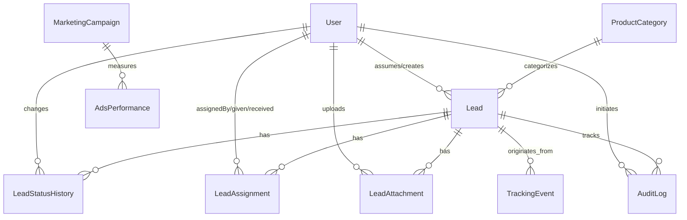

# SƠ ĐỒ CƠ SỞ DỮ LIỆU TOÀN TRUNG – MARKETING MANAGEMENT
*Runtime hiện tại: Prisma ORM + SQLite (`Database/data/source.sqlite`)*

---

## 1. Danh sách Bảng & Thực thể (15 Models)

### Chi tiết các thực thể:
1. **User**: Quản lý tài khoản, vai trò (`ADMIN`, `SALES`, `MARKETING`, `DESIGN`), mật khẩu hash bcrypt, trạng thái kích hoạt.
2. **ProductCategory**: Phân loại sản phẩm (LED trong nhà, LED ngoài trời, Bảng điện tử, Màn hình cong / đặc thù, Khác).
3. **Lead**: Khách hàng tiềm năng, dự án LED, thông tin liên hệ, nguồn tiếp cận, giá trị dự kiến, Sales phụ trách, địa chỉ thi công.
4. **LeadStatusHistory**: Lịch sử chuyển đổi trạng thái, bắt buộc lý do khi `Thất bại`.
5. **LeadAssignment**: Lịch sử chuyển giao phụ trách giữa các Sales kèm lý do.
6. **LeadAttachment**: Ảnh hiện trạng, bản vẽ CAD/PDF đính kèm.
7. **TrackingEvent**: Lịch sử truy cập từ website công ty, UTM parameters (source, medium, campaign), thiết bị, IP.
8. **MarketingCampaign**: Danh sách chiến dịch Google Ads, Facebook Ads, SEO, ngân sách và chi phí đã dùng.
9. **AdsPerformance**: Hiệu suất quảng cáo theo ngày (Impressions, Clicks, Cost, Conversions, CPC, CTR).
10. **KeywordMetric**: Danh sách từ khóa tiềm năng ngành LED, thứ hạng hiển thị, CPC trung bình và volume tìm kiếm.
11. **SyncJob**: Trạng thái đồng bộ tự động đa kênh (Google Ads, GA4, Google Search Console).
12. **BrandSetting**: Cấu hình thương hiệu (Tên hệ thống, Slogan, Logo, Favicon, Màu chủ đạo, Hotline).
13. **AuditLog**: Nhật ký kiểm toán toàn bộ hành vi trong hệ thống.
14. **DepartmentReport**: Báo cáo nội bộ theo phòng ban.
15. **DepartmentReportRead**: Trạng thái đã đọc báo cáo của từng người dùng.
