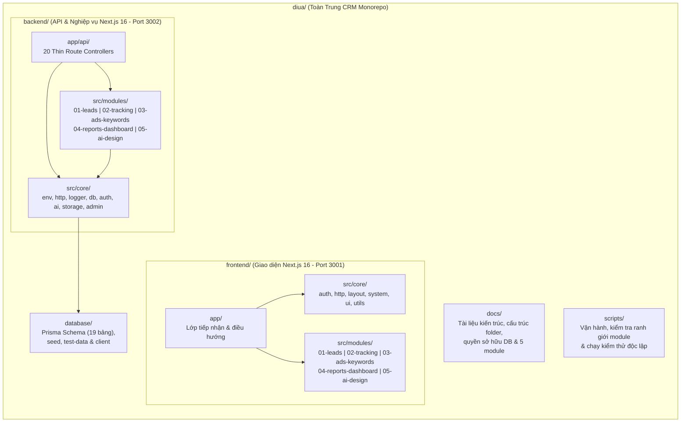

# Cấu Trúc Thư Mục Dự Án — Toàn Trung CRM (`FOLDER_STRUCTURE.md`)

Tài liệu mô tả đầy đủ cây thư mục và chức năng từng tệp của dự án **Toàn Trung CRM** sau khi tái cấu trúc theo chuẩn **5 Thư Mục Chính** và **5 Module Nghiệp Vụ Đồng Nhất (`M01` – `M05`) + `Core`**.

---

## 1. Sơ Đồ Kiến Trúc Thư Mục Tổng Quan



---

## 2. Bảng Tra Cứu Nhanh Theo 5 Nhóm Phụ Trách

| Mã | Tên Module | Nhóm phụ trách | Thư mục Frontend | Thư mục Backend | Tài liệu Module |
| :--- | :--- | :--- | :--- | :--- | :--- |
| **M01** | Quản lý Lead | **Nhóm 1** | [`frontend/src/modules/01-leads/`](file:///d:/HKDN/diua_login_fix_source/diua/frontend/src/modules/01-leads) | [`backend/src/modules/01-leads/`](file:///d:/HKDN/diua_login_fix_source/diua/backend/src/modules/01-leads) | [`docs/modules/01-leads/README.md`](file:///d:/HKDN/diua_login_fix_source/diua/docs/modules/01-leads/README.md) |
| **M02** | Tracking & đồng bộ đa kênh | **Nhóm 2** | [`frontend/src/modules/02-tracking/`](file:///d:/HKDN/diua_login_fix_source/diua/frontend/src/modules/02-tracking) | [`backend/src/modules/02-tracking/`](file:///d:/HKDN/diua_login_fix_source/diua/backend/src/modules/02-tracking) | [`docs/modules/02-tracking/README.md`](file:///d:/HKDN/diua_login_fix_source/diua/docs/modules/02-tracking/README.md) |
| **M03** | Ads & phân tích từ khóa | **Nhóm 3** | [`frontend/src/modules/03-ads-keywords/`](file:///d:/HKDN/diua_login_fix_source/diua/frontend/src/modules/03-ads-keywords) | [`backend/src/modules/03-ads-keywords/`](file:///d:/HKDN/diua_login_fix_source/diua/backend/src/modules/03-ads-keywords) | [`docs/modules/03-ads-keywords/README.md`](file:///d:/HKDN/diua_login_fix_source/diua/docs/modules/03-ads-keywords/README.md) |
| **M04** | Dashboard & báo cáo | **Nhóm 4** | [`frontend/src/modules/04-reports-dashboard/`](file:///d:/HKDN/diua_login_fix_source/diua/frontend/src/modules/04-reports-dashboard) | [`backend/src/modules/04-reports-dashboard/`](file:///d:/HKDN/diua_login_fix_source/diua/backend/src/modules/04-reports-dashboard) | [`docs/modules/04-reports-dashboard/README.md`](file:///d:/HKDN/diua_login_fix_source/diua/docs/modules/04-reports-dashboard/README.md) |
| **M05** | AI hỗ trợ Design | **Nhóm 5** | [`frontend/src/modules/05-ai-design/`](file:///d:/HKDN/diua_login_fix_source/diua/frontend/src/modules/05-ai-design) | [`backend/src/modules/05-ai-design/`](file:///d:/HKDN/diua_login_fix_source/diua/backend/src/modules/05-ai-design) | [`docs/modules/05-ai-design/README.md`](file:///d:/HKDN/diua_login_fix_source/diua/docs/modules/05-ai-design/README.md) |
| **CORE** | Hạ tầng & Database | **Core Team** | [`frontend/src/core/`](file:///d:/HKDN/diua_login_fix_source/diua/frontend/src/core) | [`backend/src/core/`](file:///d:/HKDN/diua_login_fix_source/diua/backend/src/core) | [`docs/ARCHITECTURE.md`](file:///d:/HKDN/diua_login_fix_source/diua/docs/ARCHITECTURE.md) |

---

## 3. Cây Thư Mục Chi Tiết Toàn Dự Án

```text
diua/
├── .github/                                        # Cấu hình GitHub & CI/CD
│   ├── CODEOWNERS                                  # Phân quyền chủ sở hữu mã nguồn cho Core/DB & 5 Module
│   └── workflows/
│       └── ci.yml                                  # Pipeline tự động: check-architecture -> typecheck -> test -> build
│
├── docs/                                           # [THƯ MỤC CHÍNH 1] Tài liệu hệ thống & từng module
│   ├── ARCHITECTURE.md                             # Kiến trúc thực tế sau tái cấu trúc & chuẩn logging
│   ├── FOLDER_STRUCTURE.md                         # Tài liệu cây thư mục chi tiết (file hiện tại)
│   ├── MODULE_MAP.md                               # Bản đồ tổng quan 5 module, API, bảng DB & phụ thuộc
│   ├── API_CONTRACT.md                             # Quy ước hợp đồng phản hồi HTTP { success, data, error }
│   ├── DATABASE_SCHEMA.md                          # Mô tả chi tiết lược đồ cơ sở dữ liệu
│   ├── DEPLOYMENT.md                               # Hướng dẫn triển khai Render / Cloud
│   ├── SYSTEM_ARCHITECTURE.md                      # Tổng quan luồng hệ thống
│   ├── UI_PERFORMANCE_RULES.md                     # Quy chuẩn tối ưu hiệu năng giao diện
│   ├── PHASE1_AUDIT.md                             # Báo cáo rà soát giai đoạn 1
│   ├── TEST_REPORT.md                              # Báo cáo kiểm thử hệ thống
│   └── modules/
│       ├── DATABASE_OWNERSHIP.md                   # Bảng phân quyền sở hữu ghi/đọc của toàn bộ 19 model Prisma
│       ├── 01-leads/README.md                      # Tài liệu nghiệp vụ, RBAC, API & mã lỗi của M01
│       ├── 02-tracking/README.md                   # Tài liệu nghiệp vụ, RBAC, API & mã lỗi của M02
│       ├── 03-ads-keywords/README.md               # Tài liệu nghiệp vụ, RBAC, API & mã lỗi của M03
│       ├── 04-reports-dashboard/README.md          # Tài liệu nghiệp vụ, RBAC, API & mã lỗi của M04
│       └── 05-ai-design/README.md                  # Tài liệu nghiệp vụ, RBAC, API & mã lỗi của M05
│
├── frontend/                                       # [THƯ MỤC CHÍNH 2] Giao diện người dùng (Next.js 16 - Port 3001)
│   ├── app/                                        # Lớp tiếp nhận & điều hướng mỏng của Next.js App Router
│   │   ├── globals.css                             # CSS toàn cục & biến màu giao diện Sáng/Tối
│   │   ├── layout.tsx                              # Root Layout bọc ThemeProvider & font chữ
│   │   ├── page.tsx                                # Shell điều hướng giữa 5 module & các trang hệ thống
│   │   └── login/
│   │       └── page.tsx                            # Trang đăng nhập nội bộ
│   ├── src/
│   │   ├── core/                                   # Hạ tầng giao diện dùng chung (Core FE)
│   │   │   ├── auth/
│   │   │   │   ├── auth-edge.ts                    # Xác thực token phiên trên Edge Runtime
│   │   │   │   ├── auth-types.ts                   # Kiểu dữ liệu người dùng & vai trò phiên đăng nhập
│   │   │   │   └── session-constants.ts            # Hằng số tên cookie (tt_session_token) & thời hạn phiên
│   │   │   ├── http/
│   │   │   │   ├── api-client.ts                   # Hàm gọi API chuẩn hóa { success, data, error } & AbortSignal
│   │   │   │   └── shared-fetch.ts                 # Chống gọi trùng request đồng thời & cache ngắn hạn
│   │   │   ├── layout/
│   │   │   │   ├── Header.tsx                      # Thanh tiêu đề, tìm kiếm nhanh Ctrl+K, thông báo & tài khoản
│   │   │   │   ├── Sidebar.tsx                     # Thanh điều hướng 5 module Workspace & nhóm System
│   │   │   │   ├── ThemeProvider.tsx               # Quản lý chế độ Sáng / Tối
│   │   │   │   └── ToanTrungLogo.tsx               # Logo thương hiệu Toàn Trung
│   │   │   ├── system/
│   │   │   │   ├── AdminBrandView.tsx              # Quản trị nhận diện thương hiệu
│   │   │   │   ├── AdminSettingsView.tsx           # Cài đặt cấu hình hệ thống
│   │   │   │   ├── AdminUsersView.tsx              # Quản trị nhân sự, phòng ban & quyết định bổ nhiệm
│   │   │   │   ├── NotificationsView.tsx           # Trung tâm thông báo hệ thống
│   │   │   │   └── ProfileView.tsx                 # Hồ sơ cá nhân & đổi mật khẩu
│   │   │   ├── ui/                                 # Hệ thống Design System Components dùng chung
│   │   │   │   ├── badge.tsx
│   │   │   │   ├── button.tsx
│   │   │   │   ├── card.tsx
│   │   │   │   ├── feedback-states.tsx             # Skeleton loading, Empty state, Error banner
│   │   │   │   ├── modal.tsx
│   │   │   │   ├── page-header.tsx
│   │   │   │   ├── segmented-control.tsx
│   │   │   │   ├── stat-card.tsx
│   │   │   │   └── toast.tsx
│   │   │   └── utils/
│   │   │       ├── excel-export.ts                 # Xuất báo cáo & danh sách ra tệp Excel/CSV
│   │   │       ├── lead-value.ts                   # Phân tích & định dạng tiền tệ VNĐ
│   │   │       └── utils.ts                        # Hàm gộp class Tailwind (cn) & tiện ích chung
│   │   │
│   │   └── modules/                                # 5 MODULE NGHIỆP VỤ PHÍA FRONTEND
│   │       ├── 01-leads/                           # [M01 - Nhóm 1] Quản lý Lead
│   │       │   ├── components/
│   │       │   │   ├── LeadsWorkspaceView.tsx      # Khung làm việc chính của module Quản lý Lead
│   │       │   │   ├── AiQuickLeadBar.tsx          # Thanh AI bóc tách nhanh thông tin Lead từ văn bản thô
│   │       │   │   ├── StatsCards.tsx              # 4 thẻ thống kê KPI Lead đầu trang
│   │       │   │   ├── LeadFilters.tsx             # Bộ lọc trạng thái, nguồn, Sales, sản phẩm, thời gian
│   │       │   │   ├── LeadTable.tsx               # Bảng dữ liệu Lead & chế độ xem Kanban
│   │       │   │   ├── NewLeadModal.tsx            # Hộp thoại tạo mới hồ sơ Lead & kiểm tra trùng SĐT
│   │       │   │   ├── ImportLeadsModal.tsx        # Hộp thoại nhập Excel/CSV & chia Sales tự động
│   │       │   │   ├── LeadDetailModal.tsx         # Hồ sơ chi tiết Lead, báo giá, chăm sóc & đính kèm
│   │       │   │   ├── LeadDetailAuditTab.tsx      # Tab nhật ký kiểm toán & lịch sử bàn giao Lead
│   │       │   │   ├── lead-detail-constants.ts    # Cấu hình thông số kỹ thuật module LED & mẫu báo giá
│   │       │   │   └── printable-quote.ts          # Trình kết xuất bản in báo giá PDF/HTML chuẩn B2B
│   │       │   ├── hooks/
│   │       │   │   └── useLeadsWorkspace.ts        # Quản lý state, phân trang, debounce 300ms & AbortController
│   │       │   ├── api.ts                          # Các hàm gọi API /api/leads/*
│   │       │   ├── types.ts                        # Kiểu dữ liệu Lead, Quote, Activity & hằng số Pipeline
│   │       │   ├── index.ts                        # Cổng xuất công khai duy nhất của M01 ở Frontend
│   │       │   ├── README.md                       # Tài liệu nội bộ M01 Frontend
│   │       │   └── tests/
│   │       │       └── leads.test.mjs              # Kiểm thử hợp đồng & cấu trúc M01 Frontend
│   │       │
│   │       ├── 02-tracking/                        # [M02 - Nhóm 2] Tracking & đồng bộ đa kênh
│   │       │   ├── components/
│   │       │   │   └── TrackingView.tsx            # Giao diện phiên truy cập UTM & quản lý nguồn đồng bộ
│   │       │   ├── hooks/
│   │       │   │   └── useTrackingModule.ts        # Hook tải dữ liệu tracking & kích hoạt đồng bộ
│   │       │   ├── api.ts                          # Gọi API /api/tracking & /api/tracking/sync
│   │       │   ├── types.ts                        # Kiểu dữ liệu Tracking & SyncJob
│   │       │   ├── index.ts                        # Cổng xuất công khai M02 Frontend
│   │       │   ├── README.md
│   │       │   └── tests/
│   │       │       └── tracking.test.mjs
│   │       │
│   │       ├── 03-ads-keywords/                    # [M03 - Nhóm 3] Ads & phân tích từ khóa
│   │       │   ├── components/
│   │       │   │   └── AdsView.tsx                 # Giao diện quản lý chiến dịch quảng cáo & bộ từ khóa
│   │       │   ├── hooks/
│   │       │   │   └── useAdsModule.ts             # Hook lọc chiến dịch, cập nhật ngân sách & ROAS
│   │       │   ├── api.ts                          # Gọi API /api/campaigns
│   │       │   ├── types.ts                        # Kiểu dữ liệu Campaign & KeywordMetric
│   │       │   ├── index.ts                        # Cổng xuất công khai M03 Frontend
│   │       │   ├── README.md
│   │       │   └── tests/
│   │       │       └── ads-keywords.test.mjs
│   │       │
│   │       ├── 04-reports-dashboard/               # [M04 - Nhóm 4] Dashboard & báo cáo
│   │       │   ├── components/
│   │       │   │   ├── OverviewView.tsx            # Màn hình Executive Dashboard tổng quan điều hành
│   │       │   │   ├── ReportsView.tsx             # Màn hình danh sách báo cáo, tờ trình & soạn báo cáo
│   │       │   │   └── FormattedReportBody.tsx     # Bộ hiển thị nội dung báo cáo định dạng Markdown/Callout
│   │       │   ├── hooks/
│   │       │   │   └── useReportsModule.ts         # Hook quản lý danh sách báo cáo & đánh dấu đã đọc
│   │       │   ├── api.ts                          # Gọi API /api/reports & /api/reports/[id]/read
│   │       │   ├── types.ts                        # Kiểu dữ liệu Report & thống kê Dashboard
│   │       │   ├── index.ts                        # Cổng xuất công khai M04 Frontend
│   │       │   ├── README.md
│   │       │   └── tests/
│   │       │       └── reports-dashboard.test.mjs
│   │       │
│   │       └── 05-ai-design/                       # [M05 - Nhóm 5] AI hỗ trợ Design
│   │           ├── components/
│   │           │   ├── AiDesignView.tsx            # Giao diện phòng thiết kế phối cảnh LED bằng AI
│   │           │   ├── AiDesignRecentJobsTable.tsx # Bảng lịch sử các bản thiết kế AI gần đây
│   │           │   └── ai-design-presets.ts        # Cấu hình phong cách không gian, tỷ lệ khung hình & gợi ý
│   │           ├── hooks/
│   │           │   └── useAiDesignModule.ts        # Hook gửi lệnh sinh phối cảnh & quản lý lịch sử
│   │           ├── api.ts                          # Gọi API /api/ai/design
│   │           ├── types.ts                        # Kiểu dữ liệu yêu cầu & kết quả AI Design
│   │           ├── index.ts                        # Cổng xuất công khai M05 Frontend
│   │           ├── README.md
│   │           └── tests/
│   │               └── ai-design.test.mjs
│   │
│   ├── proxy.ts                                    # Middleware bảo vệ định tuyến phía giao diện
│   ├── next.config.mjs                             # Cấu hình rewrite proxy /api/* và /uploads/* sang Backend
│   ├── tailwind.config.ts                          # Hệ thống Design Tokens & quét class trong app/ + src/
│   ├── postcss.config.js
│   ├── eslint.config.mjs
│   ├── tsconfig.json
│   └── package.json
│
├── backend/                                        # [THƯ MỤC CHÍNH 3] Máy chủ API & Nghiệp vụ (Next.js 16 - Port 3002)
│   ├── app/api/                                    # Lớp Route Handlers mỏng (chỉ nhận HTTP & gọi vào Module/Core)
│   │   ├── auth/
│   │   │   ├── login/route.ts                      # POST /api/auth/login
│   │   │   ├── logout/route.ts                     # POST /api/auth/logout
│   │   │   ├── me/route.ts                         # GET /api/auth/me
│   │   │   └── register/route.ts                   # POST /api/auth/register (khóa đăng ký tự do 403)
│   │   ├── leads/                                  # -> Ủy quyền xử lý cho backend/src/modules/01-leads/
│   │   │   ├── route.ts                            # GET, POST /api/leads
│   │   │   ├── check-duplicate/route.ts            # GET /api/leads/check-duplicate
│   │   │   ├── import/route.ts                     # POST /api/leads/import
│   │   │   ├── analytics/route.ts                  # GET /api/leads/analytics
│   │   │   ├── ai-assist/route.ts                  # POST /api/leads/ai-assist
│   │   │   └── [id]/
│   │   │       ├── route.ts                        # GET, PATCH, DELETE /api/leads/[id]
│   │   │       ├── status/route.ts                 # PATCH /api/leads/[id]/status
│   │   │       ├── assign/route.ts                 # POST /api/leads/[id]/assign
│   │   │       ├── activities/route.ts             # GET, POST /api/leads/[id]/activities
│   │   │       └── quotes/route.ts                 # GET, POST, PATCH /api/leads/[id]/quotes
│   │   ├── tracking/                               # -> Ủy quyền xử lý cho backend/src/modules/02-tracking/
│   │   │   ├── route.ts                            # GET, POST /api/tracking
│   │   │   └── sync/route.ts                       # GET, POST /api/tracking/sync
│   │   ├── campaigns/                              # -> Ủy quyền xử lý cho backend/src/modules/03-ads-keywords/
│   │   │   └── route.ts                            # GET, POST, PATCH /api/campaigns
│   │   ├── reports/                                # -> Ủy quyền xử lý cho backend/src/modules/04-reports-dashboard/
│   │   │   ├── route.ts                            # GET, POST /api/reports
│   │   │   └── [id]/read/route.ts                  # PATCH /api/reports/[id]/read
│   │   ├── ai/design/                              # -> Ủy quyền xử lý cho backend/src/modules/05-ai-design/
│   │   │   └── route.ts                            # GET, POST /api/ai/design
│   │   ├── admin/brand/route.ts                    # -> Core Admin: cấu hình thương hiệu
│   │   ├── users/                                  # -> Core Admin: quản trị tài khoản nhân sự
│   │   │   ├── route.ts
│   │   │   ├── [id]/route.ts
│   │   │   └── profile/route.ts
│   │   ├── departments/route.ts                    # -> Core Admin: quản lý phòng ban
│   │   ├── promotions/route.ts                     # -> Core Admin: quyết định bổ nhiệm nhân sự
│   │   ├── categories/route.ts                     # -> Core Admin: danh mục dòng sản phẩm LED
│   │   ├── search/route.ts                         # -> Core Admin: tìm kiếm toàn cục qua public.ts của M01 & M03
│   │   ├── upload/route.ts                         # -> Core Storage: tải tệp lên & gắn vào Lead qua M01/public
│   │   └── health/route.ts                         # -> Core Admin: kiểm tra trạng thái sống của API & DB
│   │
│   ├── src/
│   │   ├── core/                                   # Hạ tầng kỹ thuật dùng chung phía máy chủ (Core BE)
│   │   │   ├── env.ts                              # Đọc biến môi trường an toàn
│   │   │   ├── http.ts                             # Chuẩn phản hồi HTTP & xử lý lỗi AppError tập trung
│   │   │   ├── logger.ts                           # Logger JSON chuẩn (requestId, moduleId, action, errorCode, redaction)
│   │   │   ├── db/
│   │   │   │   └── prisma.ts                       # Kết nối Prisma Client dùng chung
│   │   │   ├── auth/
│   │   │   │   ├── auth.ts                         # Xác thực phiên & kiểm tra quyền người dùng từ DB
│   │   │   │   ├── auth-edge.ts                    # Xác thực chữ ký HMAC-SHA256 trên Edge
│   │   │   │   ├── auth-types.ts                   # Kiểu dữ liệu phiên xác thực
│   │   │   │   ├── auth.service.ts                 # Nghiệp vụ đăng nhập, đăng xuất & thông tin phiên /me
│   │   │   │   ├── authenticate-user.ts            # Kiểm tra mật khẩu scrypt & nâng cấp hash cũ
│   │   │   │   ├── login-rate-limit.ts             # Chống dò mật khẩu brute-force theo IP/tài khoản
│   │   │   │   └── session-constants.ts            # Hằng số cookie phiên
│   │   │   ├── ai/
│   │   │   │   └── gemini.adapter.ts               # Adapter kết nối Google Gemini REST API dùng chung cho M01 & M05
│   │   │   ├── storage/
│   │   │   │   └── upload.service.ts               # Kiểm tra chữ ký tệp (magic bytes) & lưu vào public/uploads
│   │   │   └── admin/                              # Dịch vụ quản trị hệ thống nền tảng
│   │   │       ├── brand.service.ts
│   │   │       ├── categories.service.ts
│   │   │       ├── departments.service.ts
│   │   │       ├── health.service.ts
│   │   │       ├── promotions.service.ts
│   │   │       ├── search.service.ts
│   │   │       └── users.service.ts
│   │   │
│   │   └── modules/                                # 5 MODULE NGHIỆP VỤ PHÍA BACKEND
│   │       ├── 01-leads/                           # [M01 - Nhóm 1] Quản lý Lead
│   │       │   ├── service.ts                      # Nghiệp vụ CRUD Lead, lọc, phân trang, chống trùng & thống kê
│   │       │   ├── lead-scoring.service.ts         # Tính điểm tiềm năng HOT/WARM/COLD & xử lý mã/giá trị VNĐ
│   │       │   ├── lead-status.service.ts          # Chuyển trạng thái Pipeline & bắt buộc lý do thất bại
│   │       │   ├── lead-assignment.service.ts      # Phân công Sales thủ công & chia tự động Round-Robin khi import
│   │       │   ├── lead-quote.service.ts           # Lập báo giá LED & gửi tờ trình duyệt giá sang M04/public
│   │       │   ├── lead-ai.service.ts              # AI bóc tách Lead từ tin nhắn & gợi ý kịch bản tư vấn Sales
│   │       │   ├── repository.ts                   # Truy vấn Prisma cho 6 bảng thuộc sở hữu M01
│   │       │   ├── policy.ts                       # Kiểm tra phân quyền RBAC riêng cho M01
│   │       │   ├── contracts.ts                    # Schema & kiểu dữ liệu đầu vào/đầu ra của M01
│   │       │   ├── public.ts                       # Giao diện công khai duy nhất cho module khác & Core gọi vào M01
│   │       │   ├── README.md
│   │       │   └── tests/
│   │       │       └── module.test.mjs
│   │       │
│   │       ├── 02-tracking/                        # [M02 - Nhóm 2] Tracking & đồng bộ đa kênh
│   │       │   ├── service.ts                      # Ghi nhận sự kiện UTM & xử lý đồng bộ nguồn dữ liệu
│   │       │   ├── repository.ts                   # Truy vấn Prisma cho TrackingEvent & SyncJob
│   │       │   ├── policy.ts                       # Kiểm tra quyền Marketing/Admin & khóa x-tracking-key
│   │       │   ├── contracts.ts                    # Định nghĩa nguồn kết nối EXTERNAL_CONNECTOR_SPECS
│   │       │   ├── public.ts                       # Xuất trạng thái kết nối nguồn cho M03 & snapshot cho M04
│   │       │   ├── README.md
│   │       │   └── tests/
│   │       │       └── module.test.mjs
│   │       │
│   │       ├── 03-ads-keywords/                    # [M03 - Nhóm 3] Ads & phân tích từ khóa
│   │       │   ├── service.ts                      # Quản lý chiến dịch quảng cáo, ngân sách & từ khóa
│   │       │   ├── repository.ts                   # Truy vấn Prisma cho MarketingCampaign, AdsPerformance, KeywordMetric
│   │       │   ├── policy.ts                       # Kiểm tra quyền thao tác chiến dịch quảng cáo
│   │       │   ├── contracts.ts                    # Hợp đồng dữ liệu chiến dịch & từ khóa
│   │       │   ├── public.ts                       # Xuất hàm tìm kiếm chiến dịch & tổng hợp chi tiêu Ads
│   │       │   ├── README.md
│   │       │   └── tests/
│   │       │       └── module.test.mjs
│   │       │
│   │       ├── 04-reports-dashboard/               # [M04 - Nhóm 4] Dashboard & báo cáo
│   │       │   ├── service.ts                      # Quản lý báo cáo phòng ban, tờ trình & trạng thái đã đọc
│   │       │   ├── repository.ts                   # Truy vấn Prisma cho DepartmentReport & DepartmentReportRead
│   │       │   ├── policy.ts                       # Phân quyền xem báo cáo theo vai trò & tác giả
│   │       │   ├── contracts.ts                    # Hợp đồng dữ liệu báo cáo
│   │       │   ├── public.ts                       # Xuất createSystemReportNotification cho M01 & Core gọi
│   │       │   ├── README.md
│   │       │   └── tests/
│   │       │       └── module.test.mjs
│   │       │
│   │       └── 05-ai-design/                       # [M05 - Nhóm 5] AI hỗ trợ Design
│   │           ├── service.ts                      # Quy trình sinh ảnh phối cảnh LED & thuyết minh kỹ thuật AI
│   │           ├── repository.ts                   # Lưu trữ & truy vấn lịch sử lệnh thiết kế AI
│   │           ├── policy.ts                       # Kiểm tra quyền sử dụng công cụ AI Design
│   │           ├── contracts.ts                    # Hợp đồng dữ liệu prompt, tỷ lệ khung hình & kết quả AI
│   │           ├── public.ts                       # Xuất thống kê số lượng bản thiết kế AI
│   │           ├── README.md
│   │           └── tests/
│   │               └── module.test.mjs
│   │
│   ├── public/uploads/                             # Thư mục lưu tệp tải lên (ảnh khảo sát, bản vẽ, tài liệu)
│   ├── proxy.ts                                    # Middleware kiểm tra phiên API & CORS
│   ├── next.config.mjs
│   ├── tsconfig.json
│   └── package.json
│
├── database/                                       # [THƯ MỤC CHÍNH 4] Cơ sở dữ liệu & Prisma Workspace
│   ├── prisma/
│   │   ├── schema.prisma                           # Schema tập trung gồm 19 model cho toàn hệ thống
│   │   ├── seed.mjs                                # Script khởi tạo tài khoản & dữ liệu demo ban đầu
│   │   └── test-data.mjs                           # Tệp dữ liệu kiểm thử tách riêng
│   ├── data/
│   │   └── source.sqlite                           # Database dữ liệu nguồn (được bảo vệ, không tự ghi đè)
│   ├── scripts/
│   │   ├── safe-generate.mjs                       # Sinh Prisma Client an toàn trên Windows khi DLL đang mở
│   │   └── export-test-data.mjs                    # Xuất dữ liệu kiểm thử ra tệp riêng
│   ├── src/
│   │   └── index.ts                                # Điểm xuất gói @toantrung/database
│   └── package.json
│
├── scripts/                                        # [THƯ MỤC CHÍNH 5] Các lệnh hỗ trợ vận hành & kiểm tra
│   ├── predev.mjs                                  # Giải phóng cổng dev cũ & chạy db:generate (bảo toàn source.sqlite)
│   ├── dev.mjs                                     # Chạy đồng thời Frontend (3001) & Backend (3002)
│   ├── cloud-env.mjs                               # Thiết lập biến môi trường cho Cloud / Render
│   ├── cloud-build.mjs                             # Quy trình build full-stack an toàn dữ liệu
│   ├── cloud-start.mjs                             # Quy trình khởi động production an toàn dữ liệu
│   ├── check-architecture.mjs                      # Kiểm tra tự động cấu trúc 5 module, ranh giới import & vòng lặp
│   └── run-tests.mjs                               # Bộ kiểm thử đơn vị & tích hợp trên database test-refactor.sqlite riêng
│
├── render.yaml                                     # Cấu hình hạ tầng triển khai Render
├── package.json                                    # Cấu hình npm workspaces (frontend, backend, database)
└── README.md                                       # Hướng dẫn khởi động nhanh dự án
```

---

## 4. Quy Tắc Ranh Giới Bắt Buộc Khi Làm Việc Với Cấu Trúc Này

1. **Một nơi chứa logic duy nhất**:
   - Không tạo lại các thư mục cũ (`frontend/components`, `frontend/lib`, `frontend/types`, `frontend/data`, `backend/lib`, `backend/backend`).
2. **Giao tiếp liên module qua cổng công khai**:
   - Ở **Frontend**: Chỉ import từ `@/src/modules/<mã-module>` (tức tệp `index.ts`), không import sâu vào `components/` hay `hooks/` của module khác.
   - Ở **Backend**: Chỉ import từ `@/src/modules/<mã-module>/public`, không import trực tiếp `repository.ts`, `service.ts` hay `contracts.ts` của module khác.
3. **Kiểm tra tự động trước khi commit**:
   - Chạy `npm run check:arch` để xác nhận không vi phạm ranh giới module.
   - Chạy `npm run typecheck` và `npm test` để xác nhận an toàn kiểu dữ liệu và nghiệp vụ.

