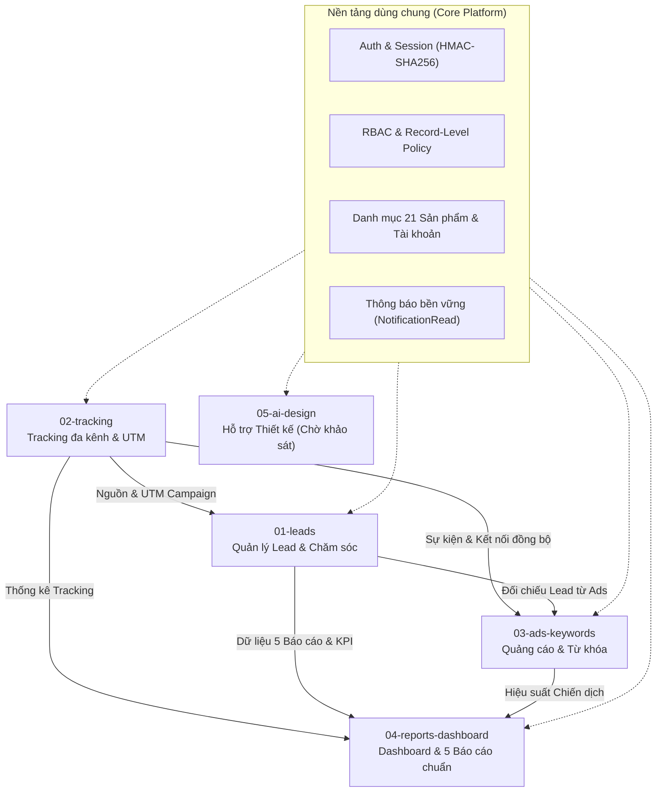

# Kiến Trúc Hệ Thống 5 Module (System Architecture)

## 1. Cấu trúc Monorepo 3 tầng & 5 Module nghiệp vụ

Hệ thống **Mini CRM Toàn Trung** tuân thủ kiến trúc tách lớp nghiêm ngặt giữa `frontend` (Next.js App Router UI, cổng `3000`), `backend` (Next.js Route Handlers API, cổng `4000`) và `database` (Prisma + SQLite):

## 2. Ranh giới 5 Module (`01` .. `05`)

| Mã Module | Tên phân hệ | Trách nhiệm chính | Giao diện Public (`public.ts` / `index.ts`) |
|---|---|---|---|
| `01-leads` | Quản lý Lead | Tiếp nhận Lead (thủ công, import, form/webhook), chuẩn hóa SĐT (`normalizedPhone`), kiểm tra trùng toàn DB, phân công/chuyển Sales, nhật ký chăm sóc và theo dõi phản hồi báo giá. | `getLeadsDashboardSnapshot`, `searchLeadsPublic`, `attachUploadedFileToLead` |
| `02-tracking` | Tracking & Tích hợp | Ghi nhận sự kiện UTM/nguồn truy cập có chống trùng (`eventKey`), quản lý trạng thái đồng bộ với Google Ads / GA4 / Search Console. | `getTrackingDashboardSnapshot`, `recordLeadCaptureTracking` |
| `03-ads-keywords` | Quảng cáo & Từ khóa | Quản lý chiến dịch quảng cáo đa kênh, từ khóa tìm kiếm và đối soát chuyển đổi nền tảng Ads (`platformConversions`) với Lead thực tế trong CRM (`crmLeadsFromAds`). | `getAdsDashboardSnapshot` |
| `04-reports-dashboard` | Dashboard & Báo cáo | Hiển thị Dashboard tổng quan, 5 báo cáo nghiệp vụ CRM chuẩn Brief, quản lý văn bản báo cáo nội bộ theo phòng ban và xuất Excel `.xlsx`. | `getReportsDashboardSnapshot`, `searchReportsPublic` |
| `05-ai-design` | Hỗ trợ Thiết kế | Không gian phác thảo Banner LED, kịch bản phân cảnh và phối cảnh công trình (đang duy trì ở mức khung cơ bản chờ khảo sát cùng đội Thiết kế). | `getDesignOrdersCountSnapshot` |

## 3. Quy tắc kiểm soát phụ thuộc tự động (`npm run check:arch`)
- Không module nào được import trực tiếp file nội bộ (`repository.ts`, `service.ts`, `policy.ts`, `components/*`) của module khác; mọi giao tiếp liên module ở Backend đi qua `@/src/modules/<id>/public` và ở Frontend đi qua `@/src/modules/<id>`.
- `frontend/` tuyệt đối không truy cập trực tiếp `process.env.SESSION_SECRET` hay `process.env.GEMINI_API_KEY`.
